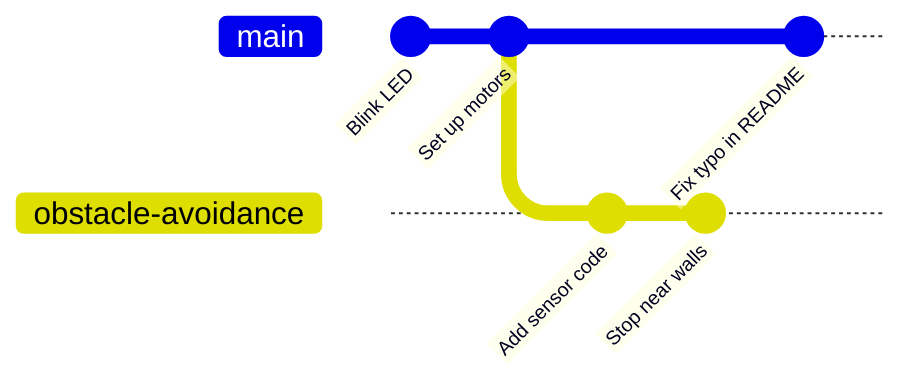

## Why branches?

Your robot drives around nicely. Now you want to add obstacle avoidance with an ultrasonic sensor. That'll take a few evenings, and while you're halfway through, the code won't work. What if you need to fix a bug in the working version in the meantime?

That's what **branches** are for. A branch is a separate line of commits. You make a new branch, do your experimenting there, and `main` stays exactly as it was. When the feature works, you merge it back in (that's the next module). If it doesn't work out, you just delete the branch.



`main` and `obstacle-avoidance` both start from "Set up motors", then go their own ways.

Branches in Git are tiny and fast. A branch is really just a label pointing at a commit, so making one is instant, no matter how big your project is. Use them freely.

---

## Listing branches

```bash
git branch
```

```text
* main
```

You only have one branch so far. The `*` shows which branch you're on.

---

## Creating and switching to a branch

To create a new branch and switch to it in one go:

```bash
git switch -c obstacle-avoidance
```

```text
Switched to a new branch 'obstacle-avoidance'
```

`-c` stands for *create*. Run `git branch` again:

```text
  main
* obstacle-avoidance
```

Branch names can't have spaces, so use hyphens. Good names say what the branch is for: `obstacle-avoidance`, `fix-left-motor`, `add-oled-display`.

> ## git checkout
>
> In older tutorials you'll see `git checkout -b obstacle-avoidance` and `git checkout main`. They do the same job as `git switch -c` and `git switch`. `git switch` was added in Git 2.23 because `checkout` does too many different things, but both work.

---

## Working on the branch

Commits now go onto `obstacle-avoidance`, not `main`. Create a file called `sensor.py`:

```python
# sensor.py - HC-SR04 ultrasonic distance sensor
from machine import Pin, time_pulse_us
import time

trigger = Pin(3, Pin.OUT)
echo = Pin(2, Pin.IN)

def distance_cm():
    trigger.low()
    time.sleep_us(2)
    trigger.high()
    time.sleep_us(10)
    trigger.low()
    pulse = time_pulse_us(echo, 1, 30000)
    return (pulse / 2) / 29.1
```

Commit it:

```bash
git add sensor.py
git commit -m "Add HC-SR04 distance sensor"
```

Now look at the graph of all branches:

```bash
git log --oneline --graph --all
```

```text
* 4e8a1c2 (HEAD -> obstacle-avoidance) Add HC-SR04 distance sensor
* 9d3f6a8 (main) Ignore secrets and Python cache files
* e5a9c40 Revert "Reverse motor direction"
* c7d2e19 Add README
...
```

`obstacle-avoidance` is one commit ahead of `main`.

---

## Switching back

Now switch back to `main`:

```bash
git switch main
ls
```

```text
README.md  main.py
```

`sensor.py` has disappeared! Don't panic: it's safe on the `obstacle-avoidance` branch. When you switch branches, Git changes the files in your folder to match that branch. Switch back and it reappears:

```bash
git switch obstacle-avoidance
ls
```

```text
README.md  main.py  sensor.py
```

This is the magic of branches: one folder, but you can flip between completely different versions of your project in an instant.

---

## Deleting a branch

When you've finished with a branch (usually after merging it), delete it:

```bash
git branch -d obstacle-avoidance
```

Git won't let you delete a branch with commits that haven't been merged anywhere, which stops you losing work. If you really want to throw an experiment away, use a capital `-D`.

Don't delete `obstacle-avoidance` yet, though: we'll merge it in the next module.

---

## Try it yourself

1. Create the `obstacle-avoidance` branch and commit `sensor.py` to it.
2. Switch back to `main` and check `sensor.py` has gone. Switch back again and check it's returned.
3. Create another branch from `main` called `add-buzzer`, add a commit, and look at `git log --oneline --graph --all`.
4. Delete `add-buzzer` with `git branch -D add-buzzer`.

---

## Common issues

- **Problem**: `error: Your local changes to the following files would be overwritten by checkout`
- **Solution**: Commit your changes first. Or put them aside temporarily with `git stash`, switch branches, and bring them back later with `git stash pop`.
- **Why**: Git won't switch branches if doing so would wipe out uncommitted work.

- **Problem**: `fatal: a branch named 'obstacle-avoidance' already exists`
- **Solution**: Switch to it with `git switch obstacle-avoidance` (no `-c`).
- **Why**: `-c` creates a branch, and the name is already taken.

- **Problem**: `error: The branch 'add-buzzer' is not fully merged`
- **Solution**: Merge it first, or use `git branch -D` if you really want to throw it away.
- **Why**: Git is protecting you from deleting commits that only exist on that branch.

---

## Check your understanding


? What does `git switch -c add-display` do?
- [ ] Switches to an existing branch called `add-display`
- [x] Creates a new branch called `add-display` and switches to it
- [ ] Deletes the `add-display` branch
> `-c` means create. Without it, `git switch` moves to a branch that already exists.

? You commit `sensor.py` on a branch, then switch to `main`. Where's `sensor.py`?
- [ ] It's been deleted forever
- [ ] It's still in the folder
- [x] It's safe on the other branch, and comes back when you switch to it
> Switching branches changes your files to match that branch's latest commit.


---
