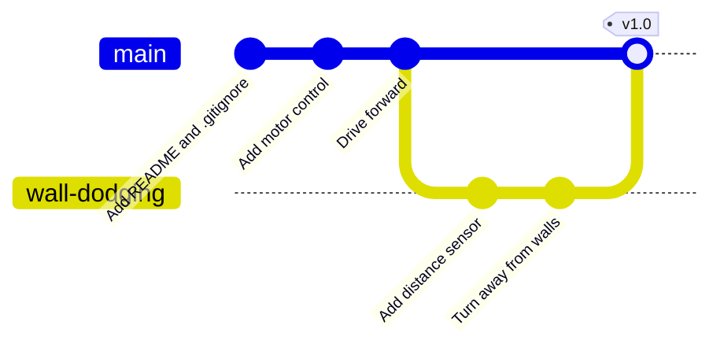

## The project

Time to use everything from the course in one go, from an empty folder to a published project on GitHub. We'll build the code for **Wall-Dodger**, a little Raspberry Pi Pico robot that drives forward and turns away when it gets close to a wall.

By the end, you'll have:

* A repository with a clean, readable history
* A `.gitignore` that keeps your Wi-Fi password out of Git
* A feature built on its own branch and merged with a pull request
* A tagged release, `v1.0`, on GitHub

You don't need the actual robot to follow along. Git doesn't care whether the code runs, but if you've got a Pico, two motors on a motor driver and an HC-SR04 sensor, you can upload the code at the end and watch it go.

Here's the history we're going to build:



---

## Step 1: Start the repository

```bash
mkdir wall-dodger
cd wall-dodger
git init
```

Create a `README.md`:

```markdown
# Wall-Dodger

A Raspberry Pi Pico robot that drives forward and turns away from walls.

## Wiring

- Left motor: GP14 and GP15
- Right motor: GP16 and GP17
- HC-SR04 trigger: GP3, echo: GP2

## Setup

Copy `secrets_example.py` to `secrets.py` and add your Wi-Fi details.
```

And a `.gitignore`:

```text
secrets.py
__pycache__/
*.pyc
.DS_Store
.vscode/
```

Add an example secrets file so people know what to fill in:

```python
# secrets_example.py - copy to secrets.py and fill in your details
WIFI_SSID = "your-network-name"
WIFI_PASSWORD = "your-password"
```

Check what Git sees, then make the first commit:

```bash
git status --short
```

```text
?? .gitignore
?? README.md
?? secrets_example.py
```

```bash
git add .
git commit -m "Add README, .gitignore and example secrets file"
```

---

## Step 2: Motor control

Create `motors.py`:

```python
# motors.py - simple control for two DC motors on a motor driver
from machine import Pin, PWM

class Motor:
    def __init__(self, pin_a, pin_b):
        self.a = PWM(Pin(pin_a), freq=1000)
        self.b = PWM(Pin(pin_b), freq=1000)

    def speed(self, percent):
        """Positive is forward, negative is backward, 0 is stop."""
        duty = int(abs(percent) / 100 * 65535)
        if percent >= 0:
            self.a.duty_u16(duty)
            self.b.duty_u16(0)
        else:
            self.a.duty_u16(0)
            self.b.duty_u16(duty)

left = Motor(14, 15)
right = Motor(16, 17)

def forward(percent=60):
    left.speed(percent)
    right.speed(percent)

def turn_right(percent=60):
    left.speed(percent)
    right.speed(-percent)

def stop():
    left.speed(0)
    right.speed(0)
```

```bash
git add motors.py
git commit -m "Add motor control for two DC motors"
```

Now `main.py`, to drive forward:

```python
# main.py - Wall-Dodger
import time
import motors

print("Wall-Dodger starting")
motors.forward()
time.sleep(2)
motors.stop()
```

Before committing, check exactly what you're saving:

```bash
git add main.py
git diff --staged
git commit -m "Drive forward for two seconds"
```

---

## Step 3: Publish to GitHub

Create an empty repository called `wall-dodger` on GitHub (no README, .gitignore or license), then:

```bash
git remote add origin https://github.com/your-username/wall-dodger.git
git push -u origin main
```

Your project is now backed up and public.

---

## Step 4: Build wall-dodging on a branch

The forward code works, so let's protect it and build the new feature on a branch:

```bash
git switch -c wall-dodging
```

Create `sensor.py`:

```python
# sensor.py - HC-SR04 ultrasonic distance sensor
from machine import Pin, time_pulse_us
import time

trigger = Pin(3, Pin.OUT)
echo = Pin(2, Pin.IN)

def distance_cm():
    trigger.low()
    time.sleep_us(2)
    trigger.high()
    time.sleep_us(10)
    trigger.low()
    pulse = time_pulse_us(echo, 1, 30000)
    if pulse < 0:
        return 999  # no echo: nothing in range
    return (pulse / 2) / 29.1
```

```bash
git add sensor.py
git commit -m "Add HC-SR04 distance sensor"
```

Now replace `main.py` with the wall-dodging loop:

```python
# main.py - Wall-Dodger
import time
import motors
from sensor import distance_cm

TOO_CLOSE_CM = 15

print("Wall-Dodger starting")
while True:
    if distance_cm() < TOO_CLOSE_CM:
        motors.turn_right()
        time.sleep(0.4)
    else:
        motors.forward()
    time.sleep(0.05)
```

Check the diff to see the change from "drive for two seconds" to the new loop, then commit:

```bash
git diff
git commit -am "Turn away from walls closer than 15cm"
```

Look at the history so far:

```bash
git log --oneline --graph --all
```

```text
* 71ac3e9 (HEAD -> wall-dodging) Turn away from walls closer than 15cm
* 2d84b10 Add HC-SR04 distance sensor
* b0f4c6a (origin/main, main) Drive forward for two seconds
* 6e2a913 Add motor control for two DC motors
* 1c7d5f2 Add README, .gitignore and example secrets file
```

---

## Step 5: Open a pull request and merge

Push the branch to GitHub:

```bash
git push -u origin wall-dodging
```

On GitHub, click **Compare & pull request**. Give it a title such as "Add wall dodging" and a short description:

```markdown
Adds an HC-SR04 distance sensor. The robot now drives forward and turns
right when something is closer than 15cm.
```

Click **Create pull request**. Have a look at the **Files changed** tab: it's a diff of everything on the branch, just like `git diff`. When you're happy, click **Merge pull request**, then **Confirm merge**. GitHub offers to delete the branch; go ahead.

Now bring the merged code down to your computer and tidy up:

```bash
git switch main
git pull
git branch -d wall-dodging
```

---

## Step 6: Tag a release

A **tag** is a permanent label on a commit, perfect for marking versions. Tag this one as version 1.0:

```bash
git tag -a v1.0 -m "First working version of Wall-Dodger"
git push origin v1.0
```

Tags aren't pushed automatically, which is why we push it by name. On GitHub, you can turn the tag into a release with notes and downloads: go to **Releases**, then **Draft a new release**, and choose `v1.0`.

From now on, whatever you change, you can always get back to the version that worked:

```bash
git switch --detach v1.0
```

(Use `git switch main` to come back.)

---

## Step 7: Keep going

Now you've got a proper workflow. For every new feature:

1. `git switch main` and `git pull`
2. `git switch -c my-new-feature`
3. Edit, `git add`, `git commit`, repeat
4. `git push -u origin my-new-feature` and open a pull request
5. Merge, then `git switch main`, `git pull`, and delete the branch

---

## Try it yourself

1. Build Wall-Dodger following all the steps, and check your history on GitHub matches the graph at the top.
2. Add a feature on a new branch: make the robot turn left or right at random. (Hint: `import random` and `random.choice()`.) Merge it with a pull request and tag it `v1.1`.
3. Create `secrets.py` with real-looking values and confirm `git status` doesn't show it.
4. Challenge: clone your repository onto a second computer or a Raspberry Pi, make a commit there, push it, and pull it back on the first computer.

---

## Common issues

- **Problem**: GitHub's **Compare & pull request** button doesn't appear
- **Solution**: Go to the **Pull requests** tab, click **New pull request**, and choose your branch.
- **Why**: The button only shows for branches pushed recently.

- **Problem**: `git pull` on `main` after merging says `Already up to date`
- **Solution**: Check you merged the pull request on GitHub, and that you're on `main` with `git branch`.
- **Why**: There's nothing to pull until the merge has actually happened on GitHub.

- **Problem**: `git branch -d wall-dodging` says the branch is not fully merged
- **Solution**: Run `git pull` on `main` first. If GitHub squashed the commits when merging, it's safe to use `git branch -D`.
- **Why**: Git checks whether the branch's commits are in `main` on your computer. Until you pull, they aren't.

---

## Check your understanding


? What's the main reason to build `wall-dodging` on a branch?
- [ ] Branches run faster on a Pico
- [x] The working code on `main` stays safe while the new feature is unfinished
- [ ] GitHub requires a branch for every commit
> You can experiment freely on a branch and only merge when the feature works.

? After merging a pull request on GitHub, what should you do on your computer?
- [x] `git switch main` then `git pull`
- [ ] Nothing, your computer updates automatically
- [ ] `git push` the branch again
> The merge happened on GitHub, so you need to pull it down to your local `main`.

? What does `git tag -a v1.0 -m "..."` do?
- [ ] Creates a branch called `v1.0`
- [x] Puts a permanent label on the current commit, marking it as version 1.0
- [ ] Uploads the project to GitHub
> Tags mark important commits such as releases. Push them with `git push origin v1.0`.


---
