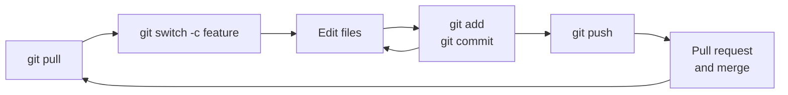

## Well done!

You've gone from never having used Git to building a project with branches, merges, pull requests and tagged releases. That covers what most people use Git for every day. Bookmark this page: it's every command from the course in one place.

---

## Setting up

Command | What it does
--------|-------------
`git --version` | Check Git is installed
`git config --global user.name "Name"` | Set your name for commits
`git config --global user.email "you@example.com"` | Set your email for commits
`git config --global init.defaultBranch main` | Call the first branch `main`
`git config --global core.editor "nano"` | Choose the editor Git opens
`git config --global pull.rebase false` | Make `git pull` merge
`git help <command>` | Open the manual for a command
{:class="table table-striped"}

## Starting a repository

Command | What it does
--------|-------------
`git init` | Start tracking the current folder
`git clone <url>` | Download a copy of a repository
{:class="table table-striped"}

## Saving work

Command | What it does
--------|-------------
`git status` | See what's changed (use it all the time!)
`git add <file>` | Stage a file for the next commit
`git add .` | Stage every change in this folder
`git commit -m "Message"` | Save the staged changes as a commit
`git commit -am "Message"` | Stage all tracked changes and commit
{:class="table table-striped"}

## Looking at history

Command | What it does
--------|-------------
`git log --oneline` | List commits, one per line
`git log --oneline --graph --all` | Draw all branches as a graph
`git show <hash>` | See what one commit changed
`git diff` | Changes not yet staged
`git diff --staged` | Changes staged for the next commit
{:class="table table-striped"}

## Undoing

Command | What it does
--------|-------------
`git restore <file>` | Throw away uncommitted edits (permanent!)
`git restore --staged <file>` | Unstage a file, keep the edits
`git commit --amend` | Fix the last commit (before pushing)
`git revert <hash>` | Undo a commit with a new commit
`git switch --detach <hash>` | Look at an old commit
`git reflog` | Find "lost" commits
`git rm --cached <file>` | Stop tracking a file, keep it on disk
{:class="table table-striped"}

## Branches

Command | What it does
--------|-------------
`git branch` | List branches
`git switch -c <name>` | Create a branch and switch to it
`git switch <name>` | Switch to a branch
`git merge <name>` | Merge a branch into the current one
`git merge --abort` | Cancel a merge
`git branch -d <name>` | Delete a merged branch
`git stash` / `git stash pop` | Put changes aside, then bring them back
{:class="table table-striped"}

## Remotes

Command | What it does
--------|-------------
`git remote add origin <url>` | Connect to a remote repository
`git remote -v` | List remotes
`git push -u origin <branch>` | Push a branch for the first time
`git push` | Push commits
`git fetch` | Download new commits without merging
`git pull` | Download and merge new commits
`git tag -a v1.0 -m "Message"` | Tag a release
`git push origin v1.0` | Push a tag
{:class="table table-striped"}

---

## The everyday workflow

---

## Habits worth keeping

* **Run `git status` constantly.** It tells you where you are and what to do next.
* **Commit little and often**, with messages that say what the commit does.
* **Read `git diff --staged`** before every commit.
* **Use a branch for anything that might break things.**
* **Pull when you start, push when you finish.**
* **Never commit secrets.** Set up `.gitignore` before your first commit.

---

## What's next?

Once you're comfortable, here are some things to explore:

* **Rebasing**: `git rebase` replays your commits on top of another branch for a straight-line history
* **Interactive staging**: `git add -p` lets you stage parts of a file, one chunk at a time
* **Blame**: `git blame main.py` shows who last changed each line, and in which commit
* **Finding bugs**: `git bisect` searches your history to find the commit that broke something
* **GitHub Actions**: run tests automatically every time you push
* **The free book**: [Pro Git](https://git-scm.com/book/en/v2) covers all of Git in depth

Related courses on this site:

* [Mastering Markdown for Documentation with Jekyll](/learn/markdown/): write great README files and publish a website from a Git repository with GitHub Pages
* [Create Diagrams with Mermaid](/learn/mermaid/): draw flowcharts and diagrams (including Git branch graphs like the ones in this course) in plain text, and keep them in Git with your code
* [Introduction to Linux](/learn/linux_intro/): get confident on the command line
* [MicroPython](/learn/micropython/): write the code for your robots, and version control it with Git

---

## Check your understanding


? You've just sat down to work on a shared project. What should you run first?
- [x] `git pull`
- [ ] `git push`
- [ ] `git init`
> Pulling first means you start from the latest code, which keeps conflicts small.

? Which command would you use to stage only some of the changes in a file?
- [ ] `git add .`
- [x] `git add -p`
- [ ] `git commit -a`
> `-p` (patch) shows each chunk of changes and asks whether to stage it.


---
