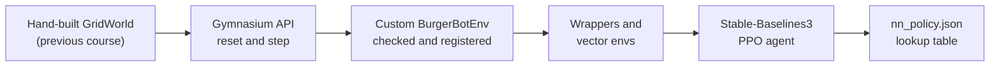

{:class="cover"}

---

Watch this first: a MuJoCo pendulum learns to balance with Stable-Baselines3 and a reward, the same tools this course uses.



---

## Overview

In the [Reinforcement Learning for Beginners](/learn/reinforcement_learning/) course you built everything by hand: a `GridWorld` class, a Q-table stored in a plain Python dictionary, an epsilon-greedy action selector and a reward function tuned for the BurgerBot maze. That was the right place to start, because understanding every line of a hand-rolled environment is how the ideas stick.

This course ports those same ideas onto the tools that researchers and industry teams use. **Gymnasium**, maintained by the Farama Foundation, is the standard API for describing environments. **Stable-Baselines3** (SB3) is a library of ready-made agents, including DQN and PPO, that plug into any Gymnasium environment. Together they let you swap algorithms, share code with the community, and move on to problems where a lookup table runs out of road.

The through-line project is the BurgerBot grid-world you already know. By the end you will have wrapped it as a proper Gymnasium environment, checked it with the official checker, trained a neural-network policy on it, and exported that policy as a JSON lookup table.

## Prerequisites

- [Reinforcement Learning for Beginners](/learn/reinforcement_learning/): you need Q-tables, epsilon-greedy exploration and the BurgerBot grid-world. This course builds on those ideas and does not re-teach them.
- [Introduction to Python](/learn/python/): functions, dictionaries, f-strings and simple classes.

## Course Content

- What the Gymnasium API is, and why it replaced OpenAI Gym
- Installing Gymnasium and running your first environment
- The five values returned by `env.step()` and why `terminated` and `truncated` are separate
- Observation spaces and action spaces: `Discrete`, `Box`, `MultiDiscrete`
- Running your tabular Q-learning agent on CartPole
- Seeding, the episode lifecycle and `env.close()`
- The `gym.Env` contract, and a custom environment that passes `check_env`
- Wrapping BurgerBot, registering it with `gym.register` and rendering it as text
- Wrappers, and vectorised environments
- Training DQN and PPO with Stable-Baselines3, then saving, loading and evaluating
- Exporting a neural-network policy as a lookup table

## Key Results

After completing this course, you will be able to:

- Use the Gymnasium API to interact with standard environments, with the current return values
- Explain the difference between `terminated` and `truncated` and why it matters for learning
- Write a custom `gym.Env` that passes `check_env`, and register it with `gym.make`
- Train a Stable-Baselines3 agent on your own environment in about twenty lines
- Export a trained policy to a JSON table, and say honestly what that table can and cannot do on a Pico

## What you'll need

This course runs entirely on a normal computer. There is no hardware to build.

- A laptop or desktop running macOS, Linux or Windows
- Python 3.10 or newer
- A virtual environment and `pip install "gymnasium[classic-control]" stable-baselines3` (the next lesson walks through it)
- Free disk space for PyTorch, which SB3 installs for you. On Linux the default download includes NVIDIA GPU libraries and took about 5 GB in testing. A GPU is not needed: everything here trains on a CPU in under a minute.

## How the course works

Every program in this course was run before it was published, with fixed random seeds, using **Python 3.13, Gymnasium 1.4.0 and Stable-Baselines3 2.9.2**. The output shown is what we saw. Where a number depends on random training, we say so, and your numbers may differ a little on other machines.

Programs are complete: save them, run them, change them. From lesson 8 onwards we keep the BurgerBot environment in one file called `burgerbot_env.py`, and later programs import it from there, so keep all your files in one folder.

Each lesson opens with an objective and ends with **Try it Yourself** exercises, **Common Issues** and a short quiz. Notes appear as blockquotes. The `> **Teachers**:` notes cover classroom catches.

> **Teachers**: The course suits learners aged about 14 and up who have finished the Reinforcement Learning for Beginners course and are comfortable with Python classes. Allow 30 to 45 minutes per lesson, and a double period for lessons 8, 12 and 13. Each learner or pair needs one computer with Python and an internet connection for the first install. The PyTorch download is large, so install it once in advance on a classroom machine or ask learners to install before the lesson, as many school networks throttle big downloads. No hardware is used. Lessons 1 to 10 need only Gymnasium, which is small, so a class can start before PyTorch arrives.
