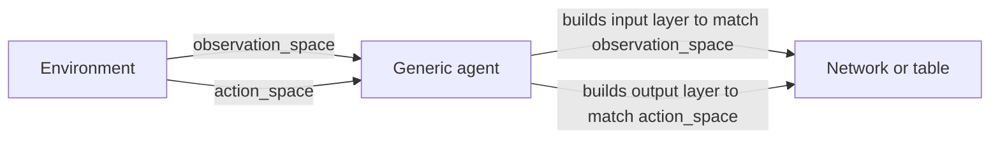

{:class="cover"}

---

By the end of this lesson you will be able to read and create `Discrete`, `Box` and `MultiDiscrete` spaces, and explain why a generic agent needs them.

---

## Why spaces exist

When you wrote the BurgerBot Q-learning agent by hand, your code knew the exact shape of the state: a tuple of `(row, col, heading, sensor)`, with `row` from 0 to 6 and so on. You hard-coded that knowledge.

A generic algorithm that should work on CartPole, BurgerBot and a simulated arm cannot hard-code anything. It needs to ask: "What does an observation look like? What can I do?" That is what `env.observation_space` and `env.action_space` are for: machine-readable descriptions of the shape and range of the data going in and out.



## The three spaces you will use most

### Discrete

One integer from `0` to `n - 1`. BurgerBot's actions use `Discrete(4)`: 0 forward, 1 turn left, 2 turn right, 3 stop.

### Box

A block of numbers, each with a lower and upper bound. It covers sensor readings, joint angles, velocities and even camera images, which are a `Box` of shape `(height, width, 3)`. CartPole's observation is a `Box` of four numbers: cart position, cart speed, pole angle, pole angular speed.

### MultiDiscrete

Several independent integers, each with its own range. BurgerBot's observation is `[row, col, heading, sensor]`, so it is `MultiDiscrete([7, 7, 4, 3])`.

Here is all three in one runnable program:

```python
import numpy as np
from gymnasium import spaces

# Discrete: one integer from 0 to n-1
actions = spaces.Discrete(4)
print("Discrete(4) n =", actions.n)
print("contains 2:", actions.contains(2), " contains 4:", actions.contains(4))

# Box: continuous numbers with bounds (here CartPole's observation)
inf = np.float32(np.inf)
cartpole_obs = spaces.Box(
    low=np.array([-4.8, -inf, -0.418, -inf], dtype=np.float32),
    high=np.array([4.8, inf, 0.418, inf], dtype=np.float32),
    dtype=np.float32,
)
print("Box shape:", cartpole_obs.shape)
print("zeros float32 inside:", cartpole_obs.contains(np.zeros(4, dtype=np.float32)))
print("zeros float64 inside:", cartpole_obs.contains(np.zeros(4)))
print("cart at 9.0 inside:", cartpole_obs.contains(np.array([9.0, 0, 0, 0], dtype=np.float32)))

# MultiDiscrete: several integers, each with its own range (BurgerBot)
burger_obs = spaces.MultiDiscrete([7, 7, 4, 3])
print("nvec:", burger_obs.nvec)
print("legal:", burger_obs.contains(np.array([6, 6, 3, 2])))
print("row 7:", burger_obs.contains(np.array([7, 0, 0, 0])))
print("number of states:", int(np.prod(burger_obs.nvec)))
burger_obs.seed(1)
print("sample:", burger_obs.sample())
```

Output:

```
Discrete(4) n = 4
contains 2: True  contains 4: False
Box shape: (4,)
zeros float32 inside: True
zeros float64 inside: False
cart at 9.0 inside: False
nvec: [7 7 4 3]
legal: True
row 7: False
number of states: 588
sample: [3 6 0 2]
```

Look at the `zeros float64` line: a `float64` array of zeros is **not** inside a `float32` Box, even though the numbers are fine. Spaces check the data type as well as the range. That is the number-one cause of `check_env` errors when you write your own environment.

The 588 matches the state count from the previous course: 7 x 7 x 4 x 3.

## Looking at real environments

Every environment tells you its spaces. This program prints five of them:

```python
import gymnasium as gym

for env_id in ["CartPole-v1", "MountainCar-v0", "Acrobot-v1", "Pendulum-v1", "FrozenLake-v1"]:
    env = gym.make(env_id)
    print(env_id)
    print("  observation:", env.observation_space)
    print("  action:     ", env.action_space)
    env.close()
```

On our run, MountainCar printed `Box([-1.2  -0.07], [0.6  0.07], (2,), float32)` for its observation and `Discrete(3)` for actions, FrozenLake printed `Discrete(16)` and `Discrete(4)`, and Pendulum printed a `Box` for its action: its action is a continuous torque, not a choice from a short list. Notice how different the problems are, yet your code can ask each of them the same questions.

## How an agent uses spaces

A library like Stable-Baselines3 reads the spaces and builds its network to fit. For BurgerBot it one-hot encodes the four `MultiDiscrete` numbers, which gives `7 + 7 + 4 + 3 = 21` network inputs, and uses 4 outputs for the four actions (we confirmed this by printing the policy network in testing). The library never reads your environment's code; the spaces are enough.

Spaces also give you a generic random action:

```python
if random.random() < epsilon:
    action = env.action_space.sample()      # explore: any legal action
else:
    action = best_action_from_q_table(state)  # exploit
```
{: .no-snakie }

This replaces `random.choice(ACTIONS)` from the previous course and works on any environment with any number of actions.

## Try it Yourself

1. Make a `Box` for a 64 by 64 greyscale image: values 0 to 255, `dtype=np.uint8`. What is its `shape`? Does `contains` accept an array of zeros of type `uint8`? What about `float32`?
2. Make `MultiDiscrete([3, 3])` for a 3 by 3 tic-tac-toe cell choice. How many distinct values can it hold?
3. Print the spaces for `Acrobot-v1`. How many numbers make up one observation? How many actions are there?
4. Challenge: `Pendulum-v1` has a `Box` action space. What does `env.action_space.sample()` return? Why could a Q-table with one row per action not handle it?

## Common Issues

- **Problem**: `AttributeError: 'Box' object has no attribute 'n'`
- **Solution**: Use `.n` only on `Discrete`. For a Box, use `.shape`, `.low` and `.high`.
- **Why**: Each space type has its own attributes. Check the type with `print(env.action_space)` first.

- **Problem**: `check_env` complains that the observation is not in the observation space.
- **Solution**: Return an array with the dtype the space declares: `np.float32` for a `float32` Box, `np.int64` for a `MultiDiscrete`.
- **Why**: `contains` checks the dtype as well as the range, as the `float64` line above shows.

- **Problem**: `gym.make("LunarLander-v3")` fails with `DependencyNotInstalled: Box2D`.
- **Solution**: That environment needs an extra install (`pip install swig` then `pip install "gymnasium[box2d]"`, as the error message says). Use one of the five environments above instead.
- **Why**: Some environments depend on physics libraries that are not part of the base install.

## Check your understanding


? Which space describes BurgerBot's actions (forward, turn left, turn right, stop)?
- [x] `Discrete(4)`
- [ ] `Box(4)`
- [ ] `MultiDiscrete([4])`
> Four choices numbered 0 to 3 is a `Discrete(4)`.

? Which space fits CartPole's four continuous sensor numbers?
- [ ] `Discrete(4)`
- [x] `Box` of shape `(4,)`
- [ ] `MultiDiscrete([4, 4])`
> Continuous values with bounds are a `Box`.

? How many distinct observations are in `MultiDiscrete([7, 7, 4, 3])`?
- [ ] 21
- [x] 588
- [ ] 84
> Multiply the ranges: 7 x 7 x 4 x 3 = 588.

? Why was a `float64` array of zeros not inside the `float32` Box?
- [ ] Zero is out of range
- [x] Spaces check the data type as well as the range
- [ ] Boxes cannot hold zeros
> The program printed `False` for float64 and `True` for float32.

