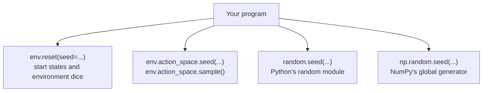

{:class="cover"}

---

By the end of this lesson you will be able to make a Gymnasium run repeatable by seeding it correctly, and write a training loop that follows the full episode lifecycle.

---

## Why reproducibility matters

Two things go wrong in reinforcement learning projects all the time:

1. "It worked yesterday and now it fails." The training was random, and you cannot get the same run back.
2. "My agent beats the baseline but my friend's identical code does not." Different random seeds led to different outcomes.

Seeds are how you tell whether a change really improved your agent or you were just lucky with the dice. If a run is repeatable, you can change one thing and compare fairly.

## Where the randomness lives

A Gymnasium program has several separate random number generators, and each needs its own seed:



Seeding one does not seed the others. Here is a short program that proves the first two work:

```python
import gymnasium as gym


def first_five(seed):
    env = gym.make("CartPole-v1")
    obs, info = env.reset(seed=seed)
    env.action_space.seed(seed)
    actions = [int(env.action_space.sample()) for _ in range(5)]
    env.close()
    return obs.round(4), actions


print(first_five(42))
print(first_five(42))
print(first_five(7))
```

Output:

```
(array([ 0.0274, -0.0061,  0.0359,  0.0197], dtype=float32), [0, 1, 1, 0, 0])
(array([ 0.0274, -0.0061,  0.0359,  0.0197], dtype=float32), [0, 1, 1, 0, 0])
(array([ 0.0125,  0.0397,  0.0276, -0.0275], dtype=float32), [1, 1, 1, 1, 1])
```

The first two lines match exactly, because both runs used seed 42. Seed 7 gives a different start state and a different run of actions.

> **Note**: If your own loop uses `random.random()` or `np.random.rand()`, seed those too with `random.seed(42)` and `np.random.seed(42)`. That is why lesson 5 started with `random.seed(0)`.

## Seed once per run, not per episode

A common mistake is re-seeding every episode:

```python
for episode in range(100):
    obs, info = env.reset(seed=42)    # BAD: every episode starts identically
```
{: .no-snakie }

Each reset with the same seed rebuilds the generator in the same state, so every episode starts from the same place. Seed on the first reset only, and let the generator move on:

```python
obs, info = env.reset(seed=42)        # seed once, here
for episode in range(100):
    # ... run the episode ...
    obs, info = env.reset()           # no seed: the generator carries on
```
{: .no-snakie }

To compare several experiments fairly, change the seed number *between* complete runs, not between episodes.

## The full episode lifecycle

This is the loop every Gymnasium program follows. Run it three times and compare the three seeds:

```python
import gymnasium as gym

for seed in [0, 1, 2]:
    env = gym.make("CartPole-v1")
    obs, info = env.reset(seed=seed)          # 1. seed once and start
    env.action_space.seed(seed)

    rewards = []
    for episode in range(5):
        done = False
        episode_reward = 0
        while not done:                       # 2. step until the episode ends
            action = env.action_space.sample()                           # 3. choose
            obs, reward, terminated, truncated, info = env.step(action)  # 4. act
            episode_reward += reward
            done = terminated or truncated    # 5. check for the end
        rewards.append(int(episode_reward))
        obs, info = env.reset()               # 6. reset, no seed this time
    env.close()                               # 7. always close
    print(f"Seed {seed}: episode rewards = {rewards}")
```

Output:

```
Seed 0: episode rewards = [18, 16, 11, 14, 11]
Seed 1: episode rewards = [29, 10, 11, 36, 13]
Seed 2: episode rewards = [14, 28, 10, 47, 22]
```

Run it again and you get exactly the same lines. Change a seed and that line changes.

| Step | What happens |
| --- | --- |
| 1. Seed and reset | The environment starts, and returns the first observation |
| 2. Episode loop | Runs until the episode ends |
| 3. Choose | Your agent, or the random sampler, picks an action |
| 4. Act | `step()` returns five values |
| 5. Check | `terminated or truncated` ends the episode |
| 6. Reset | A new episode begins, with no seed |
| 7. Close | Frees windows and files |
{:class="table table-single"}

## Why env.close() matters

`env.close()` releases anything the environment opened: a pygame window, a video recorder, open files. Forgetting it with `render_mode="human"` can leave a window hanging. A `with` block closes it for you, even if your code crashes halfway:

```python
import gymnasium as gym

with gym.make("CartPole-v1") as env:
    obs, info = env.reset(seed=0)
    obs, reward, terminated, truncated, info = env.step(0)
    print(reward, terminated, truncated)
```

This prints `1.0 False False`. After the block the environment is closed.

## Try it Yourself

1. Run the three-seed program twice. Are the results identical? Now delete the line `env.action_space.seed(seed)` and run it twice again. What changes, and why?
2. Write a function `run_experiment(seed, episodes)` that returns the list of rewards. Use it to find the best of seeds 0 to 9 for a random agent. Is the best seed meaningful, or just luck?
3. Put `env.reset(seed=42)` inside the episode loop and print the first observation of each episode. What do you notice?
4. Challenge: add `random.seed()` and `np.random.seed()` calls to the lesson 5 program and confirm it still prints the same numbers.

## Common Issues

- **Problem**: Results differ between runs even though you passed a seed to `reset`.
- **Solution**: Seed `env.action_space` too, and seed `random` and `np.random` if your code uses them.
- **Why**: Each generator is separate. `reset(seed=...)` seeds only the environment.

- **Problem**: Every episode in training looks the same.
- **Solution**: Only pass `seed=` on the very first `reset()`.
- **Why**: Passing the same seed again restarts the generator, so each episode begins from the same state.

- **Problem**: `reset()` raises `TypeError` about an unexpected `seed` argument.
- **Solution**: The environment is written for old Gym. Update it so `reset(self, *, seed=None, options=None)` calls `super().reset(seed=seed)`.
- **Why**: Old Gym had a separate `env.seed(42)` call. Gymnasium moved seeding into `reset()`.

## Check your understanding


? Where should you pass `seed=` to `reset()`?
- [ ] On every episode
- [x] On the first reset of a run
- [ ] Never, Gymnasium seeds itself
> Re-seeding every episode makes every episode start the same way.

? Which line makes `env.action_space.sample()` repeatable?
- [ ] `env.reset(seed=0)`
- [x] `env.action_space.seed(0)`
- [ ] `env.seed(0)`
> The action space has its own generator, separate from the environment's.

? Does `env.reset(seed=42)` also seed Python's `random` module?
- [ ] Yes
- [x] No
> Seed `random` and `np.random` yourself if your code uses them.

? Why use `with gym.make(...) as env:`?
- [x] It calls `env.close()` for you, even after an error
- [ ] It makes training faster
- [ ] It seeds the environment
> The with block guarantees the environment is closed.

