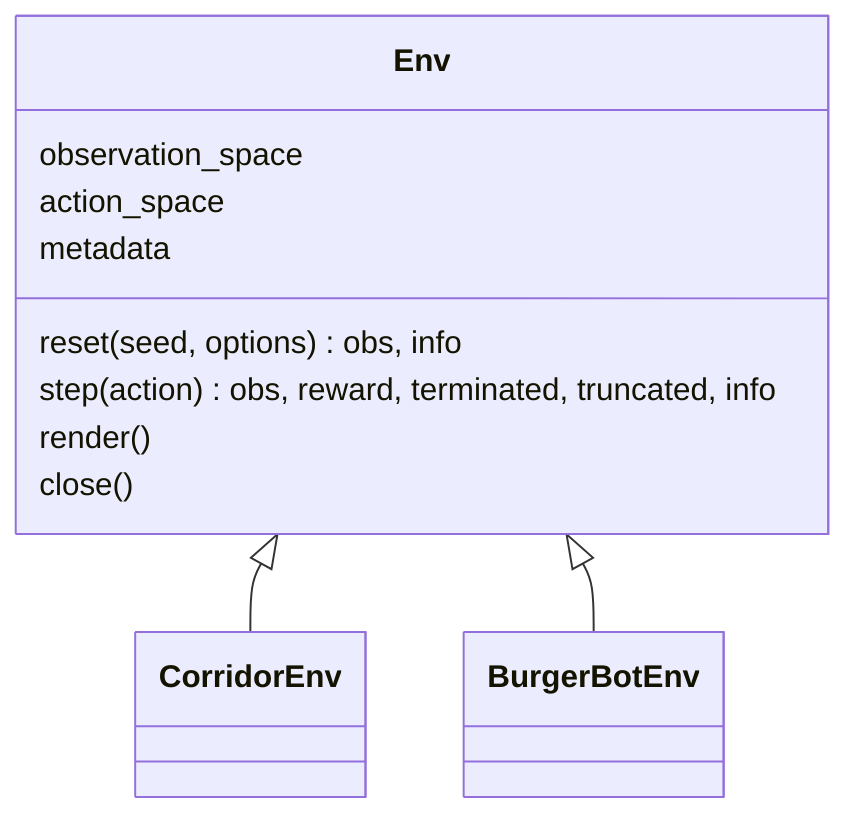

{:class="cover"}

---

By the end of this lesson you will be able to write a small `gym.Env` subclass and validate it with `check_env`.

---

## The contract

To write a Gymnasium environment you subclass `gym.Env` and provide four things:

1. `observation_space` and `action_space`, set up in `__init__`
2. `reset(*, seed=None, options=None)`, which returns `(obs, info)`
3. `step(action)`, which returns `(obs, reward, terminated, truncated, info)`
4. Optionally `render()` and a `metadata` dictionary

That is the entire contract. Anything that follows it works with Stable-Baselines3, with Gymnasium's wrappers and with any other tool that speaks the API.



## A tiny example: the corridor

Before BurgerBot, let's build something so small you can see every piece. A 10-cell corridor: the agent starts in cell 0 and the goal is cell 9. It can move left or right, and stepping left off cell 0 is a crash.

Save this as `corridor.py`:

```python
import gymnasium as gym
from gymnasium import spaces
from gymnasium.utils.env_checker import check_env


class CorridorEnv(gym.Env):
    """A 10-cell corridor. The agent starts at cell 0 and the goal is cell 9.

    Actions: 0 = left, 1 = right.
    Observation: the agent's cell number, 0 to 9.
    """

    metadata = {"render_modes": ["ansi"]}

    def __init__(self, render_mode=None, max_steps=50):
        super().__init__()
        self.observation_space = spaces.Discrete(10)
        self.action_space = spaces.Discrete(2)
        self.render_mode = render_mode
        self.max_steps = max_steps
        self.position = 0
        self.steps = 0

    def reset(self, *, seed=None, options=None):
        super().reset(seed=seed)       # sets up self.np_random
        self.position = 0
        self.steps = 0
        return self.position, {}       # (observation, info)

    def step(self, action):
        self.steps += 1
        self.position += 1 if action == 1 else -1

        hit_wall = self.position < 0
        reached_goal = self.position == 9

        if hit_wall:
            self.position = 0          # keep the observation inside the space
            reward = -5.0
        elif reached_goal:
            reward = 10.0
        else:
            reward = -0.1              # a small cost per step encourages speed

        terminated = reached_goal or hit_wall      # the task's own endings
        truncated = self.steps >= self.max_steps   # the outside time limit
        return self.position, reward, terminated, truncated, {}

    def render(self):
        if self.render_mode == "ansi":
            cells = ["."] * 10
            cells[9] = "G"
            cells[self.position] = "A"
            return "[" + " ".join(cells) + "]"


if __name__ == "__main__":
    check_env(CorridorEnv())
    print("CorridorEnv passed check_env")

    env = CorridorEnv(render_mode="ansi")
    obs, info = env.reset(seed=0)
    print(env.render())
    total, steps, done = 0.0, 0, False
    while not done:
        obs, reward, terminated, truncated, info = env.step(1)   # always right
        total += reward
        steps += 1
        done = terminated or truncated
        if steps == 4:
            print(env.render())
    print(env.render())
    print(f"Steps: {steps}, total reward: {total:.1f}")
    env.close()
```

Run it with `python3 corridor.py`:

```
CorridorEnv passed check_env
[A . . . . . . . . G]
[. . . . A . . . . G]
[. . . . . . . . . A]
Steps: 9, total reward: 9.2
```

You may also see a `WARN` line before the first message about the environment not having a spec or a render fps. For this text-only environment those warnings are harmless; they appear because we built the class directly instead of through `gym.make`.

The reward adds up as 8 steps at -0.1 plus 10.0 for the goal, which is 9.2.

Notice the shape of `step()`: it moves the agent, decides what happened, picks a reward, and sets the two flags, with the crash and goal as `terminated` and the step limit as `truncated`. `BurgerBotEnv` will follow exactly the same pattern.

## What check_env tests

`check_env` runs your environment through a battery of tests: it calls `reset()` with and without a seed, checks every observation against `observation_space`, takes some random steps, and checks the types of everything `step()` returns. Run it on every environment you write. Let's break the corridor on purpose and see what it says:

```python
from corridor import CorridorEnv, check_env


class ForgetsSuper(CorridorEnv):
    def reset(self, *, seed=None, options=None):
        self.position = 0              # no super().reset(seed=seed)!
        self.steps = 0
        return self.position, {}


class FloatObs(CorridorEnv):
    def reset(self, *, seed=None, options=None):
        super().reset(seed=seed)
        return 0.0, {}                 # a float is not a Discrete observation


for broken in (ForgetsSuper, FloatObs):
    try:
        check_env(broken())
    except AssertionError as error:
        print(broken.__name__, "->", str(error)[:100])
```

Save that as `break_it.py` beside `corridor.py` and run it. We cut each message to 100 characters, and in our run they read:

```
ForgetsSuper -> Expects the random number generator to have been generated given a seed was passed to reset. Most li
FloatObs -> The first element returned by `env.reset()` is not within the observation space.
```

Good error messages. Read them first, they usually tell you the fix.

One more subtle trap: `check_env` is a smoke test, not a proof. If you declare `Discrete(9)` when the corridor really has 10 cells, `check_env` still passed in our test, because a few random steps never reached cell 9. Check the *edges* of your space by hand: the first, last and terminal observations.

## Try it Yourself

1. Change `max_steps` to 5 and run an agent that always chooses action 1. Which flag fires: `terminated` or `truncated`? Why does it not reach the goal?
2. Make the reward grow with the cell number (`reward += 0.1 * self.position`). Does it still pass `check_env`? Does a random agent score higher?
3. Write a `SnailEnv`: the observation is a counter from 0 to 9, the only action is "wait" (`Discrete(1)`), and the episode ends after 10 steps. It is the smallest useful environment, and a handy scaffold for debugging.
4. Challenge: break the corridor in a way not shown here, for example `observation_space = spaces.Discrete(9)`. Does `check_env` catch it? What test would?

## Common Issues

- **Problem**: `check_env` fails with a message about the random number generator.
- **Solution**: Add `super().reset(seed=seed)` as the first line of your `reset()`.
- **Why**: That call sets up `self.np_random`, which Gymnasium uses to seed the environment.

- **Problem**: The first observation is "not within the observation space".
- **Solution**: Return the type the space declares: an `int` for `Discrete`, a `float32` array for a `float32` Box.
- **Why**: Spaces check type and range together, as lesson 4 showed.

- **Problem**: `step()` complains it cannot unpack your return value.
- **Solution**: Return exactly five things: `obs, reward, terminated, truncated, info`.
- **Why**: Gymnasium wrappers and libraries unpack five values and cannot guess which one you left out.

## Check your understanding


? Which line should begin your `reset()` method?
- [ ] `self.position = 0`
- [x] `super().reset(seed=seed)`
- [ ] `return obs, {}`
> It sets up `self.np_random` so seeding works.

? What does `step()` return in Gymnasium?
- [ ] `obs, reward, done, info`
- [x] `obs, reward, terminated, truncated, info`
- [ ] `obs, reward`
> Five values, with the old `done` split in two.

? In the corridor, why is hitting the left wall `terminated` rather than `truncated`?
- [x] It is an ending defined by the task's own rules
- [ ] It happens after a time limit
- [ ] Walls are always truncation
> The step limit is the only truncation. A crash is a real ending.

? Does a passing `check_env` prove your spaces are correct?
- [ ] Yes, it checks every possible state
- [x] No, it runs a few random steps, so you must check the edges yourself
> Our `Discrete(9)` mistake passed, because the random steps never reached cell 9.

