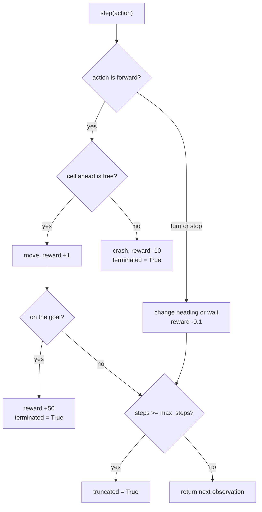

{:class="cover"}

---

By the end of this lesson you will be able to turn a hand-built simulator into a Gymnasium environment that passes `check_env`, and run a random agent on it.

---

## What we are porting

In the [previous course](/learn/reinforcement_learning/) you built a `GridWorld` for the BurgerBot: a 7 by 7 grid with seven obstacles, a start at the top left and a goal at the bottom right.

```
. . . O . . .
. O . . . O .
. . . . . . .
O . . O . . .
. . . . . O .
. O . . . . .
. . . . . . G
```

The robot starts at row 0, column 0, facing east, and must reach `G` without driving into an `O` or off the grid. Its state is `(row, col, heading, sensor)`, where the sensor reports how many clear cells lie straight ahead, binned into near, medium and far.

The physics, the obstacles, the sensor and the rewards stay identical. Only the interface changes: spaces, the five-value `step()`, and a `reset()` that returns `(obs, info)`.



## Design decisions

**Observation space.** Four integers: `row` 0 to 6, `col` 0 to 6, `heading` 0 to 3 (north, east, south, west) and `sensor` 0 to 2 (near, medium, far). That is `MultiDiscrete([7, 7, 4, 3])`, with 588 possible observations, the same count the Q-table had.

**Action space.** Four actions, `Discrete(4)`: 0 forward, 1 turn left, 2 turn right, 3 stop.

**Terminated or truncated.** A crash and reaching the goal are real endings, so `terminated`. Running out of steps is a time limit, so `truncated`. This is lesson 3 put into practice.

**The sensor.** It counts the clear cells ahead, up to 5. Zero or one clear cell is "near" (0), two or three is "medium" (1), and four or more is "far" (2).

## The complete environment

Save this whole listing as `burgerbot_env.py`. Every later lesson imports from it, so keep it in your course folder.

```python
"""BurgerBot 7x7 grid world as a Gymnasium environment.

Save this file as burgerbot_env.py. Later lessons import it with
    from burgerbot_env import BurgerBotEnv
"""

import gymnasium as gym
import numpy as np
from gymnasium import spaces

# World constants, identical to the GridWorld in the Reinforcement Learning course
GRID_ROWS, GRID_COLS = 7, 7
OBSTACLES = {(0, 3), (1, 1), (1, 5), (3, 0), (3, 3), (4, 5), (5, 1)}
START, GOAL = (0, 0), (6, 6)
ACTIONS = ["forward", "turn_left", "turn_right", "stop"]
HEADINGS = ["north", "east", "south", "west"]
HEADING_DELTA = {"north": (-1, 0), "east": (0, 1), "south": (1, 0), "west": (0, -1)}
NEAR, MEDIUM = 1, 3


class BurgerBotEnv(gym.Env):
    """The BurgerBot grid world.

    Observation: np.array([row, col, heading_index, sensor_level], dtype=int64)
        heading_index: 0 north, 1 east, 2 south, 3 west
        sensor_level:  0 near (0 or 1 clear cells ahead)
                       1 medium (2 or 3 clear cells)
                       2 far (4 or more clear cells)

    Actions: 0 forward, 1 turn_left, 2 turn_right, 3 stop

    Rewards: crash -10, goal +50, forward move +1, turn or stop -0.1
    """

    metadata = {"render_modes": ["ansi"]}

    def __init__(self, max_steps=150, render_mode=None):
        super().__init__()
        self.max_steps = max_steps
        self.render_mode = render_mode
        self.observation_space = spaces.MultiDiscrete([GRID_ROWS, GRID_COLS, 4, 3])
        self.action_space = spaces.Discrete(4)
        self.row, self.col = START
        self.heading = "east"
        self.steps = 0

    def _sensor(self):
        """Count clear cells straight ahead (up to 5) and bin the count."""
        dr, dc = HEADING_DELTA[self.heading]
        r, c = self.row + dr, self.col + dc
        n = 0
        while 0 <= r < GRID_ROWS and 0 <= c < GRID_COLS:
            if (r, c) in OBSTACLES:
                break
            n += 1
            if n >= 5:
                break
            r += dr
            c += dc
        if n <= NEAR:
            return 0
        if n <= MEDIUM:
            return 1
        return 2

    def _obs(self):
        return np.array(
            [self.row, self.col, HEADINGS.index(self.heading), self._sensor()],
            dtype=np.int64,
        )

    def reset(self, *, seed=None, options=None):
        super().reset(seed=seed)
        self.row, self.col = START
        self.heading = "east"
        self.steps = 0
        return self._obs(), {}

    def step(self, action):
        self.steps += 1
        name = ACTIONS[int(action)]
        hit = False
        moved = False

        if name == "forward":
            dr, dc = HEADING_DELTA[self.heading]
            nr, nc = self.row + dr, self.col + dc
            if 0 <= nr < GRID_ROWS and 0 <= nc < GRID_COLS and (nr, nc) not in OBSTACLES:
                self.row, self.col = nr, nc
                moved = True
            else:
                hit = True
        elif name == "turn_left":
            self.heading = HEADINGS[(HEADINGS.index(self.heading) - 1) % 4]
        elif name == "turn_right":
            self.heading = HEADINGS[(HEADINGS.index(self.heading) + 1) % 4]
        # "stop" changes nothing

        reached = (self.row, self.col) == GOAL

        if hit:
            reward = -10.0
        elif reached:
            reward = 50.0
        elif moved:
            reward = 1.0
        else:
            reward = -0.1

        terminated = reached or hit
        truncated = self.steps >= self.max_steps
        return self._obs(), reward, terminated, truncated, {}

    def render(self):
        if self.render_mode != "ansi":
            return None
        arrow = {"north": "^", "east": ">", "south": "v", "west": "<"}
        lines = []
        for r in range(GRID_ROWS):
            cells = []
            for c in range(GRID_COLS):
                if (r, c) == (self.row, self.col):
                    cells.append(arrow[self.heading])
                elif (r, c) in OBSTACLES:
                    cells.append("O")
                elif (r, c) == GOAL:
                    cells.append("G")
                else:
                    cells.append(".")
            lines.append(" ".join(cells))
        return "\n".join(lines)
```

A few details are worth a second look. `_obs()` builds the array with `dtype=np.int64` to match the `MultiDiscrete` space. `step()` calls `int(action)` because libraries sometimes hand you a NumPy integer. And `reset()` begins with `super().reset(seed=seed)`, as you learned last lesson.

## Validate it, then watch a random agent

Save this as `try_burgerbot.py` in the same folder and run it:

```python
from gymnasium.utils.env_checker import check_env

from burgerbot_env import BurgerBotEnv

env = BurgerBotEnv()
check_env(env)
print("BurgerBotEnv passed check_env")
env.close()

env = BurgerBotEnv(render_mode="ansi")
obs, info = env.reset(seed=7)
env.action_space.seed(7)
print("Observation:", obs)
print(env.render())

total_reward = 0.0
for step in range(1, 101):
    action = env.action_space.sample()
    obs, reward, terminated, truncated, info = env.step(action)
    total_reward += reward
    if terminated or truncated:
        print(f"Episode ended at step {step}.")
        print(f"terminated={terminated}, truncated={truncated}")
        break

print(f"Total reward from random agent: {total_reward:.1f}")
print(env.render())
env.close()
```

In our run `check_env` printed one harmless `WARN` about render modes and then:

```
BurgerBotEnv passed check_env
Observation: [0 0 1 1]
> . . O . . .
. O . . . O .
. . . . . . .
O . . O . . .
. . . . . O .
. O . . . . .
. . . . . . G
Episode ended at step 8.
terminated=True, truncated=False
Total reward from random agent: -10.7
^ . . O . . .
. O . . . O .
. . . . . . .
O . . O . . .
. . . . . O .
. O . . . . .
. . . . . . G
```

The first observation `[0 0 1 1]` reads: row 0, column 0, heading 1 (east), sensor 1 (medium). Medium, because two clear cells lie ahead before the obstacle at column 3. The random agent spent seven steps turning and waiting at the start (seven steps at -0.1 each, which is where the -0.7 in the total comes from), ended up facing north, and then drove forward off the top edge of the grid for the -10 crash penalty. That gives `terminated=True` and `truncated=False`, exactly as designed.

How bad is a random agent? We ran 200 random episodes. Every one of them ended in a crash, none reached the goal, and the average length was about 10 steps. That is the baseline a trained agent has to beat.

## Old versus new

| Aspect | Original GridWorld | BurgerBotEnv |
| --- | --- | --- |
| `reset()` returns | `state` | `(observation, info)` |
| `step()` returns | `(state, reward, done)` | `(obs, reward, terminated, truncated, info)` |
| State type | Python tuple with strings | NumPy `int64` array |
| Ending | One `done` flag | `terminated` and `truncated` |
| Spaces | Implicit | `observation_space`, `action_space` |
| Works with SB3 and wrappers | No | Yes |
{:class="table table-single"}

## Try it Yourself

1. In `_obs()`, return a plain list instead of an array and run `check_env`. Read the error. Put it back.
2. Set `max_steps=10` and run an agent that always chooses action 3 (stop). Which flag ends the episode, and at which step?
3. Write a function that runs 100 random episodes with different seeds and counts how many different observations the agent sees. Compare it to 588.
4. Challenge: write a hand-coded policy (no learning) that gets the robot to the goal. It needs to avoid the obstacles at row 0 column 3 and row 1 column 1. How many steps does your route take?

## Common Issues

- **Problem**: `check_env` says the observation is not within the observation space.
- **Solution**: Make `_obs()` return `dtype=np.int64`, and check every value is inside its range (row 0 to 6, heading 0 to 3, sensor 0 to 2).
- **Why**: `MultiDiscrete` validates the array's type and every element.

- **Problem**: The robot seems to move the wrong way when facing north.
- **Solution**: Check `HEADING_DELTA`: north must be `(-1, 0)`.
- **Why**: Row 0 is the top of the grid, so moving north means the row number goes down.

- **Problem**: `IndexError: list index out of range` inside `step()`.
- **Solution**: Only pass actions 0 to 3, which `env.action_space.sample()` guarantees.
- **Why**: `ACTIONS[action]` has exactly four entries.

## Check your understanding


? Which space describes the BurgerBot observation `[row, col, heading, sensor]`?
- [ ] `Discrete(588)`
- [x] `MultiDiscrete([7, 7, 4, 3])`
- [ ] `Box(0, 6, (4,))`
> Four independent integers, each with its own range.

? A BurgerBot drives forward into an obstacle. Which flags does `step()` return?
- [x] `terminated=True`, `truncated=False` (unless the step limit coincides)
- [ ] `terminated=False`, `truncated=True`
- [ ] Both always True
> A crash is a real ending. Truncation only reflects the step limit.

? At the start state `[0 0 1 1]`, what does the last 1 mean?
- [ ] The robot is facing east
- [x] The sensor reads medium: two or three clear cells ahead
- [ ] One obstacle is nearby
> The last number is the sensor level. Heading is the third number.

? What is `check_env` for?
- [ ] Training the agent
- [x] Testing that the environment follows the Gymnasium contract
- [ ] Rendering the grid
> It runs the contract's tests and tells you what is broken.

