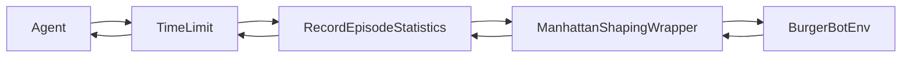

{:class="cover"}

---

By the end of this lesson you will be able to stack Gymnasium's built-in wrappers on an environment and write your own reward-shaping wrapper.

---

## What is a wrapper?

A wrapper is an environment that sits in front of another environment and intercepts some of its calls. The agent talks to the outer wrapper as if it were a normal environment. The inner environment does not know it is wrapped.

That lets you change behaviour, such as adding a step limit, logging results, rescaling observations or reshaping rewards, without editing the environment's source. And if the change turns out to be a bad idea, you remove one line.



Every call to `step()` travels inward through the layers, and every result travels back out, with each layer free to change it on the way.

## The built-in wrappers you will meet most

**`TimeLimit`** counts steps and sets `truncated=True` when the limit is reached. You already got one for free when you registered with `max_episode_steps`.

**`RecordEpisodeStatistics`** adds an `"episode"` entry to `info` on the final step of every episode, holding the total reward (`"r"`), the length (`"l"`) and the elapsed time (`"t"`). This is the easy way to log training progress, and Stable-Baselines3 reads the same keys.

**`ObservationWrapper`, `RewardWrapper`, `ActionWrapper`** are base classes. Subclass one and override `observation(obs)`, `reward(r)` or `action(a)` to change just that piece. When you need more than one piece at once, subclass the general `gym.Wrapper` and override `step()` and `reset()`.

## A reward-shaping wrapper for BurgerBot

BurgerBot's rewards are sparse: +50 for the goal, -10 for a crash, +1 for moving forward. **Reward shaping** adds a small extra signal to guide the agent. Here we pay a bonus for each step that takes the robot closer to the goal, measured as the Manhattan distance: rows away plus columns away.

We need the robot's position, which is in the observation, so we subclass `gym.Wrapper` rather than `RewardWrapper` (which only sees the reward). Because the bonus is the *drop* in distance, going away and coming back cancels out, so the robot cannot farm points by pacing in circles.

Save this program as `wrappers_demo.py` beside `burgerbot_env.py`:

```python
import gymnasium as gym
import numpy as np
from gymnasium.wrappers import RecordEpisodeStatistics, TimeLimit

from burgerbot_env import GOAL, BurgerBotEnv


class ManhattanShapingWrapper(gym.Wrapper):
    """Add a small bonus each time the robot moves closer to the goal."""

    def __init__(self, env, scale=0.5):
        super().__init__(env)
        self.scale = scale
        self._prev_distance = 0

    @staticmethod
    def _distance(obs):
        row, col = int(obs[0]), int(obs[1])
        return abs(row - GOAL[0]) + abs(col - GOAL[1])

    def reset(self, **kwargs):
        obs, info = self.env.reset(**kwargs)
        self._prev_distance = self._distance(obs)
        return obs, info

    def step(self, action):
        obs, reward, terminated, truncated, info = self.env.step(action)
        distance = self._distance(obs)
        progress = self._prev_distance - distance      # +1 closer, -1 further
        self._prev_distance = distance
        return obs, reward + self.scale * progress, terminated, truncated, info


class ScaledObservation(gym.ObservationWrapper):
    """Rescale BurgerBot's four integers to floats between 0 and 1."""

    def __init__(self, env):
        super().__init__(env)
        self._top = np.array([6, 6, 3, 2], dtype=np.float32)
        self.observation_space = gym.spaces.Box(0.0, 1.0, shape=(4,), dtype=np.float32)

    def observation(self, obs):
        return (obs / self._top).astype(np.float32)


# 1. TimeLimit: a robot that only waits is cut off after 5 steps
env = TimeLimit(BurgerBotEnv(max_steps=1000), max_episode_steps=5)
env.reset(seed=0)
for i in range(1, 10):
    obs, reward, terminated, truncated, info = env.step(3)
    if terminated or truncated:
        print(f"TimeLimit: step {i}, terminated={terminated}, truncated={truncated}")
        break

# 2. RecordEpisodeStatistics: the summary appears only on the last step
env = RecordEpisodeStatistics(BurgerBotEnv())
env.action_space.seed(3)
for episode in range(3):
    obs, info = env.reset(seed=episode)
    done = False
    while not done:
        obs, reward, terminated, truncated, info = env.step(env.action_space.sample())
        done = terminated or truncated
    stats = info["episode"]
    print(f"episode {episode + 1}: return={float(stats['r']):.1f}  length={int(stats['l'])}")

# 3. Reward shaping: the same three forward moves, plain and shaped
for name, e in (("plain ", BurgerBotEnv()), ("shaped", ManhattanShapingWrapper(BurgerBotEnv()))):
    e.reset(seed=0)
    rewards = []
    for action in (0, 0, 0):        # forward, forward, forward: the third hits the obstacle
        obs, reward, terminated, truncated, info = e.step(action)
        rewards.append(round(float(reward), 2))
    print(name, rewards)

# 4. Stacking, and getting back to the original
env = BurgerBotEnv()
env = ManhattanShapingWrapper(env)
env = RecordEpisodeStatistics(env)
env = TimeLimit(env, max_episode_steps=100)
print(env)
print("unwrapped:", type(env.unwrapped).__name__)
try:
    env.row
except AttributeError as error:
    print("AttributeError:", error)
print("row via unwrapped:", env.unwrapped.row)

# 5. An observation wrapper
scaled = ScaledObservation(BurgerBotEnv())
obs, info = scaled.reset(seed=0)
print(obs, scaled.observation_space)
```

Output from our run:

```
TimeLimit: step 5, terminated=False, truncated=True
episode 1: return=-8.1  length=4
episode 2: return=-9.3  length=5
episode 3: return=-9.5  length=7
plain  [1.0, 1.0, -10.0]
shaped [1.5, 1.5, -10.0]
<TimeLimit<RecordEpisodeStatistics<ManhattanShapingWrapper<BurgerBotEnv instance>>>>
unwrapped: BurgerBotEnv
AttributeError: 'TimeLimit' object has no attribute 'row'
row via unwrapped: 0
[0.         0.         0.33333334 0.5       ] Box(0.0, 1.0, (4,), float32)
```

Walk through what you see:

- **Step 1**: `TimeLimit` ended the waiting robot at step 5 with `truncated=True`, the case lesson 3 told you not to treat as a failure.
- **Step 2**: the three random episodes crashed after 4, 5 and 7 steps. The summary dictionary appears only on the last step of each episode, which is why we read it after the loop. Its time field `"t"` is wall-clock time, so it varies, and we left it out.
- **Step 3**: the first two forward moves each take the robot one cell closer, so the shaped wrapper adds 0.5 to each. The third forward move crashes, so no progress is made and the penalty is the same. The environment underneath is unchanged.
- **Step 4**: printing the stack shows the order, outermost first. `env.row` fails because wrappers only pass on the standard Gymnasium attributes; `env.unwrapped.row` reaches the real object.
- **Step 5**: the observation wrapper declares a *new* `Box` space. When you change what the environment returns, you must also change the space that describes it.

> **Note**: Reward shaping is a loaded gun. A bonus that is not carefully balanced can teach the agent to chase the bonus instead of the goal. Our bonus is a drop in distance, so it cannot be farmed, and it is half the size of the real +1 per move.

## Try it Yourself

1. Wrap `BurgerBotEnv` in `RecordEpisodeStatistics`, run 20 random episodes with different seeds, and print the average length. Does it match the roughly 10 steps from lesson 8?
2. Change `scale` in `ManhattanShapingWrapper` to 5.0. Predict what the shaped rewards will look like for the same three moves, then check.
3. Write a `ClipRewardWrapper` as a subclass of `gym.RewardWrapper` whose `reward(self, r)` method returns `max(r, -1.0)`, so crashes cost at most 1. Does the crash still end the episode?
4. Challenge: write an `ActionWrapper` called `NoStop` that turns action 3 (stop) into action 1 (turn left). Does `check_env` still pass? What happens to the action space?

## Common Issues

- **Problem**: `AttributeError: 'TimeLimit' object has no attribute 'row'`
- **Solution**: Use `env.unwrapped.row` to reach attributes of your own class.
- **Why**: Wrappers forward only the standard API, not the custom attributes of the environment inside.

- **Problem**: A custom observation wrapper breaks `check_env` or the agent complains about shapes.
- **Solution**: Set `self.observation_space` in the wrapper to describe the *new* observations.
- **Why**: The agent builds itself from the space it sees, so the space must match what you now return.

- **Problem**: `info["episode"]` is missing in the middle of an episode.
- **Solution**: Read it on the step where `terminated or truncated` is true.
- **Why**: The wrapper only writes the summary when the episode ends.

## Check your understanding


? Why does the shaping wrapper subclass `gym.Wrapper` instead of `gym.RewardWrapper`?
- [ ] `RewardWrapper` does not exist
- [x] It needs the observation to find the robot's position, and `RewardWrapper.reward()` only sees the reward
- [ ] Wrappers cannot change rewards
> We override `step()` so we can see the observation as well as the reward.

? What does `RecordEpisodeStatistics` add to `info`, and when?
- [x] An `"episode"` entry with return, length and time, on the final step
- [ ] The robot's position, on every step
- [ ] A seed, on `reset()`
> The summary appears only when the episode ends.

? How do you get back to your own environment object under several wrappers?
- [ ] `env.base`
- [x] `env.unwrapped`
- [ ] `env.parent`
> `unwrapped` removes all the wrapper layers.

? If a wrapper changes what the observations look like, what else must it change?
- [ ] The reward
- [x] `observation_space`
- [ ] The seed
> The agent trusts the space to describe the data, as in lesson 4.

