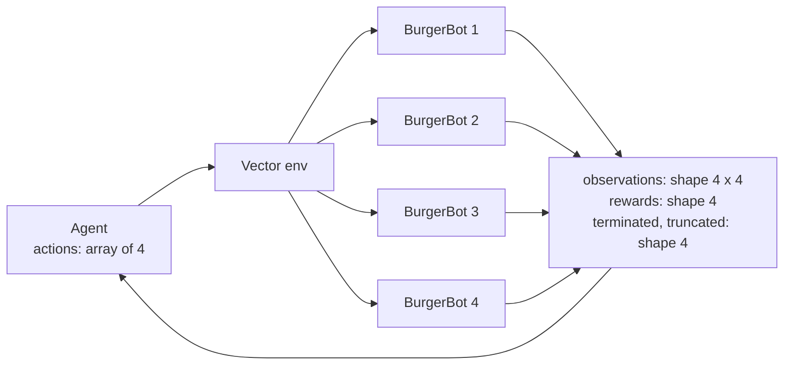

{:class="cover"}

---

By the end of this lesson you will be able to run several copies of an environment as one batch, and explain what happens to an environment that finishes mid-batch.

---

## Why more than one copy?

A neural-network agent learns from batches of experience. One environment gives it one transition at a time. Running N copies side by side gives it N transitions for every call, and they come from different situations, which makes learning steadier.

The vector API wraps N environments in one object. You send in N actions and get back N observations, N rewards and N pairs of flags, all as NumPy arrays.



## A tour in one program

Save this as `vector_demo.py` beside `burgerbot_env.py`. It needs Stable-Baselines3 for its last part, so install that first if you have not.

```python
import gymnasium as gym
import numpy as np
from gymnasium.vector import SyncVectorEnv
from stable_baselines3.common.env_util import make_vec_env

from burgerbot_env import BurgerBotEnv

# 1. Gymnasium's own vector environment: four CartPoles in one object
cartpoles = gym.make_vec("CartPole-v1", num_envs=4, vectorization_mode="sync")
obs, info = cartpoles.reset(seed=0)
print("CartPole batch observation shape:", obs.shape)
cartpoles.action_space.seed(0)
actions = cartpoles.action_space.sample()
print("one action per env:", actions)
obs, rewards, terminated, truncated, infos = cartpoles.step(actions)
print("rewards:", rewards, " terminated:", terminated)
cartpoles.close()

# 2. A vector of BurgerBots: pass one factory function per copy
burgers = SyncVectorEnv([lambda: BurgerBotEnv() for _ in range(4)])
obs, info = burgers.reset(seed=0)
print("\nBurgerBot batch observation:", obs.shape, obs.dtype)

# 3. Auto-reset: every robot drives forward, and crashes at the obstacle in step 3
forward = np.zeros(4, dtype=np.int64)
for step in range(1, 5):
    obs, rewards, terminated, truncated, infos = burgers.step(forward)
    print(f"step {step}: reward {rewards[0]:5.1f}  terminated {terminated[0]}  "
          f"position {obs[0][:2]}")

# 4. Count finished episodes over 500 steps of random actions
burgers.reset(seed=1)
burgers.action_space.seed(0)
finished = 0
for _ in range(500):
    obs, rewards, terminated, truncated, infos = burgers.step(burgers.action_space.sample())
    finished += int((terminated | truncated).sum())
print("\nepisodes finished by 4 robots in 500 steps:", finished)
burgers.close()

# 5. Stable-Baselines3 builds its own vector environment for you
sb3_envs = make_vec_env(BurgerBotEnv, n_envs=4, seed=0)
print("\nSB3 type:", type(sb3_envs).__name__)
print("SB3 reset gives one array:", sb3_envs.reset().shape)
obs, rewards, dones, infos = sb3_envs.step(forward)
obs, rewards, dones, infos = sb3_envs.step(forward)
obs, rewards, dones, infos = sb3_envs.step(forward)
print("after the crash step, dones:", dones)
print("terminal observation kept in infos:", infos[0]["terminal_observation"])
print("fresh observation already returned:", obs[0])
```

Our output:

```
CartPole batch observation shape: (4, 4)
one action per env: [1 0 0 0]
rewards: [1. 1. 1. 1.]  terminated: [False False False False]

BurgerBot batch observation: (4, 4) int64
step 1: reward   1.0  terminated False  position [0 1]
step 2: reward   1.0  terminated False  position [0 2]
step 3: reward -10.0  terminated True  position [0 2]
step 4: reward   0.0  terminated False  position [0 0]

episodes finished by 4 robots in 500 steps: 182

SB3 type: DummyVecEnv
SB3 reset gives one array: (4, 4)
after the crash step, dones: [ True  True  True  True]
terminal observation kept in infos: [0 2 1 0]
fresh observation already returned: [0 0 1 1]
```

## Batches, in numbers

`obs.shape` is `(4, 4)`: four environments, each with a four-number observation. `actions` has one entry per environment, and `rewards` and the two flags are arrays of length four. `vec.single_action_space` and `vec.single_observation_space` still describe one copy.

## How auto-reset works

You cannot call `reset()` on one copy mid-batch, so the vector environment handles it. Look at steps 3 and 4 in the output:

- **Step 3**: the robots crash. The reward is -10, `terminated` is `True`, and the returned observation is the *final* observation of the finished episode, still at position `[0 2]`.
- **Step 4**: the vector environment sees that the previous step ended the episode, so it **ignores the action you sent**, resets that copy, returns the first observation of the new episode (position `[0 0]`) and gives reward 0 with both flags `False`.

This is Gymnasium's `NEXT_STEP` auto-reset mode, the default in 1.x. Two consequences. The step right after an episode ends is a "reset step", not a real move: do not count its zero reward as experience. And you do not get a separate `final_observation` entry, because the terminal observation is simply the one returned when the episode ended. Older tutorials describe a different behaviour, where the reset happened immediately and the old observation went into `infos["final_observation"]`; that is not how Gymnasium 1.x works.

Stable-Baselines3 has its own vector environments, and they behave the other way round (last lines of the output). `make_vec_env` returns a `DummyVecEnv`. When an episode ends it resets *immediately*, hands you the fresh observation, and tucks the finished episode's last observation into `infos[i]["terminal_observation"]`. SB3 uses that to handle `truncated` correctly. Both designs are valid: just know which library you are talking to.

> **Note**: Stable-Baselines3 uses its own `VecEnv` classes, not Gymnasium's. Do not pass a `gym.vector.SyncVectorEnv` to `PPO(...)`. Build with `make_vec_env(...)` as in section 5, or pass a plain environment and SB3 wraps it for you.

## When vectorising helps

Algorithms that learn from large fresh batches, such as PPO, gain most. With 4 copies, collecting 2,048 steps takes 512 calls instead of 2,048. For off-policy algorithms like DQN the gain is smaller, but the replay buffer fills faster.

For a tiny, quick environment like BurgerBot, the speed difference is small. There is also `AsyncVectorEnv`, which runs each copy in its own process. For tiny environments the cost of sending data between processes can swamp the gain: in our test, 2,000 steps of 4 BurgerBots took about 0.05 s in sync mode and about 0.6 s in async mode, and your numbers will vary. Async pays off when each `step()` is slow, for example in a physics simulation.

## Try it Yourself

1. Change the number of copies in section 2 to 8. How does the shape of `obs` change? Does the count of finished episodes in section 4 roughly double?
2. In section 3, send action `3` (stop) to all robots instead of forward. Which flag eventually fires, and when? (Remember the 150-step limit.)
3. Time `gym.make_vec("CartPole-v1", num_envs=4, vectorization_mode="sync")` against `"async"` for 2,000 steps with `time.perf_counter()`. For async, put your code under `if __name__ == "__main__":`. Which wins on your machine?
4. Challenge: make the four robots take *different* actions in one step by passing `np.array([0, 1, 2, 3])`. Print the four observations. What do you see?

## Common Issues

- **Problem**: `RuntimeError` or a hang when using `vectorization_mode="async"` on Windows or macOS.
- **Solution**: Put your code under `if __name__ == "__main__":`.
- **Why**: Those systems start worker processes by re-importing your script, which would otherwise start more workers without end.

- **Problem**: Your code looks for `infos["final_observation"]` and it is not there.
- **Solution**: With Gymnasium 1.x vector environments, read the observation returned on the step where `terminated` or `truncated` is true. With Stable-Baselines3 vector environments, use `infos[i]["terminal_observation"]`.
- **Why**: The libraries differ in when they auto-reset, as the output above shows.

- **Problem**: `ValueError: The environment is of type SyncVectorEnv, not a Gymnasium environment` when you create a `PPO` model.
- **Solution**: Use `make_vec_env(BurgerBotEnv, n_envs=4)` from Stable-Baselines3 instead.
- **Why**: SB3 has its own vector classes and does not accept Gymnasium's.

- **Problem**: `TypeError` when building `SyncVectorEnv(...)`.
- **Solution**: Pass a list of functions that take no arguments and return an environment, like `lambda: BurgerBotEnv()`.
- **Why**: The vector environment calls each function itself to build its copies.

## Check your understanding


? What is the shape of `obs` for 4 BurgerBot copies?
- [ ] `(4,)`
- [x] `(4, 4)`
- [ ] `(16,)`
> Four environments, each with a four-number observation.

? In Gymnasium 1.x's default auto-reset mode, what happens on the step after an episode ends?
- [ ] Your action is applied to the old episode
- [x] The environment resets, ignoring your action, and returns the new first observation
- [ ] The program raises an error
> We saw reward 0.0 and position `[0 0]` on step 4: a reset step.

? Where does Stable-Baselines3 store the last observation of a finished episode?
- [ ] `infos["final_observation"]`
- [x] `infos[i]["terminal_observation"]`
- [ ] It is thrown away
> SB3's `DummyVecEnv` resets immediately and keeps the old observation in that key.

? Which helper builds a vector environment you can give to PPO?
- [ ] `gym.vector.SyncVectorEnv`
- [x] `make_vec_env` from Stable-Baselines3
- [ ] `gym.make_vec`
> SB3 expects its own `VecEnv` classes.

