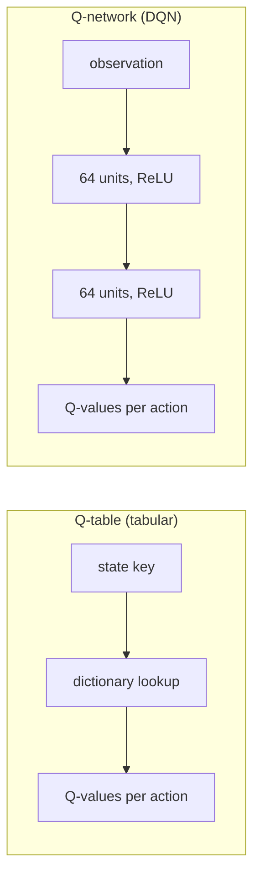

{:class="cover"}

---

By the end of this lesson you will be able to train a DQN agent with Stable-Baselines3, measure it with `evaluate_policy`, and explain how a Q-network stands in for a Q-table.

---

## From table to network

The previous course ended with a question: what if the state space is too big for a lookup table? Your BurgerBot has 588 states, which is tiny. A 64 by 64 greyscale camera image has more possible pictures than there are atoms in the universe, so no table could hold them.

The answer is to replace the table with a neural network. Instead of looking up `Q[state]`, you feed the observation through a function and get a Q-value for every action. Because the network is smooth, it **generalises**: states it has never seen get sensible answers if they resemble ones it has.

**Stable-Baselines3** (SB3) gives you tested versions of the common deep RL algorithms, so you do not have to write the network, the replay buffer, the loss or the optimiser. You hand it an environment and a policy type, and call `learn()`.



## Install and check

```bash
pip install stable-baselines3
```

This brings PyTorch with it, and it is a big download, so it may take a while.

> **Teachers**: Plan for the install to take several minutes and a few gigabytes on Linux, because the default PyTorch download includes GPU libraries. On a locked-down or slow network, install in advance and have learners reuse the same environment. Training in this lesson takes under a minute on a laptop CPU.

## DQN on CartPole

DQN (Deep Q-Network) is Q-learning with a neural network for the Q-function, a replay buffer of past experience, and a slowly updated "target" copy of the network for stability. You keep the Q-learning idea from the previous course and swap the table for the network.

Save this as `dqn_cartpole.py`:

```python
import gymnasium as gym
import stable_baselines3
from stable_baselines3 import DQN
from stable_baselines3.common.evaluation import evaluate_policy
from stable_baselines3.common.monitor import Monitor

print("gymnasium", gym.__version__, "| stable-baselines3", stable_baselines3.__version__)

env = Monitor(gym.make("CartPole-v1"))

model = DQN(
    "MlpPolicy",
    env,
    learning_rate=1e-3,
    buffer_size=50_000,
    learning_starts=1_000,
    exploration_fraction=0.3,
    target_update_interval=250,
    verbose=0,
    seed=0,
)

before, before_std = evaluate_policy(model, env, n_eval_episodes=10, deterministic=True)
print(f"Before training: {before:.1f} +/- {before_std:.1f}")

model.learn(total_timesteps=30_000)

after, after_std = evaluate_policy(model, env, n_eval_episodes=10, deterministic=True)
print(f"After training:  {after:.1f} +/- {after_std:.1f}")

obs, info = env.reset(seed=123)
action, _state = model.predict(obs, deterministic=True)
print("predicted action for one observation:", int(action))
print(model.policy.q_net.q_net)
env.close()
```

Output from our test run (it took about 25 seconds on a CPU):

```
gymnasium 1.4.0 | stable-baselines3 2.9.2
Before training: 9.3 +/- 0.8
After training:  129.7 +/- 7.6
predicted action for one observation: 0
Sequential(
  (0): Linear(in_features=4, out_features=64, bias=True)
  (1): ReLU()
  (2): Linear(in_features=64, out_features=64, bias=True)
  (3): ReLU()
  (4): Linear(in_features=64, out_features=2, bias=True)
)
```

The untrained network balances the pole for about 9 steps. After 30,000 steps of experience it reaches about 130: a clear win, though short of CartPole's 500 maximum. Your numbers will differ slightly, and DQN results on CartPole are known to wobble: in our testing a 100,000-step run scored about 113, no better than the 30,000-step one, and a 5,000-step run scored about 46. More training does not always mean a better policy with DQN, so treat any single result with care. In exercise 2 you will try PPO on the same problem, which in our test scored the full 500 in 30,000 steps.

The last lines show what "MlpPolicy" gave us: a network with 4 inputs (the four CartPole numbers), two hidden layers of 64 units, and 2 outputs, one Q-value per action. SB3 read the sizes from the spaces, as lesson 4 described.

## What the pieces mean

**`"MlpPolicy"`** means a Multi-Layer Perceptron: plain fully connected layers. It takes flat number arrays, including `Box`, `Discrete` and `MultiDiscrete` observations.

**`Monitor`** wraps the environment so SB3 records true episode scores. It silences a warning from `evaluate_policy`, and it is the SB3 cousin of `RecordEpisodeStatistics`.

**`model.predict(obs, deterministic=True)`** returns `(action, state)`. The second value is only used by recurrent policies, so we ignore it. `deterministic=True` means "always take the highest-valued action", which is what you want when *using* the agent. During training SB3 handles exploration itself.

**`evaluate_policy`** runs full episodes and returns the mean and standard deviation of the return. Use it, not a hand-rolled loop, when you want numbers you can compare.

## The knobs that matter

| Parameter | What it controls |
| --- | --- |
| `learning_rate` | How big each weight update is |
| `buffer_size` | How many past transitions the replay buffer remembers |
| `learning_starts` | Random steps collected before any learning begins |
| `batch_size` | Transitions used for each weight update |
| `gamma` | The discount factor, the same gamma as in the previous course |
| `exploration_fraction` | The share of training spent lowering epsilon |
| `exploration_final_eps` | The smallest epsilon, the "never stop exploring" floor |
| `target_update_interval` | How often the target network copies the main one |
{:class="table table-single"}

You will recognise `gamma` and epsilon from the previous course. SB3 anneals epsilon for you: it starts at 1.0 and falls linearly over `exploration_fraction` of the run.

## Try it Yourself

1. Change `total_timesteps` to 5,000. How far does the score drop? What does that tell you about how much experience DQN needs?
2. Swap `DQN` for `PPO` (`from stable_baselines3 import PPO`) with `PPO("MlpPolicy", env, seed=0)`. Remove the DQN-only keyword arguments. How does PPO do after 30,000 steps?
3. Print `model.policy` for the full architecture. Can you find the main network and the target network?
4. Challenge: run the same script with `gym.make("Acrobot-v1")`. Does DQN learn it? What score counts as good, given that every step costs -1?

## Common Issues

- **Problem**: `UserWarning: Evaluation environment is not wrapped with a Monitor wrapper`
- **Solution**: Wrap the environment with `Monitor(...)` as in the program.
- **Why**: Other wrappers can change the rewards or lengths SB3 sees, and `Monitor` records the true episode numbers.

- **Problem**: Training seems to print nothing.
- **Solution**: Set `verbose=1` on the model to see progress tables.
- **Why**: We set `verbose=0` to keep the output short. SB3 prints its logs only when verbose is on.

- **Problem**: `ValueError` about the policy or observation space when your observations are dictionaries or images.
- **Solution**: Use `"MultiInputPolicy"` for `Dict` spaces and `"CnnPolicy"` for images.
- **Why**: `MlpPolicy` expects flat numbers. Other observation types need other network designs.

## Check your understanding


? What does `"MlpPolicy"` mean in `DQN("MlpPolicy", env)`?
- [ ] A camera-based policy
- [x] A fully connected neural network
- [ ] A lookup table
> MLP stands for Multi-Layer Perceptron. SB3 sizes its input and output from the spaces.

? What does `deterministic=True` do in `model.predict`?
- [ ] Adds exploration noise
- [x] Always picks the action with the highest value
- [ ] Reseeds the environment
> Use it when you want the trained agent's best behaviour, not exploration.

? Why can a network handle states that a Q-table has never seen?
- [ ] It memorises more states
- [x] It generalises between similar inputs
- [ ] It ignores the observation
> A table has one cell per state, with nothing for an unseen one. A network gives an answer for any input.

? Which function gives you a clean mean and standard deviation of episode returns?
- [ ] `model.predict`
- [x] `evaluate_policy`
- [ ] `env.render`
> It runs full episodes and averages the results.

