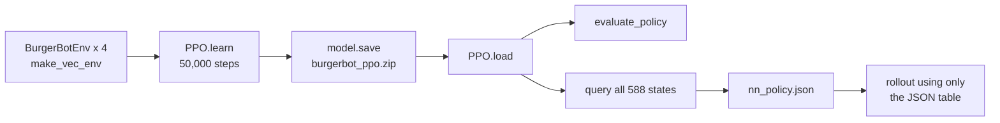

{:class="cover"}

---

By the end of this lesson you will be able to train a PPO agent on BurgerBotEnv, save, load and evaluate it, and export its policy as a JSON lookup table that runs with no neural network.

---

## Bringing it all together

This is the capstone. In the previous course you trained a Q-table on the BurgerBot grid-world and saved it as JSON. Here the policy comes from a neural network trained by Stable-Baselines3 on your own `BurgerBotEnv`.

A neural network cannot run on a Raspberry Pi Pico, but BurgerBot's observation space is tiny: 588 possible observations. So we can ask the trained network "what would you do?" in every one of them and write the answers down. The result is a plain lookup table, in the same spirit as the Q-table you started with.



## The training and export program

Save this as `train_burgerbot.py` beside `burgerbot_env.py`. We trained with four copies of the environment (lesson 11), PPO with its default network, and a fixed seed.

```python
import json

import numpy as np
from stable_baselines3 import PPO
from stable_baselines3.common.env_util import make_vec_env
from stable_baselines3.common.evaluation import evaluate_policy
from stable_baselines3.common.monitor import Monitor

from burgerbot_env import ACTIONS, GOAL, GRID_COLS, GRID_ROWS, BurgerBotEnv

TIMESTEPS = 50_000


def reached_goal_rate(model, episodes=50):
    """Run greedy episodes and count how many finish on the goal cell."""
    env = BurgerBotEnv()
    successes = 0
    for ep in range(episodes):
        obs, info = env.reset(seed=1000 + ep)
        done = False
        while not done:
            action, _ = model.predict(obs, deterministic=True)
            obs, reward, terminated, truncated, info = env.step(action)
            done = terminated or truncated
        if (env.row, env.col) == GOAL:
            successes += 1
    env.close()
    return successes / episodes


# Training: four copies of the environment, collecting experience together.
train_env = make_vec_env(BurgerBotEnv, n_envs=4, seed=42)
model = PPO("MlpPolicy", train_env, verbose=0, seed=42, n_steps=256, batch_size=64)
model.learn(total_timesteps=TIMESTEPS)
print("Training complete.")

model.save("burgerbot_ppo")
loaded = PPO.load("burgerbot_ppo")

eval_env = Monitor(BurgerBotEnv())
mean_reward, std_reward = evaluate_policy(loaded, eval_env, n_eval_episodes=20, deterministic=True)
print(f"Mean reward over 20 episodes: {mean_reward:.1f} +/- {std_reward:.1f}")
print(f"Goal reach rate: {100 * reached_goal_rate(loaded):.0f}%")

# Export: ask the network for its choice in every one of the 588 states.
policy_table = {}
for row in range(GRID_ROWS):
    for col in range(GRID_COLS):
        for heading in range(4):
            for sensor in range(3):
                obs = np.array([row, col, heading, sensor], dtype=np.int64)
                action, _ = loaded.predict(obs, deterministic=True)
                policy_table[f"{row},{col},{heading},{sensor}"] = ACTIONS[int(action)]

with open("nn_policy.json", "w") as f:
    json.dump(policy_table, f, indent=1)
print(f"Exported {len(policy_table)} states to nn_policy.json")
print("Start state 0,0,1,1 ->", policy_table["0,0,1,1"])
```

It took about 40 seconds on a CPU. Our output, identical on a second run with the same seeds:

```
Training complete.
Mean reward over 20 episodes: 60.8 +/- 0.0
Goal reach rate: 100%
Exported 588 states to nn_policy.json
Start state 0,0,1,1 -> forward
```

### Reading the result

- A reward of **60.8** is what the route earns: 14 steps in total, made of 12 forward moves (11 at +1, then the final one onto the goal for +50) and 2 turns at -0.1 each, so `11 + 50 - 0.2 = 60.8`. Twelve moves is the shortest possible trip across the grid.
- The standard deviation is **0.0** and the goal rate is **100%**, and that is not a lucky streak. BurgerBot has a fixed start, no random obstacles and no noise, and `deterministic=True` always picks the same action, so every evaluation episode is the *same* episode. Do not read "100% over 20 episodes" as "robust". It means "this one route works". In the previous course you added sensor noise to test that kind of thing.
- **PPO** (Proximal Policy Optimisation) is a policy-gradient algorithm: it learns the policy directly rather than learning Q-values. It is a good default, and SB3 handles the `terminated`/`truncated` distinction for you.
- SB3 one-hot encodes each `MultiDiscrete` entry, so the network sees 21 numbers (lesson 4).

If you cut training to `TIMESTEPS = 5_000`, our test scored a mean reward of -8.4 and a 0% goal rate: the robot crashed. Training time matters, and a number like 50,000 is not magic: it is just enough here.

## Using only the exported table

The test that matters is whether the table behaves like the network. Save this as `run_table.py`. It loads `nn_policy.json`, never touches PyTorch or SB3, and drives a fresh environment:

```python
import json

from burgerbot_env import ACTIONS, BurgerBotEnv

with open("nn_policy.json") as f:
    table = json.load(f)

env = BurgerBotEnv(render_mode="ansi")
obs, info = env.reset(seed=0)
total = 0.0
for step in range(1, 151):
    key = ",".join(str(int(v)) for v in obs)
    action = ACTIONS.index(table[key])
    obs, reward, terminated, truncated, info = env.step(action)
    total += reward
    if terminated or truncated:
        break

print(env.render())
print(f"Finished after {step} steps, total reward {total:.1f}, terminated={terminated}")
env.close()
```

Our output:

```
. . . O . . .
. O . . . O .
. . . . . . .
O . . O . . .
. . . . . O .
. O . . . . .
. . . . . . >
Finished after 14 steps, total reward 60.8, terminated=True
```

The arrow sits on the goal cell: the robot arrived. The same route, 14 steps and 60.8 reward, came out of the table alone. The policy now lives in a 14 KB text file.

## What this can and cannot do on a Pico

This is the honest part. The Reinforcement Learning course's Pico program uses a Q-table whose keys are only the sensor reading, `near`, `medium` or `far`, because a real robot knows what its ultrasonic sensor sees but not "I am in row 4, column 2". **`nn_policy.json` is a different table**: its keys are `"row,col,heading,sensor"`, and so it cannot replace that `q_table.json`, and the old loader will not find its keys.

You can load the new file on a Pico with the `json` module, and a lookup is a dictionary access:

```python
import json

with open("nn_policy.json") as f:
    table = json.load(f)


def choose_action(row, col, heading, sensor):
    return table[f"{row},{col},{heading},{sensor}"]
```
{: .no-snakie }

But the robot must *know* its row, column and heading. That needs a way to track position, such as counting wheel turns or using a camera or a floor grid, and that is a robotics project in itself. We did not run this on a board, so treat the file size (about 14 KB, which should fit in a Pico's memory) as an estimate to check, not a promise.

The deeper lesson is the pattern: a trained network can be distilled into a table when the observation space is small and discrete. For bigger spaces, such as camera images, the realistic route is to run the network on a Raspberry Pi and send commands to a Pico for the motors.

## Try it Yourself

1. Run with `TIMESTEPS = 5_000` and look at the result. Then try 20,000. At what point does the robot first reach the goal?
2. Open `nn_policy.json` and find an entry for a cell the robot can never reach, such as `"0,3,1,2"` (an obstacle cell). What does the network say, and does it matter?
3. Add one random action 10% of the time inside `run_table.py` (use `random.random() < 0.1`) and run it 20 times. How often does the robot still reach the goal? Now you are testing robustness.
4. Challenge: use the shaping wrapper from lesson 10 during training. Does PPO reach the goal with fewer timesteps?

## Common Issues

- **Problem**: `ModuleNotFoundError: No module named 'burgerbot_env'`
- **Solution**: Run the script from the folder that has `burgerbot_env.py` in it.
- **Why**: Python only finds the module if it is in the script's folder or on the path.

- **Problem**: The robot reaches the goal 0% of the time.
- **Solution**: Train for more timesteps (50,000 worked in our test, 5,000 did not), and check that you did not change the reward function.
- **Why**: The goal reward of +50 is only found by luck early on. The network needs enough experience to learn the route to it.

- **Problem**: `TypeError: Object of type int64 is not JSON serializable` when saving.
- **Solution**: Convert NumPy values with `int(...)` before they go into the dictionary, as the program does with `ACTIONS[int(action)]`.
- **Why**: The `json` module does not know NumPy integer types.

> **Teachers**: Training takes under a minute on a laptop, so it fits easily in a lesson, and `burgerbot_ppo.zip` and `nn_policy.json` are small files that learners can swap and compare. A good discussion: two learners with different seeds may get different routes, both correct. Stress that "100% on one fixed start" is not proof of a robust robot.

## Check your understanding


? Why does the evaluation show a standard deviation of 0.0?
- [ ] PPO always scores zero
- [x] The environment has a fixed start and no noise, and the policy is deterministic, so every episode is identical
- [ ] The evaluation function is broken
> Same start, same actions, same result every time.

? How is the exported `nn_policy.json` used?
- [ ] It contains the neural network weights
- [x] It maps each of the 588 observations to the action the network chose
- [ ] It is a PyTorch checkpoint
> It is a plain lookup table that needs no PyTorch.

? Why can't `nn_policy.json` simply replace the previous course's `q_table.json` on a Pico?
- [ ] It is too large
- [x] Its keys include row, column and heading, which that robot does not sense
- [ ] JSON is not supported
> The old table is keyed by sensor reading alone. This one needs the robot's position.

? Which two calls save and reload a Stable-Baselines3 model?
- [x] `model.save("name")` and `PPO.load("name")`
- [ ] `model.export()` and `PPO.import()`
- [ ] `json.dump(model)` and `json.load()`
> SB3 saves to a zip file and loads it with the algorithm's class.

