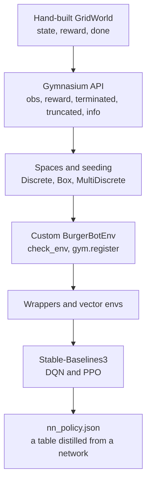

{:class="cover"}

---

By the end of this lesson you will be able to summarise what changed between a hand-built RL loop and the Gymnasium and Stable-Baselines3 workflow, and choose what to learn next.

---

## The journey so far

In [Reinforcement Learning for Beginners](/learn/reinforcement_learning/) you wrote everything yourself: grid, sensor, reward, Q-table and epsilon-greedy loop. In this course you moved those same ideas onto the tools the wider community uses.

What changed, and what did not:

| Piece | Before | After |
| --- | --- | --- |
| Environment call | `state, reward, done = world.step(a)` | `obs, reward, terminated, truncated, info = env.step(a)` |
| Describing the problem | Hard-coded in your agent | `observation_space` and `action_space` |
| Agent | A dictionary of 588 entries | A neural network trained by PPO |
| Ending an episode | One `done` flag | `terminated` and `truncated` |
| Deployment | `q_table.json`, keyed by sensor reading | `nn_policy.json`, keyed by full state |
{:class="table table-single"}

The physics did not change: same grid, obstacles, sensor and rewards. What changed was the interface around them and the algorithm on top.

## Old Gym code cheat sheet

You will meet old tutorials for years. Here is how to bring them up to date:

| Old Gym code | Gymnasium 1.x |
| --- | --- |
| `import gym` | `import gymnasium as gym` |
| `obs = env.reset()` | `obs, info = env.reset(seed=...)` |
| `obs, r, done, info = env.step(a)` | `obs, r, terminated, truncated, info = env.step(a)` |
| `env.seed(42)` | `env.reset(seed=42)` |
| `env.render(mode="human")` | `gym.make(..., render_mode="human")` |
| `info["TimeLimit.truncated"]` | the `truncated` return value |
{:class="table table-single"}

## Concept checklist

Work through these. If one feels shaky, go back to the lesson in brackets.

- [ ] `reset()` returns two values and `step()` returns five (lessons 2 and 3)
- [ ] I can explain `terminated` and `truncated`, and which one stops the bootstrap (3)
- [ ] I can read and create `Discrete`, `Box` and `MultiDiscrete` spaces (4)
- [ ] I can seed an environment, its action space and Python's `random` (6)
- [ ] I can write a `gym.Env` subclass that passes `check_env` (7 and 8)
- [ ] I can register an environment and create it with `gym.make` (9)
- [ ] I can stack wrappers and write a reward-shaping wrapper (10)
- [ ] I know how vector environments auto-reset, and that SB3 uses its own (11)
- [ ] I can train, save, load and evaluate a DQN or PPO agent (12 and 13)
- [ ] I can export a policy table, and say what it can and cannot do on a robot (13)

## What's next

**Other courses on this site**

- [Reinforcement Learning for Beginners](/learn/reinforcement_learning/): the foundation for this course. Re-read the tabular Q-learning lessons if the bootstrap idea still feels fuzzy.
- [Learn ROS](/learn/learn_ros/): the professional robotics stack, where simulated robots can be controlled by the kind of policy you built here.
- [MicroPython Robotics Projects](/learn/micropython_robotics/): build the hardware a policy table could eventually drive.

**Going deeper on RL**

- **Other algorithms in SB3**: `A2C`, `SAC` and `TD3` use the same `model.learn()` call. SAC and TD3 are for continuous actions, such as motor speeds, where DQN cannot be used.
- **Reading the code**: SB3's DQN is plain DQN with a replay buffer and a target network. Variants such as Double DQN and Dueling DQN are not switched on by default.
- **Farama's other libraries**: PettingZoo for multi-agent problems, Minari for recorded datasets, and Gymnasium's own environment pages at [gymnasium.farama.org](https://gymnasium.farama.org/) for more environments to try.
- **Reward design**: the biggest practical lever you have. Revisit the shaping wrapper from lesson 10 and break it on purpose.

## One last thing

The move from a hand-written environment to a Gymnasium class is mostly renaming and restructuring. The concepts (states, actions, rewards, episodes, exploration, exploitation) do not change. The standard API just makes them portable.

The move from a Q-table to a network is the bigger step. The network is harder to inspect and harder to trust. But it scales to problems a table never could, and the table you exported from it is a nice reminder that sometimes the old tool is still the right one.

Good luck building.

## Try it Yourself

1. Pick a different environment from Gymnasium (such as `Acrobot-v1` or `MountainCar-v0`), and train PPO on it with the same few lines you used for CartPole.
2. Change one thing about `BurgerBotEnv`: add a new obstacle, or move the goal. Re-run `check_env`, retrain, and export a new table. How many steps does it need now?
3. Make BurgerBot harder: with a 10% chance, a `forward` action does nothing. Does a PPO agent trained on the old version cope? What does your exported table do?
4. Challenge: write a short README for your environment explaining its spaces, rewards and endings, as if you were publishing it for others.

## Common Issues

- **Problem**: An old tutorial's code fails with `ValueError: too many values to unpack` or `AttributeError` about `reset()`.
- **Solution**: Use the cheat sheet above. The error almost always comes from four versus five return values, or one versus two from `reset()`.
- **Why**: The API changed in the move from Gym to Gymnasium.

- **Problem**: A trained agent works in training but behaves strangely when you test it.
- **Solution**: Evaluate with `deterministic=True`, the same environment settings and a fresh environment, and check that you did not leave a reward-shaping wrapper on.
- **Why**: Exploration noise and wrappers that change rewards or observations both change what the agent experiences.

## Check your understanding


? What replaces `env.seed(42)` in Gymnasium 1.x?
- [ ] `env.set_seed(42)`
- [x] `env.reset(seed=42)`
- [ ] `gym.seed(42)`
> Seeding moved into `reset()`.

? Which pair of values does `reset()` return?
- [ ] `obs, reward`
- [x] `obs, info`
- [ ] `obs, done`
> The cheat sheet shows `obs, info = env.reset(seed=...)`.

? When is it sensible to turn a trained network into a lookup table?
- [ ] Whenever the observation is a camera image
- [x] When the observation space is small and discrete, so every state can be enumerated
- [ ] Never
> We could ask the network about all 588 states, and a camera image has far too many.

? Which Stable-Baselines3 algorithms suit continuous actions such as motor speeds?
- [ ] DQN
- [x] SAC and TD3
- [ ] None of them
> DQN picks from a short list of discrete actions.

