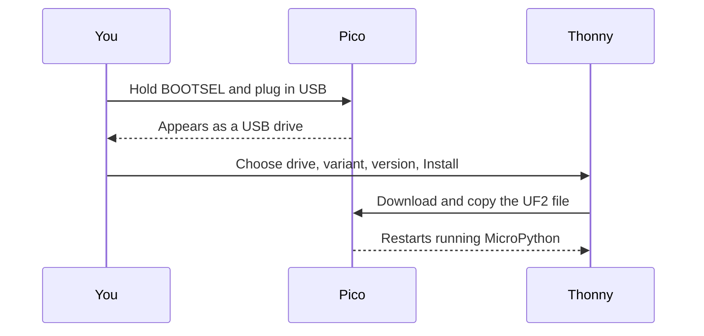

{:class="cover"}

---

By the end of this lesson you will be able to install MicroPython on a Pico using Thonny's built-in installer.

Thonny is a free Python editor that is popular with beginners, and it has a handy tool that downloads the right firmware and copies it to your Pico for you. It is the quickest way to get going, so let's start there. If you would rather use the site's own Snakie IDE, it has a firmware flasher too, covered at the end of this lesson.

## Steps

1. Download and install Thonny from [thonny.org](https://thonny.org), then open it.
2. Hold down the **BOOTSEL** button on your Pico. It is the white button on the board.
3. While still holding it, plug the USB cable into your computer. Then let go of the button.
4. Your Pico is now in **bootloader mode**. It shows up on your computer as a USB drive, called `RPI-RP2` for a Pico or Pico W, or `RP2350` for a Pico 2 or Pico 2 W.
5. In Thonny, open the MicroPython installer. Click the interpreter name at the bottom right of the window and choose the install option, or look for it under **Run** then **Configure interpreter**. The exact wording changes a little between Thonny versions.
6. In the installer, check the **Target volume** is your Pico's drive.
7. Choose your board in the **variant** list. Use the table in the previous lesson to match your board: Pico and Pico H, Pico W and Pico WH, Pico 2, or Pico 2 W.
8. Leave the **version** on the latest release unless you have a reason to use an older one.
9. Click **Install** and wait. Thonny downloads the file, copies it to the Pico, and tells you when it has finished. The drive disappears on its own because the Pico restarts.

After the install, pick the Pico as your interpreter (bottom right of Thonny, a MicroPython option for the Pico) and you should see a `>>>` prompt in the Shell. That prompt is the REPL, and we will use it in a later lesson to prove everything worked.

## Why UF2?

UF2 is a file format designed for copying firmware onto a microcontroller by simply dropping a file onto its USB drive. When Thonny installs MicroPython, it is doing exactly that for you. You can do it yourself, which is the next lesson.

## Using Snakie instead

The Snakie IDE has a **Flash firmware** button in its status bar that does the same job: pick your board, put it in bootloader mode, and click **Download & Flash**. It is covered step by step in [Flashing MicroPython](/learn/snakie_getting_started/07_flashing_micropython.html) in the Getting Started with Snakie course.

> **Teachers**: Installing Thonny normally needs permission to install software, which school computers often block. Ask IT in advance, or use the portable version of Thonny from a USB stick if your school allows it. The firmware download also needs internet access from the learner's computer, so test it on the school network first.

## Try it Yourself

1. Install MicroPython with Thonny, then unplug and replug the Pico. Does the `RPI-RP2` or `RP2350` drive come back? (It should not, unless you hold BOOTSEL.)
2. Open the installer again and look at the **version** list. Which versions are offered, and which is the newest?
3. Challenge: look through the variant list and match each entry to a board in the table from the previous lesson. Which of your classmates' or friends' boards would need a different variant from yours?

## Common Issues

- **Problem**: Thonny does not show a drive to install to.
- **Solution**: Unplug the Pico, hold BOOTSEL, and plug it in again while still holding the button. Let go once it appears as a drive.
- **Why**: The installer can only write to the Pico while it is in bootloader mode, and it only shows up as a drive in that mode.

- **Problem**: Nothing happens when I plug the Pico in.
- **Solution**: Try a different USB cable, ideally one you know carries data.
- **Why**: Some micro USB cables only carry power, so the computer never sees the Pico.

- **Problem**: Thonny says it cannot download the firmware.
- **Solution**: Check your internet connection, or download the UF2 file yourself and use the drag and drop method in the next lesson.
- **Why**: The installer fetches the file from the internet each time.

## Check your understanding


? How do you put a Pico into bootloader mode?
- [ ] Press the RESET button twice
- [x] Hold BOOTSEL while plugging in the USB cable
- [ ] Type a command in Thonny
> Holding BOOTSEL as the Pico powers up makes it appear as a USB drive.

? What is the name of the USB drive for a Pico 2?
- [ ] RPI-RP2
- [x] RP2350
- [ ] PICO
> The original Pico and Pico W show as RPI-RP2. The Pico 2 range shows as RP2350.

? What does the Pico do when the installation finishes?
- [x] Restarts running MicroPython, and the drive disappears
- [ ] Stays in bootloader mode
- [ ] Erases the firmware
> The disappearing drive is how you know it worked.

