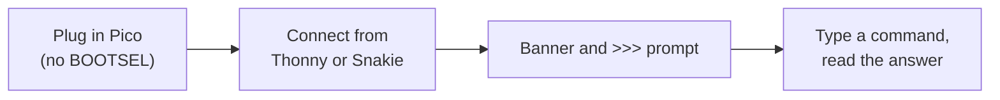

{:class="cover"}

---

By the end of this lesson you will be able to connect to your Pico and use the REPL to confirm which version of MicroPython and which board you are running.

The drive disappeared, which is a good sign. But a proper maker checks. The best test is to talk to MicroPython directly using the **REPL**, which stands for Read, Evaluate, Print, Loop. You type a line, MicroPython runs it and prints the answer, and then waits for the next line. It is like a chat with your robot's brain.

## Connect with Thonny

1. Plug the Pico in normally, without holding BOOTSEL.
2. Open Thonny and choose the MicroPython interpreter for the Pico from the bottom right of the window.
3. Look in the **Shell** panel at the bottom. You should see a line starting with `MicroPython` and then a `>>>` prompt.

## Connect with Snakie

Open the Snakie IDE, connect to your board, and look in the console. The first line shows the same banner. See [Connect, run, stop](/learn/snakie_getting_started/08_connect_run_stop.html) and [The REPL and console](/learn/snakie_getting_started/04_the_repl_and_console.html) in the Getting Started with Snakie course.



## The banner

When you connect, the first line looks like this (your version number, date and board name will differ):

```text
MicroPython v1.29.0 on <build date>; Raspberry Pi Pico 2 W with RP2350
```

It tells you the MicroPython version, then the board and chip the firmware was built for. If the board name there does not match the Pico on your desk, you installed the wrong file, so go back and fix it in the next lesson.

## Ask the board directly

The banner scrolls away as you work. You can ask again any time with a short program. Type this into the REPL, or into the editor and run it:

```python
import sys

print("Python version:", sys.version)
print("Board:", sys.implementation._machine)
print("MicroPython version:", sys.implementation.version)
```

You should see your board name, such as `Raspberry Pi Pico W with RP2040`, and the MicroPython version as a tuple of numbers, such as `(1, 29, 0, '')`. Congratulations, your Pico speaks Python!

> **Teachers**: The REPL banner makes a lovely quick check. Ask each learner to read out the board name from their banner, so you can spot wrong-firmware installs before the rest of the lesson starts.

## Try it Yourself

1. Connect to your Pico and read the banner. Write down the version number and the board name.
2. Type `1 + 1` at the REPL and press Enter. Then try `print("Hello, maker!")`.
3. Challenge: run the program above, and compare `sys.implementation._machine` with the board name printed on the underside of your Pico. Do they match?

## Common Issues

- **Problem**: Thonny says it cannot connect, or shows no `>>>` prompt.
- **Solution**: Check the interpreter at the bottom right, unplug and replug the Pico, and press the Stop button in Thonny.
- **Why**: Thonny needs to select the Pico's serial port, and it can lose it when the board restarts.

- **Problem**: The banner names a different board from mine.
- **Solution**: Reinstall using the right UF2 file for your board.
- **Why**: Firmware is board-specific, so the banner reports what the file was built for.

- **Problem**: Nothing appears in Thonny when I plug in, and the Pico shows as a drive.
- **Solution**: The Pico is still in BOOTSEL mode. Unplug it and plug it in again without holding the button.
- **Why**: In BOOTSEL mode the Pico is a USB drive, not a MicroPython board.

## Check your understanding


? What does REPL stand for?
- [x] Read, Evaluate, Print, Loop
- [ ] Run, Execute, Program, Load
- [ ] Reset, Erase, Program, Load
> You type a line, MicroPython runs it and prints the result, then waits for more.

? What does the first line of the banner tell you?
- [x] The MicroPython version and the board the firmware was built for
- [ ] How much battery is left
- [ ] Which Wi-Fi network you are on
> It is a quick way to check you installed the right firmware.

? Which line prints the board name?
- [ ] `print(sys.version)`
- [x] `print(sys.implementation._machine)`
- [ ] `print(sys.path)`
> `sys.implementation._machine` holds the board and chip name the firmware was built for.

