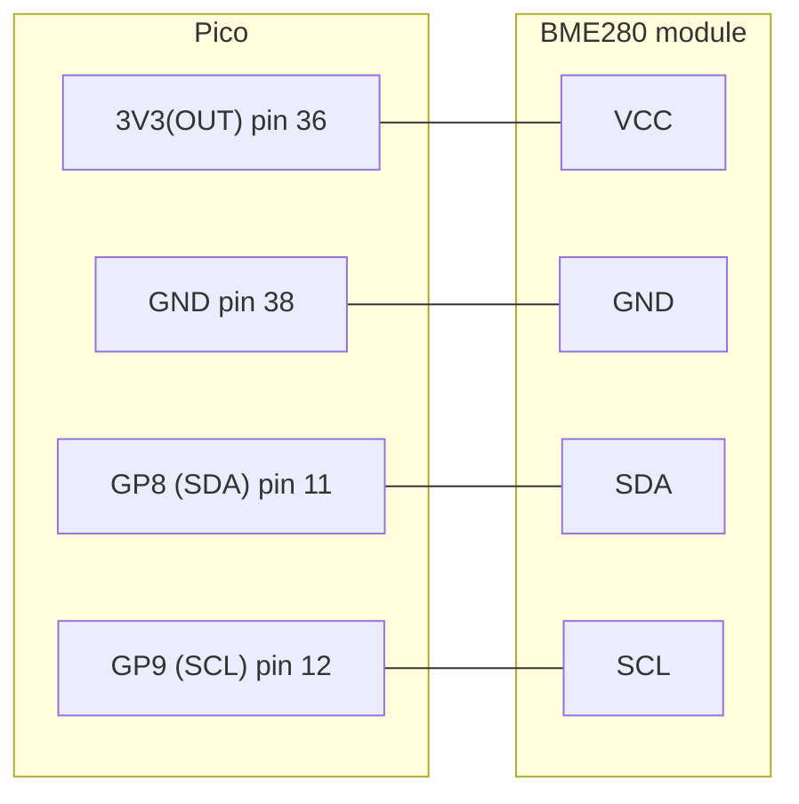

{:class="cover"}

---

By the end of this lesson you will be able to wire a BME280 to the Pico, explain why the bus needs pull-up resistors, and check the wiring with a scan.

## Wiring Your First I2C Device

Now that you understand what I2C is, let's connect a real BME280 sensor to your Raspberry Pi Pico. This lesson covers everything you need to know about physical connections, power requirements, and the mysterious pull-up resistors.

## Understanding the BME280 Sensor

The BME280 is a fantastic sensor that measures:

- **Temperature** - Accurate to 1 degree Celsius
- **Humidity** - Percentage relative humidity
- **Barometric Pressure** - Atmospheric pressure

It communicates via I2C (or SPI), costs just a few dollars, and is perfect for weather stations, environmental monitoring, and learning I2C fundamentals.

> **Note**: BME280 modules come on small breakout boards that handle the complicated stuff (voltage regulation, filtering) so you can focus on learning.

## BME280 Pinout

Most BME280 breakout boards have 4 pins:

| Pin | Name | Description |
|-----|------|-------------|
| VCC | Power | 3.3V from Pico |
| GND | Ground | Common ground |
| SCL | Serial Clock | Connect to Pico GP9 |
| SDA | Serial Data | Connect to Pico GP8 |
{:class="table table-single table-narrow"}

> **Important**: The BME280 chip itself runs from 1.71 V to 3.6 V. Some breakout boards add a regulator so they can be powered from 5 V, but the Pico's GPIO pins are only 3.3 V tolerant, so power the board from the Pico's 3V3(OUT) pin (pin 36). Never connect VBUS (5 V) to a board whose pull-up resistors go to VCC: it would put 5 V on SDA and SCL.

## The Essential Pull-up Resistors

Here's something crucial about I2C: **the SDA and SCL lines need pull-up resistors**. Let me explain why.

### Why Pull-up Resistors Matter

I2C uses "open-drain" outputs. This means:

- Devices can pull the line LOW (to ground)
- Devices can release the line (let it float)
- **Devices cannot pull the line HIGH**

Without pull-up resistors, the lines would float randomly when released. The resistors pull them HIGH so devices only need to pull them LOW. Think of it like gravity - the resistor naturally lifts the line up, and devices pull it down when needed.

### Good News About Pull-ups

Most BME280 breakout boards already have pull-up resistors built in! Look at your board carefully:

- Small surface-mount resistors marked "103" (10 kilohms), "472" (4.7 kilohms) or "502" (5 kilohms) near SDA/SCL
- Sometimes labelled "R1" and "R2"

If your board has these, you don't need to add external resistors. If it doesn't, add a 4.7 kilohm resistor from SDA to 3.3V and another from SCL to 3.3V (10 kilohms is fine at 100 kHz).

The Pico's I2C driver also switches on the RP2040's own internal pull-ups, but those are weak (roughly 50 to 80 kilohms), so a bus that "half works" without proper pull-ups often fails once you raise the speed or add wires. Treat real pull-ups as required.

```python
# You don't need to do anything in code for pull-ups
# They're purely hardware components
# Just know they must be present somewhere in the circuit
```

## Wiring the BME280 to Raspberry Pi Pico

Here's the complete wiring guide:

### Step-by-Step Connections

1. **Power Connection**
   - BME280 VCC → Pico 3.3V (pin 36)
   - BME280 GND → Pico GND (any GND pin)

2. **I2C Connection**
   - BME280 SCL → Pico GP9 (pin 12)
   - BME280 SDA → Pico GP8 (pin 11)

### Wiring table

| BME280 pin | Pico GPIO | Pico physical pin |
|------------|-----------|-------------------|
| VCC | 3V3(OUT) | 36 |
| GND | GND | 38 (or any GND pin) |
| SDA | GP8 | 11 |
| SCL | GP9 | 12 |
{:class="table table-single table-narrow"}



### Colour coding tips

If you're using jumper wires, consider this colour scheme:

- **Red** - Power (VCC to 3.3V)
- **Black** - Ground (GND to GND)
- **Yellow** - SCL (clock)
- **Blue** - SDA (data)

This makes troubleshooting easier and keeps your projects organised.

## Physical Connection Best Practices

### Use a Breadboard

For prototyping, breadboards are perfect. Run 3.3V and GND to the power rails first, then plug the BME280 header into the board and wire SDA and SCL straight across to the Pico.

### Wire Length Matters

- Keep wires **short** - under 10cm if possible
- Longer wires increase capacitance and can cause communication errors
- If you need longer distances, slow the bus to 100 kHz or use a dedicated I2C bus extender chip

### Secure Connections

- Push wires firmly into breadboard holes
- Check that pins are making contact
- Wiggle wires gently - they shouldn't come loose

## Power Considerations

### Voltage Levels

The Raspberry Pi Pico uses 3.3V logic:

- **Safe**: 3.3V devices (like most BME280 boards)
- **Risky**: 5V-only devices (need level shifters)
- **Never**: Higher voltages - will damage your Pico

> **Warning**: Double-check your sensor's voltage requirements. Some sensors marked "5V" actually mean "can be powered by 5V" but use 3.3V logic. Read the datasheet to be sure.

### Power Supply Current

The BME280 uses very little current:

- **Sleep mode**: about 0.1 microamps
- **One reading per second** at the lowest oversampling: about 3.6 microamps on average
- **During a measurement**: roughly 350 microamps for a few milliseconds
- **Pico 3V3(OUT) pin**: suitable for about 300 milliamps in total

This means you can power the BME280 directly from the Pico with no issues.

## Testing Your Wiring

Once everything is connected, let's verify the wiring with a simple test:

```python
from machine import I2C, Pin
import time

# Initialize I2C
i2c = I2C(0, scl=Pin(9), sda=Pin(8), freq=400000)

print("Testing I2C connection...")

# Scan for devices (we'll learn more about this in the next lesson)
devices = i2c.scan()

if devices:
    print(f"Found {len(devices)} device(s)!")
    for device in devices:
        print(f"  - Device at address: 0x{device:02X}")
else:
    print("No devices found - check your wiring")
```

**What you should see:**

```
Testing I2C connection...
If this runs without errors, wiring is likely correct
Found 1 device(s)!
  - Device at address: 0x76
```

or

```
Found 1 device(s)!
  - Device at address: 0x77
```

> **Note**: BME280 sensors usually appear at address 0x76 or 0x77, depending on the manufacturer and whether they've connected the SDO pin to GND or VCC.

## Try It Yourself

Let's build confidence with your wiring:

1. **Wire your BME280** following the guide above
2. **Run the test code** and verify your device appears
3. **Intentionally disconnect SDA** - run the code again. You should see "No devices found"
4. **Reconnect SDA** - devices should reappear
5. **Try different GPIO pins** - modify the code to use GP4 (SDA) and GP5 (SCL), rewire accordingly

```python
# Using alternate pins
i2c = I2C(0, scl=Pin(5), sda=Pin(4), freq=400000)
devices = i2c.scan()
print(f"Devices on alternate pins: {devices}")
```

## Wiring Checklists

### No Devices Found

**Problem**: Test code shows "No devices found"

**Possible causes**:
1. SDA or SCL wires not connected properly
2. Power not connected (VCC or GND loose)
3. Wrong pins in code vs physical wiring
4. Faulty sensor or breadboard connection

**Solution checklist**:
- [ ] Verify VCC connected to 3.3V pin
- [ ] Verify GND connected to GND pin
- [ ] Check SDA on GP8
- [ ] Check SCL on GP9
- [ ] Push all connections firmly
- [ ] Try different breadboard holes

### OSError or Bus Error

**Possible causes**:
1. Missing pull-up resistors
2. Short circuit between SDA and SCL
3. Sensor damaged

**Solutions**:
- Check that your BME280 board has pull-up resistors
- Ensure SDA and SCL wires aren't touching
- Try a different sensor if available

### Wrong Address

**This is usually fine!** BME280 sensors can appear at either 0x76 or 0x77. Make note of your sensor's address - you'll need it for the next lesson.

```python
# If your sensor is at 0x76 instead of 0x77, just use that
BME280_ADDRESS = 0x76  # or 0x77
```

## Multiple I2C Devices

One of I2C's superpowers is connecting multiple devices to the same bus. Here's how:

### Wiring Multiple Devices

All devices share the same SDA and SCL lines:

```
Pico GP8 (SDA) ──┬── Device 1 SDA
                 ├── Device 2 SDA
                 └── Device 3 SDA

Pico GP9 (SCL) ──┬── Device 1 SCL
                 ├── Device 2 SCL
                 └── Device 3 SCL

Pico 3.3V ───────┬── Device 1 VCC
                 ├── Device 2 VCC
                 └── Device 3 VCC

Pico GND ────────┬── Device 1 GND
                 ├── Device 2 GND
                 └── Device 3 GND
```

Each device gets its own power and ground, but they share the communication lines.

> **Remember**: Each device needs a unique address. You can't have two BME280s at 0x76 on the same bus.

## Common Issues

- **Problem**: The scan prints "No devices found"
- **Solution**: Check VCC, GND, SDA and SCL one wire at a time, and make sure SDA is on GP8 and SCL on GP9 to match the code
- **Why**: A single loose or swapped wire looks exactly the same to the Pico as no sensor at all

- **Problem**: The scan finds a device, but at 0x77 and not 0x76 (or the other way round)
- **Solution**: Use the address the scan reports; do not change the sensor
- **Why**: The BME280 has two valid addresses, chosen by the level on its SDO pin

- **Problem**: `OSError: [Errno 5] EIO` or `[Errno 110] ETIMEDOUT`
- **Solution**: Check for a short between SDA and SCL, and for missing pull-up resistors
- **Why**: The Pico cannot get an acknowledgement from the device, so the bus transaction fails

## Check your understanding


? Why do SDA and SCL need pull-up resistors?
- [ ] To make the clock run faster
- [x] Devices can only pull the lines low, so resistors pull them high when released
- [ ] To protect the sensor from static
> I2C uses open-drain outputs: devices pull a line down, and the resistor lifts it back up.

? Which Pico pin should power a BME280 breakout?
- [ ] VBUS (5 V)
- [x] 3V3(OUT), pin 36
- [ ] Any GPIO pin
> The Pico's GPIO pins are 3.3 V, so power the sensor from 3.3 V as well.

? Where do GP8 (SDA) and GP9 (SCL) sit on the Pico's header?
- [ ] Pins 36 and 38
- [x] Pins 11 and 12
- [ ] Pins 1 and 2
> The wiring table in this lesson lists the physical pin numbers.


> **Teachers**: Breakout boards differ, so have learners check the silkscreen for the VCC voltage before connecting power. A module wired the wrong way round can fail in seconds, so a quick wiring check by a second pair of eyes before plugging in the USB cable saves modules. Keep a couple of spare BME280 boards in the class set.

## What You've Learned

In this lesson, you mastered:

- BME280 pinout and pin functions (VCC, GND, SCL, SDA)
- Why I2C needs pull-up resistors and how to identify them
- Proper wiring from BME280 to Raspberry Pi Pico
- Best practices for breadboarding and wire management
- Power requirements and voltage levels
- Testing connections with scanning code
- Troubleshooting common wiring problems
- How to connect multiple I2C devices

Your BME280 is now physically connected and ready to communicate. You've verified it appears on the I2C bus with the test code.

## What's Next

Now that your sensor is wired and responding, let's learn how to scan the I2C bus systematically, understand device addresses, and why that "0x" notation keeps appearing. In the next lesson, we'll explore I2C scanning in detail and prepare to read actual sensor data.
