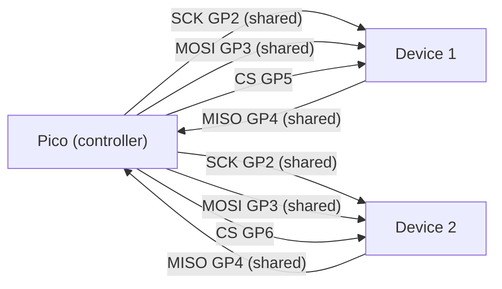

{:class="cover"}

---

By the end of this lesson you will be able to name the four SPI signals, wire them to the right Pico pins, and set the SPI mode (polarity and phase) in MicroPython.

## Understanding SPI

SPI (Serial Peripheral Interface) is another communication protocol for connecting microcontrollers to sensors, displays, and other devices. While I2C uses two wires and addresses, SPI uses more wires but is significantly faster. Let's explore how it works and when to choose it over I2C.

## How SPI Works

Think of SPI like a teacher calling on students. I2C is like shouting a student's name across the classroom (addressing), while SPI is like tapping them directly on the shoulder (chip select). More physical contact, but instant and unambiguous.

### The Four-Wire System

SPI uses four main signals:

1. **SCLK (Serial Clock)** - Clock signal from controller
2. **MOSI (Master Out, Slave In)** - Data from controller to peripheral
3. **MISO (Master In, Slave Out)** - Data from peripheral to controller
4. **CS (Chip Select)** - Selects which device to talk to

> **Note**: Modern terminology is replacing "Master/Slave" with "Controller/Peripheral", so you might see MOSI/MISO called COPI (Controller Out, Peripheral In) and CIPO (Controller In, Peripheral Out).

### SPI Signal Names

You'll encounter various names for the same signals:

| Function | Common Names |
|----------|--------------|
| Clock | SCLK, SCK, CLK |
| Data Out | MOSI, SDO, DO, COPI |
| Data In | MISO, SDI, DI, CIPO |
| Chip Select | CS, SS, CE, nCS |
{:class="table table-single table-narrow"}

They all refer to the same four signals - just different naming conventions from different manufacturers.

## SPI Communication Flow

Here's how SPI communication works:

1. **Controller activates CS** - Pulls chip select line LOW for target device
2. **Controller generates clock** - SCLK pulses for each data bit
3. **Data flows both ways simultaneously** - MOSI sends data out, MISO receives data in
4. **Controller deactivates CS** - Pulls chip select HIGH when done

```python
# Conceptual flow (MicroPython handles this automatically)
cs.value(0)             # Select device
spi.write(b'data')      # Send data
response = spi.read(1)  # Receive 1 byte
cs.value(1)             # Deselect device
```
{: .no-snakie }

Here is the bus with two devices. The clock and both data lines are shared, and each device has its own chip select:



## SPI on Raspberry Pi Pico

The Pico has two SPI buses (SPI0 and SPI1), each with flexible pin assignments:

### SPI0 Pins
- **SCLK**: GP2, GP6, GP18
- **MOSI**: GP3, GP7, GP19
- **MISO**: GP0, GP4, GP16
- **CS**: Any GPIO (software controlled)

### SPI1 Pins
- **SCLK**: GP10, GP14
- **MOSI**: GP11, GP15
- **MISO**: GP8, GP12
- **CS**: Any GPIO (software controlled)

**Typical SPI0 setup**:
```python
from machine import Pin, SPI

spi = SPI(0,
          baudrate=1000000,  # 1 MHz
          polarity=0,
          phase=0,
          sck=Pin(2),
          mosi=Pin(3),
          miso=Pin(4))

cs = Pin(5, Pin.OUT)
cs.value(1)  # Start deselected (HIGH)
```

## Basic SPI Example

Let's initialize SPI and communicate with a simple device:

```python
from machine import Pin, SPI
import time

# Initialize SPI
spi = SPI(0,
          baudrate=1000000,   # 1 MHz clock speed
          polarity=0,         # Clock idle state LOW
          phase=0,            # Sample on first edge
          sck=Pin(2),         # Clock on GP2
          mosi=Pin(3),        # Data out on GP3
          miso=Pin(4))        # Data in on GP4

# Chip select on GP5
cs = Pin(5, Pin.OUT)
cs.value(1)  # Deselected (HIGH is inactive)

print("SPI initialized")
print(f"Configuration: {spi}")

# Example: Send command to device
def spi_write_read(data):
    """Write data and read response"""
    cs.value(0)                    # Select device
    time.sleep_us(1)               # Small delay for device setup
    reply = bytearray(len(data))   # Somewhere to put the bytes that come back
    spi.write_readinto(data, reply)  # Send and receive at the same time
    time.sleep_us(1)               # Small delay before deselect
    cs.value(1)                    # Deselect device
    return reply

# Send a command byte
command = bytearray([0x00])
reply = spi_write_read(command)
print("Command sent via SPI, reply:", reply)
```

## SPI Clock Polarity and Phase

SPI has four modes defined by two parameters:

### Clock Polarity (CPOL)
- **0**: Clock idle state is LOW
- **1**: Clock idle state is HIGH

### Clock Phase (CPHA)
- **0**: Sample data on first (leading) clock edge
- **1**: Sample data on second (trailing) clock edge

### Four SPI Modes

| Mode | CPOL | CPHA | Description |
|------|------|------|-------------|
| 0 | 0 | 0 | Clock LOW when idle, sample on rising edge |
| 1 | 0 | 1 | Clock LOW when idle, sample on falling edge |
| 2 | 1 | 0 | Clock HIGH when idle, sample on falling edge |
| 3 | 1 | 1 | Clock HIGH when idle, sample on rising edge |
{:class="table table-single table-narrow"}

**Most devices use Mode 0 or Mode 3**. Check the datasheet!

```python
# Mode 0 (most common)
spi = SPI(0, baudrate=1000000, polarity=0, phase=0, sck=Pin(2), mosi=Pin(3), miso=Pin(4))

# Mode 3 (also common)
spi = SPI(0, baudrate=1000000, polarity=1, phase=1, sck=Pin(2), mosi=Pin(3), miso=Pin(4))
```

## SPI Speed

SPI can run much faster than I2C:

| Protocol | Typical Speed | Maximum Speed |
|----------|---------------|---------------|
| I2C | 100-400 kHz | 3.4 MHz |
| SPI | 1-10 MHz | 60+ MHz |
{:class="table table-single table-narrow"}

<!-- code-check: skip -->
```python
# Slow - for testing and compatibility
spi = SPI(0, baudrate=100000, ...)   # 100 kHz

# Medium - good for sensors
spi = SPI(0, baudrate=1000000, ...)  # 1 MHz

# Fast - for displays and memory
spi = SPI(0, baudrate=10000000, ...) # 10 MHz

# Very fast - the Pico's hardware can reach 62.5 MHz, but jumper wires
# on a breadboard are only reliable up to a few MHz
spi = SPI(0, baudrate=62500000, ...) # 62.5 MHz
```
{: .no-snakie }

> **Tip**: Start with 1 MHz and increase speed once everything works. Some sensors have maximum speed limits.

## Multiple SPI Devices

Unlike I2C's addressing system, SPI uses physical chip select lines:

```python
from machine import Pin, SPI

# One SPI bus
spi = SPI(0, baudrate=1000000, sck=Pin(2), mosi=Pin(3), miso=Pin(4))

# Separate CS for each device
cs_sensor = Pin(5, Pin.OUT)
cs_display = Pin(6, Pin.OUT)
cs_memory = Pin(7, Pin.OUT)

# Start with all deselected
cs_sensor.value(1)
cs_display.value(1)
cs_memory.value(1)

# Talk to sensor
cs_sensor.value(0)
spi.write(b'\x00')  # Send command
cs_sensor.value(1)

# Talk to display
cs_display.value(0)
spi.write(b'\xFF')  # Send command
cs_display.value(1)

# Talk to memory
cs_memory.value(0)
spi.write(b'\x20')  # Send command
cs_memory.value(1)
```

**Key point**: All devices share SCLK, MOSI, and MISO. Only CS is unique per device.

## SPI vs I2C Comparison

| Feature | I2C | SPI |
|---------|-----|-----|
| Wires | 2 (SDA, SCL) | 4+ (SCLK, MOSI, MISO, CS per device) |
| Speed | 100-400 kHz (typically) | 1-60 MHz |
| Device selection | Address (0x76, etc.) | Chip select pin |
| Max devices | 127 (theoretical) | Limited by available CS pins |
| Full duplex | No | Yes (send and receive simultaneously) |
| Complexity | Simpler wiring | More wires |
| Power | Depends on the chip's sleep modes | Faster clocking uses a little more |
| Distance | ~1 meter | ~10 cm (very short) |
{:class="table table-single table-narrow"}

## When to Use SPI

Choose SPI when you need:

**Speed**
- High-resolution displays (TFT, LCD)
- SD cards and flash memory
- Fast sensors (high sample rate)
- DMA (Direct Memory Access) transfers

**Full-duplex communication**
- Radio modules (sending and receiving simultaneously)
- Fast real-time control

**Simplicity in addressing**
- Only a few devices
- Don't want to deal with address conflicts

## When to Use I2C

Choose I2C when you need:

**Many devices**
- Sensor networks
- Multiple accessories on same bus
- Limited GPIO pins

**Sensors spread across a robot**
- Two wires are easier to run to several places
- Slow the bus to 100 kHz for longer runs

**Low-speed battery projects**
- Many I2C sensors have sleep modes
- Fewer pins to drive

**Simplicity in wiring**
- Just two wires for everything
- Easy to add devices

## Real-World SPI Example - Reading a Register

Here's a typical pattern for reading from an SPI sensor:

```python
from machine import Pin, SPI
import time

# Setup
spi = SPI(0, baudrate=1000000, polarity=0, phase=0,
          sck=Pin(2), mosi=Pin(3), miso=Pin(4))
cs = Pin(5, Pin.OUT)
cs.value(1)

def read_register(address):
    """Read a single register from SPI device"""
    # Most SPI devices use bit 7 to indicate read (1) vs write (0)
    read_cmd = address | 0x80  # Set bit 7 for read

    # Prepare buffers
    tx_buf = bytearray([read_cmd, 0x00])  # Command + dummy byte
    rx_buf = bytearray(2)                  # Receive buffer

    # Transfer
    cs.value(0)
    spi.write_readinto(tx_buf, rx_buf)
    cs.value(1)

    # Return data byte (second byte received)
    return rx_buf[1]

# Example: Read WHO_AM_I register at 0x0F
device_id = read_register(0x0F)
print(f"Device ID: 0x{device_id:02X}")
```

## Try It Yourself

Experiment with SPI initialization:

1. **Initialize SPI at different speeds**:

```python
from machine import Pin, SPI

speeds = [100000, 500000, 1000000, 5000000, 10000000]

for speed in speeds:
    spi = SPI(0, baudrate=speed, sck=Pin(2), mosi=Pin(3), miso=Pin(4))
    print(f"SPI at {speed/1000000:.1f} MHz: {spi}")
```

2. **Try different SPI modes**:

```python
for mode in range(4):
    polarity = mode >> 1    # Bit 1 of mode
    phase = mode & 1        # Bit 0 of mode
    spi = SPI(0, baudrate=1000000, polarity=polarity, phase=phase,
              sck=Pin(2), mosi=Pin(3), miso=Pin(4))
    print(f"Mode {mode} (CPOL={polarity}, CPHA={phase}): {spi}")
```

3. **Create a helper class**:

```python
class SPIDevice:
    """Helper class for SPI device with chip select"""
    def __init__(self, spi, cs_pin):
        self.spi = spi
        self.cs = Pin(cs_pin, Pin.OUT)
        self.cs.value(1)  # Deselected

    def write(self, data):
        """Write data to device"""
        self.cs.value(0)
        self.spi.write(data)
        self.cs.value(1)

    def read(self, num_bytes):
        """Read data from device"""
        buf = bytearray(num_bytes)
        self.cs.value(0)
        self.spi.readinto(buf)
        self.cs.value(1)
        return buf

# Use it
spi = SPI(0, baudrate=1000000, sck=Pin(2), mosi=Pin(3), miso=Pin(4))
device = SPIDevice(spi, cs_pin=5)
device.write(b'\x00')  # Automatically handles CS
```

## Common Issues

- **Problem**: The device does not respond, or you read all 0x00 or all 0xFF
- **Solution**: Check the wiring (MOSI to the device's data-in, MISO to its data-out), then try mode 0 and mode 3, and drop the speed to 100 kHz while testing
- **Why**: A device sampling on the wrong clock edge sees garbage, and a floating MISO line reads as all ones or all zeros

- **Problem**: The reply is shifted by one byte, or the data byte is missing
- **Solution**: Send the command plus a dummy byte and keep the second byte received:

```python
tx_buf = bytearray([0x8F, 0x00, 0x00])  # command, then dummy bytes to clock data in
rx_buf = bytearray(3)
spi.write_readinto(tx_buf, rx_buf)
data = rx_buf[1:]  # the first byte is whatever the device sent while receiving the command
```
{: .no-snakie }

- **Why**: SPI is full-duplex, so the device can only send while the controller is clocking, and it cannot reply to the byte it is still receiving

- **Problem**: `ValueError: bad SCK pin` (or MOSI or MISO)
- **Solution**: Use pins from the SPI0 or SPI1 list in this lesson, with all three on the same bus
- **Why**: Hardware SPI is built into fixed pins on the RP2040

## Check your understanding


? How does the controller choose which SPI device to talk to?
- [ ] By its address
- [x] By pulling that device's chip select line low
- [ ] By the order of the wires
> I2C uses addresses; SPI uses a chip select wire for each device.

? Which SPI mode has the clock idle low and samples on the rising edge?
- [x] Mode 0 (polarity 0, phase 0)
- [ ] Mode 1 (polarity 0, phase 1)
- [ ] Mode 2 (polarity 1, phase 0)
> Polarity 0 means the clock idles low, and phase 0 means data is sampled on the first (rising) edge.

? Which Pico pins can be SPI0 SCK?
- [ ] GP0, GP4 or GP16
- [x] GP2, GP6 or GP18
- [ ] Any GPIO
> GP0, GP4 and GP16 are the SPI0 MISO choices. Only chip select can be any GPIO.


## What You've Learned

In this lesson, you mastered:

- SPI uses four signals: SCLK, MOSI, MISO, CS
- SPI is faster than I2C (1-60 MHz vs 100-400 kHz)
- Devices are selected with chip select, not addresses
- SPI modes (polarity and phase) must match device requirements
- Multiple devices share bus but have unique CS pins
- When to choose SPI vs I2C for your projects

You now understand the fundamental differences between I2C and SPI. SPI trades simplicity for speed - more wires, but much faster communication.

## What's Next

Theory is great, but let's wire up a real SPI device! In the next lesson, we'll connect an SPI sensor or display to your Pico, covering proper wiring, timing, and troubleshooting.
