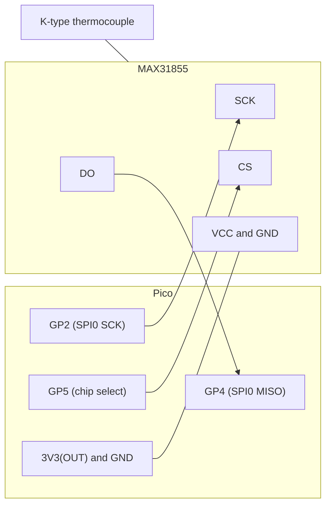

{:class="cover"}

---

By the end of this lesson you will be able to wire an SPI device to the Pico, read its pinout, and test the connection by reading data from it.

## Wiring Your First SPI Device

SPI requires more physical connections than I2C, but the wiring is straightforward once you understand the signal flow. This lesson covers connecting SPI devices to your Raspberry Pi Pico, focusing on practical examples and common pitfalls.

## Understanding SPI Connections

Every SPI device needs:

1. **Power** (VCC/VDD and GND)
2. **Clock** (SCLK/SCK) - Shared timing signal
3. **Data Out from Controller** (MOSI) - Pico sends data
4. **Data In to Controller** (MISO) - Pico receives data
5. **Chip Select** (CS) - Unique per device

> **Important**: Unlike I2C, SPI devices don't have addresses. Each device needs its own chip select pin.

## Example: MAX31855 Thermocouple Amplifier

The MAX31855 is a great SPI learning device - it reads thermocouple temperature sensors and communicates via SPI. Many modules are available on breakout boards.

### MAX31855 Pinout

Typical breakout board pins:

| Pin | Name | Description |
|-----|------|-------------|
| VCC | Power | 3.0-3.6V (3.3V from Pico) |
| GND | Ground | Common ground |
| SCK | Clock | SPI clock input |
| DO | Data Out | SPI MISO (data to Pico) |
| CS | Chip Select | Active LOW chip select |
{:class="table table-single table-narrow"}

> **Note**: Some modules might have "SO" (Serial Out) instead of "DO" - it's the same signal (connects to MISO).

## Wiring MAX31855 to Raspberry Pi Pico

Here's the complete connection guide:

### Step-by-Step Connections

1. **Power**
   - MAX31855 VCC → Pico 3.3V (pin 36)
   - MAX31855 GND → Pico GND (pin 38 or any GND)

2. **SPI Signals**
   - MAX31855 SCK → Pico GP2 (pin 4) - SPI0 SCK
   - MAX31855 DO → Pico GP4 (pin 6) - SPI0 MISO
   - MAX31855 CS → Pico GP5 (pin 7) - Any GPIO

3. **No MOSI connection needed!**
   - MAX31855 only sends data, doesn't receive
   - MOSI pin (GP3) remains unconnected

### Wiring table

| MAX31855 pin | Pico GPIO | Pico physical pin | SPI role |
|--------------|-----------|-------------------|----------|
| VCC | 3V3(OUT) | 36 | Power |
| GND | GND | 38 | Ground |
| SCK | GP2 | 4 | SPI0 SCK |
| DO | GP4 | 6 | SPI0 MISO (RX) |
| CS | GP5 | 7 | Chip select (any GPIO) |
{:class="table table-single table-narrow"}



The thermocouple goes into the screw terminals on the breakout board. The board marks one terminal + and the other -, and so does the thermocouple's datasheet or packaging. Connect them the right way round, because swapped leads make the reading fall when the tip is heated.

## Alternative SPI Device: SPI OLED Display

Let's also cover a more complex device - an SPI OLED display (like SSD1306 or SH1106):

### SPI OLED Pinout

| Pin      | Name         | Description               |
|----------|--------------|---------------------------|
| GND      | Ground       | Common ground             |
| VCC      | Power        | 3.3V or 5V (check module) |
| SCK      | Clock        | SPI clock                 |
| SDA/MOSI | Data         | SPI data in (MOSI)        |
| RES/RST  | Reset        | Display reset (GPIO)      |
| DC       | Data/Command | Register select (GPIO)    |
| CS       | Chip Select  | SPI chip select (GPIO)    |
{:class="table table-single table-narrow"}

### Wiring SPI OLED to Pico

```
OLED      →    Pico
GND       →    GND (pin 38)
VCC       →    3.3V (pin 36)
SCK       →    GP2 (pin 4) - SPI0 SCK
SDA/MOSI  →    GP3 (pin 5) - SPI0 MOSI
RES/RST   →    GP6 (pin 9) - Any GPIO
DC        →    GP7 (pin 10) - Any GPIO
CS        →    GP8 (pin 11) - Any GPIO
```

> **Important**: Unlike simple sensors, displays need extra control pins (RST and DC) to manage display operations. These are regular GPIO, not special SPI signals.

## Testing Your SPI Wiring

Once connected, verify with this test code:

### MAX31855 Test Code

```python
from machine import Pin, SPI
import time

# Initialize SPI
spi = SPI(0,
          baudrate=1000000,   # 1 MHz (MAX31855 supports up to 5 MHz)
          polarity=0,
          phase=0,
          sck=Pin(2),
          mosi=Pin(3),        # Not used but must be specified
          miso=Pin(4))

# Chip select
cs = Pin(5, Pin.OUT)
cs.value(1)  # Start deselected

print("Testing MAX31855 connection...")

# Read 4 bytes from MAX31855
def read_temperature():
    """Read temperature from MAX31855"""
    cs.value(0)              # Select device
    time.sleep_us(1)         # Small delay
    data = bytearray(4)      # MAX31855 sends 32 bits
    spi.readinto(data)       # Read data
    cs.value(1)              # Deselect device

    # Combine bytes into 32-bit value
    raw_value = (data[0] << 24) | (data[1] << 16) | (data[2] << 8) | data[3]

    # Check for errors (bit 16)
    if raw_value & 0x00010000:
        print("[WARNING] Thermocouple error detected")
        return None

    # Extract temperature (bits 31:18, signed 14-bit value)
    temp_raw = (raw_value >> 18) & 0x3FFF

    # Check sign bit (bit 13)
    if temp_raw & 0x2000:
        temp_raw = -((~temp_raw & 0x3FFF) + 1)  # Two's complement

    # Convert to Celsius (0.25°C per LSB)
    temperature = temp_raw * 0.25

    return temperature

# Test reading
temp = read_temperature()

if temp is not None:
    print(f"[OK] Temperature: {temp:.2f}°C ({temp*9/5+32:.2f}°F)")
    print("SPI connection working!")
else:
    print("[FAIL] Check wiring and thermocouple connection")
```

**Expected output**:

```
Testing MAX31855 connection...
[OK] Temperature: 22.50°C (72.50°F)
SPI connection working!
```

If you see this, your SPI wiring is correct!

## Wiring Mistakes to Look For

### MOSI and MISO Swapped

**Problem**: Device doesn't respond or returns garbage

**Symptom**: All zeros, all 0xFF, or random data

**Solution**:
```python
# Check connections:
# Pico MOSI (GP3) → Device MOSI/SDI/DI (data IN to device)
# Pico MISO (GP4) → Device MISO/SDO/DO (data OUT from device)

# If you swapped them, move the jumper wires, not the code.
# Hardware SPI0 only accepts GP3 as MOSI and GP4 as MISO (in this setup),
# so SPI(0, mosi=Pin(4), miso=Pin(3)) raises ValueError: bad MOSI pin.
```

### Chip Select Logic Inverted

**Problem**: Device doesn't respond

**Symptom**: No data or timeout errors

**Cause**: CS is active-LOW on almost every device: you pull it low to select and release it high when done. If the code forgets to do this (or the CS wire is on the wrong pin), the device never listens

**Solution**:
```python
cs.value(0)   # select: LOW
# ... transfer ...
cs.value(1)   # deselect: HIGH, which ends the transaction
```
{: .no-snakie }

### Clock Speed Too Fast

**Problem**: Intermittent errors or wrong data

**Solution**: Reduce SPI speed

<!-- code-check: skip -->
```python
# Start slow
spi = SPI(0, baudrate=100000, ...)  # 100 kHz

# Once working, increase gradually
spi = SPI(0, baudrate=1000000, ...)  # 1 MHz
```
{: .no-snakie }

### Wrong SPI Mode

**Problem**: Constant wrong data or no response

**Solution**: Try different modes

<!-- code-check: skip -->
```python
# Mode 0 (most common)
spi = SPI(0, baudrate=1000000, polarity=0, phase=0, ...)

# Mode 1
spi = SPI(0, baudrate=1000000, polarity=0, phase=1, ...)

# Mode 2
spi = SPI(0, baudrate=1000000, polarity=1, phase=0, ...)

# Mode 3
spi = SPI(0, baudrate=1000000, polarity=1, phase=1, ...)
```
{: .no-snakie }

## Multiple SPI Devices

Wire multiple devices to the same bus:

```python
from machine import Pin, SPI

# Shared SPI bus
spi = SPI(0, baudrate=1000000, sck=Pin(2), mosi=Pin(3), miso=Pin(4))

# Unique CS for each device
cs_sensor = Pin(5, Pin.OUT)
cs_display = Pin(6, Pin.OUT)
cs_memory = Pin(7, Pin.OUT)

# Deselect all
cs_sensor.value(1)
cs_display.value(1)
cs_memory.value(1)

# Talk to sensor
cs_sensor.value(0)
sensor_data = spi.read(4)
cs_sensor.value(1)
print(f"Sensor: {sensor_data}")

# Talk to display
cs_display.value(0)
spi.write(b'\xFF\x00')  # Send command
cs_display.value(1)

# Talk to memory
cs_memory.value(0)
memory_data = spi.read(256)
cs_memory.value(1)
print(f"Memory: {len(memory_data)} bytes read")
```

**Key points**:
- All devices share SCK, MOSI, MISO
- Each device has unique CS pin
- Only one CS active (LOW) at a time
- Different devices can use different speeds/modes (reconfigure SPI between devices)

## Wire Length and Signal Integrity

SPI is fast but sensitive to wire length:

### Best Practices

**Keep wires short**:
- Under 10cm (4 inches) for reliable operation
- Under 5cm for speeds above 10 MHz
- Use breadboards for prototyping, PCBs for final projects

**Avoid long jumper wires**:
- Don't use 30cm jumpers for SPI
- Signals degrade with length
- Crosstalk increases with parallel wires

**Use ground reference**:
- Run ground wire alongside SPI signals
- Provides return path for high-frequency signals
- Reduces noise and interference

## Power Supply Considerations

### Voltage Levels

Ensure compatibility:

```python
# Check device datasheet
# MAX31855: 3.0-3.6V (safe with Pico's 3.3V)
# SPI OLED: check the module; many have a regulator and accept 3.3V or 5V,
#           but the data pins must still be 3.3V logic
# SD Cards: 3.3V only

# If device is 5V only, use level shifter
```

### Current Requirements

Most SPI sensors use minimal current:
- MAX31855: 1.5 mA
- Small OLED: 20-30 mA
- SD card: 100-200 mA

The Pico's 3V3(OUT) pin is suitable for about 300 mA in total, which is enough for the sensor and a small OLED. An SD card can briefly draw more, so keep an eye on the total.

## Try It Yourself

Practice SPI wiring skills:

1. **Wire your SPI device** following the guide

2. **Run the test code** to verify connections

3. **Intentionally disconnect MISO** - What happens?

```python
# With MISO disconnected, you'll read all 0x00 or 0xFF
```

4. **Swap MOSI and MISO** - Does it work? (It shouldn't!)

5. **Try different CS pins**:

```python
# Move CS wire to GP6 and update code
cs = Pin(6, Pin.OUT)
# Should work the same
```

6. **Challenge**: Create a wiring checker:

```python
from machine import Pin, SPI

def check_spi_wiring():
    """Verify SPI is initialized correctly"""
    try:
        spi = SPI(0, baudrate=1000000, sck=Pin(2), mosi=Pin(3), miso=Pin(4))
        cs = Pin(5, Pin.OUT)

        print("[OK] SPI initialized")
        print("[OK] CS pin configured")

        # Try simple read
        cs.value(0)
        data = spi.read(1)
        cs.value(1)

        print(f"[OK] Read test: 0x{data[0]:02X}")
        print("\nWiring appears correct!")

    except Exception as e:
        print(f"[FAIL] Error: {e}")
        print("Check your connections")

check_spi_wiring()
```

## Common Issues

- **Problem**: Every reading is 0 or 0xFFFFFFFF
- **Solution**: Check that DO goes to GP4 (MISO), SCK to GP2, CS to GP5, and that VCC and GND are connected
- **Why**: With the data line unplugged the MISO pin floats, which reads as all zeros or all ones

- **Problem**: The error "Thermocouple fault" or an open-circuit reading
- **Solution**: Push the thermocouple wires firmly into the screw terminals and check for a break in the wire
- **Why**: The MAX31855 sets its fault bit when the thermocouple is open or shorted

- **Problem**: Readings that jump around at higher speeds
- **Solution**: Lower `baudrate` to 1 MHz or less and shorten the wires
- **Why**: Long jumper wires pick up noise and smear fast clock edges

## Check your understanding


? Why does the MAX31855 wiring not need a MOSI connection?
- [ ] MOSI is only used by SD cards
- [x] The chip only sends data to the Pico, so nothing needs to go the other way
> The MAX31855 only has an output (DO), so only the clock, MISO and chip select are wired.

? Which Pico pins are used for the SPI0 wiring in this lesson?
- [ ] GP8 and GP9
- [x] GP2 (SCK), GP4 (MISO) and GP5 (CS)
- [ ] GP10 and GP11
> GP8 and GP9 were the I2C pins; this lesson uses SPI0.

? How many chip select wires do three SPI devices on one bus need?
- [ ] One shared one
- [x] Three, one per device
- [ ] None, they use addresses
> The clock, MOSI and MISO are shared, but each device needs its own CS.


> **Teachers**: A thermocouple tip can be very hot, and even a lit candle or soldering iron is enough to give a reading, so agree safe heat sources (a mug of warm water, a hairdryer on low) before learners start. The MAX31855 board and probe are the costliest items in the course, so one set per group is realistic. With no hardware, learners can read the bit layout in the next lesson and decode a sample 32-bit value by hand.

## What You've Learned

In this lesson, you mastered:

- SPI device pinouts and signal identification
- Proper wiring from Raspberry Pi Pico to SPI devices
- Understanding MOSI, MISO, SCLK, and CS connections
- Testing SPI connections with real code
- Common wiring mistakes and how to fix them
- Connecting multiple SPI devices to one bus
- Wire length considerations for signal integrity
- Power supply requirements and current limits

Your SPI device is now physically connected and tested. You've verified communication works and understand the signal flow.

## What's Next

With hardware wired and tested, let's dive into a complete SPI sensor example. In the next lesson, we'll read data continuously, handle errors gracefully, and build a practical temperature monitoring system with the MAX31855.
