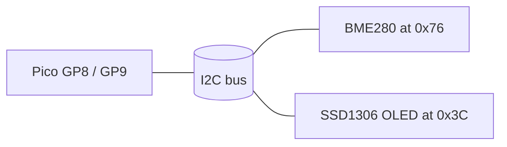

{:class="cover"}

---

By the end of this lesson you will be able to build a complete monitoring station that reads a BME280, shows the values on an OLED, and logs them to a file, all on one I2C bus.

## Your Capstone Project

Congratulations! You've mastered I2C and SPI communication. Now let's combine everything into a practical, working environmental monitoring station. This project demonstrates real-world application of the skills you've learned.

## Project Overview

**What we're building**:
A complete environmental monitoring system that:

- Reads temperature, humidity, and pressure from BME280 (I2C)
- Displays current readings on OLED display (I2C)
- Logs data to a CSV file for analysis
- Alerts when readings go outside safe ranges
- Keeps running when a single reading fails

**Skills demonstrated**:
- I2C multi-device communication
- Sensor data acquisition
- Data processing and filtering
- File I/O and logging
- Display updates
- Error handling
- System architecture

## Hardware Requirements

### Essential Components

- **Raspberry Pi Pico** (or Pico W)
- **BME280 sensor** (I2C version)
- **128x64 OLED display** (I2C, SSD1306 chip)
- **Breadboard**
- **Jumper wires**
- **USB cable** for power and programming

### Optional Components

- **SD card module** (SPI) for larger storage
- **Real-time clock (DS3231)** for accurate timestamps
- **Buzzer or LED** for alerts
- **Button** for user interaction

## Circuit Diagram

### I2C Bus Wiring

All I2C devices share the same two wires:

```
Raspberry Pi Pico:
  GP8 (SDA) ──┬── BME280 SDA
              └── OLED SDA

  GP9 (SCL) ──┬── BME280 SCL
              └── OLED SCL

  3.3V ───────┬── BME280 VCC
              └── OLED VCC

  GND ────────┬── BME280 GND
              └── OLED GND
```

### Connection Summary

| Pico pin | BME280 | OLED (SSD1306, I2C version) |
|----------|--------|-----------------------------|
| GP8 (pin 11) | SDA | SDA |
| GP9 (pin 12) | SCL | SCL |
| 3V3(OUT) (pin 36) | VCC | VCC |
| GND (pin 38) | GND | GND |
{:class="table table-single table-narrow"}



The two devices have different addresses (0x76 or 0x77, and 0x3C or 0x3D), so they share the bus without a clash. Run the scan from lesson 3 first and check that both show up.

## Software Architecture

### Project Structure

These three files end up on the Pico:

```text
main.py       the monitoring program (below)
bme280.py     the BME280 driver you saved in lesson 4
ssd1306.py    the OLED display driver (Step 1)
```

### Core Components

1. **Sensor Manager** - Reads BME280 data
2. **Display Manager** - Updates OLED screen
3. **Data Logger** - Writes to CSV file
4. **Alert System** - Monitors thresholds
5. **Main Loop** - Coordinates everything

## Complete Implementation

### Step 1: Get the Display Driver

The SSD1306 driver is not built into the MicroPython firmware either. It lives in the official `micropython-lib` collection (under `micropython/drivers/display/ssd1306`). To get it onto the Pico:

- **On a Pico W with Wi-Fi set up**: run `import mip` then `mip.install("ssd1306")` in the Thonny shell
- **On any Pico**: download `ssd1306.py` from the `micropython-lib` repository on GitHub to your computer, open it in Thonny, and use File, Save as, Raspberry Pi Pico to save it as `ssd1306.py` in the top folder
- **Thonny package manager**: Tools, Manage packages, search for `micropython-ssd1306`

No display? Skip this step: the program below notices that the driver or the screen is missing and carries on without it.

### Step 2: The BME280 Driver

Use the `bme280.py` you saved in [lesson 4](/learn/i2c_spi/04_reading-i2c-sensor.html). Its `read()` method returns the temperature in degrees Celsius, the pressure in hPa and the humidity in percent, already calibrated.

### Step 3: Main Application

```python
# main.py
from machine import Pin, I2C
import time
from bme280 import BME280

try:
    import ssd1306          # only needed if you have the OLED
except ImportError:
    ssd1306 = None

class EnvironmentalMonitor:
    """Complete environmental monitoring system"""

    def __init__(self):
        # Initialize I2C bus
        self.i2c = I2C(0, scl=Pin(9), sda=Pin(8), freq=400000)
        print("I2C initialized")

        # Scan for devices
        devices = self.i2c.scan()
        print(f"Found devices: {[hex(d) for d in devices]}")

        # Initialize BME280 sensor
        if 0x76 in devices:
            self.sensor = BME280(self.i2c, addr=0x76)
            print("[OK] BME280 initialized at 0x76")
        elif 0x77 in devices:
            self.sensor = BME280(self.i2c, addr=0x77)
            print("[OK] BME280 initialized at 0x77")
        else:
            raise RuntimeError("BME280 not found")

        # Initialize OLED display (128x64)
        if ssd1306 is None:
            self.display = None
            print("ssd1306.py not found - continuing without display")
        elif 0x3C in devices:
            self.display = ssd1306.SSD1306_I2C(128, 64, self.i2c, addr=0x3C)
            print("[OK] OLED display initialized at 0x3C")
        elif 0x3D in devices:
            self.display = ssd1306.SSD1306_I2C(128, 64, self.i2c, addr=0x3D)
            print("[OK] OLED display initialized at 0x3D")
        else:
            self.display = None
            print("[WARNING] OLED display not found - continuing without display")

        # Alert thresholds
        self.temp_low = 15.0    # °C
        self.temp_high = 30.0   # °C
        self.humidity_low = 30.0  # %
        self.humidity_high = 70.0 # %

        # Data logging
        self.log_file = "environment.csv"
        self.init_log_file()

        # Statistics
        self.reading_count = 0
        self.error_count = 0
        self.start_ms = time.ticks_ms()

    def init_log_file(self):
        """Create CSV file with headers"""
        try:
            with open(self.log_file, "w") as f:
                f.write("Uptime_s,Temperature_C,Pressure_hPa,Humidity_%,Status\n")
            print(f"[OK] Log file '{self.log_file}' created")
        except Exception as e:
            print(f"[WARNING] Could not create log file: {e}")

    def read_sensors(self):
        """Read all sensor data with error handling"""
        try:
            temp, press, hum = self.sensor.read()
            self.reading_count += 1
            return temp, press, hum, True
        except Exception as e:
            self.error_count += 1
            print(f"Sensor error: {e}")
            return None, None, None, False

    def check_alerts(self, temp, hum):
        """Check if readings are within safe ranges"""
        alerts = []

        if temp < self.temp_low:
            alerts.append(f"LOW TEMP: {temp:.1f}°C")
        elif temp > self.temp_high:
            alerts.append(f"HIGH TEMP: {temp:.1f}°C")

        if hum < self.humidity_low:
            alerts.append(f"LOW HUMIDITY: {hum:.1f}%")
        elif hum > self.humidity_high:
            alerts.append(f"HIGH HUMIDITY: {hum:.1f}%")

        return alerts

    def update_display(self, temp, press, hum, alerts):
        """Update OLED with current readings"""
        if self.display is None:
            return

        self.display.fill(0)  # Clear screen

        # Title
        self.display.text("Env Monitor", 0, 0)

        # Readings
        self.display.text(f"Temp: {temp:.1f}C", 0, 16)
        self.display.text(f"Pres: {press:.0f}hPa", 0, 28)
        self.display.text(f"Hum:  {hum:.1f}%", 0, 40)

        # Alert indicator
        if alerts:
            self.display.text("! ALERT !", 0, 54)
        else:
            self.display.text("OK", 0, 54)

        self.display.show()

    def log_data(self, temp, press, hum, status):
        """Log data to CSV file"""
        try:
            # The Pico has no battery-backed clock, so log seconds since start-up
            uptime = time.ticks_diff(time.ticks_ms(), self.start_ms) // 1000
            with open(self.log_file, "a") as f:
                f.write(f"{uptime},{temp:.2f},{press:.2f},{hum:.2f},{status}\n")
        except Exception as e:
            print(f"Log error: {e}")

    def print_summary(self, temp, press, hum, alerts):
        """Print reading summary to console"""
        print("\n" + "="*50)
        print(f"Reading #{self.reading_count}")
        print(f"Temperature:  {temp:.2f}°C ({temp*9/5+32:.2f}°F)")
        print(f"Pressure:     {press:.2f} hPa")
        print(f"Humidity:     {hum:.2f}%")

        if alerts:
            print("\n[WARNING] ALERTS:")
            for alert in alerts:
                print(f"  - {alert}")
        else:
            print("\n[OK] All readings normal")

        print(f"\nErrors: {self.error_count}")
        print("="*50)

    def run(self, interval=5, duration=None):
        """
        Run monitoring loop

        Args:
            interval: Seconds between readings (default 5)
            duration: Total seconds to run (None = forever)
        """
        print("\n" + "="*50)
        print("Environmental Monitor Starting")
        print("="*50)
        print(f"Interval: {interval}s")
        print("Duration:", "Forever" if duration is None else duration)
        print("Press Ctrl+C to stop")
        print()

        start_time = time.time()

        try:
            while True:
                # Read sensors
                temp, press, hum, success = self.read_sensors()

                if success:
                    # Check alerts
                    alerts = self.check_alerts(temp, hum)

                    # Update display
                    self.update_display(temp, press, hum, alerts)

                    # Log data
                    status = "ALERT" if alerts else "OK"
                    self.log_data(temp, press, hum, status)

                    # Print summary
                    self.print_summary(temp, press, hum, alerts)

                else:
                    print("[WARNING] Sensor read failed - retrying next cycle")

                # Check duration
                if duration and (time.time() - start_time) >= duration:
                    break

                # Wait for next reading
                time.sleep(interval)

        except KeyboardInterrupt:
            print("\n\nMonitoring stopped by user")

        # Final statistics
        elapsed = time.time() - start_time
        print("\n" + "="*50)
        print("Monitoring Session Complete")
        print("="*50)
        print(f"Duration:      {elapsed:.1f} seconds")
        print(f"Readings:      {self.reading_count}")
        print(f"Errors:        {self.error_count}")
        attempts = self.reading_count + self.error_count
        if attempts:
            print(f"Success rate:  {100 * self.reading_count / attempts:.1f}%")
        print(f"Data logged to: {self.log_file}")
        print("="*50)

# Run the monitor
if __name__ == "__main__":
    monitor = EnvironmentalMonitor()
    monitor.run(interval=5)  # Read every 5 seconds
```

## Running the Project

### Initial Setup

1. **Wire hardware** following the circuit diagram
2. **Install libraries**:
   - `bme280.py` (the driver from lesson 4)
   - `ssd1306.py` (Step 1 above)
3. **Save the program** on your Pico as `main.py` (File, Save as, Raspberry Pi Pico) so it also starts on power-up
4. **Run the program** from Thonny

### Expected Output

```
I2C initialized
Found devices: ['0x3c', '0x76']
[OK] BME280 initialized at 0x76
[OK] OLED display initialized at 0x3C
[OK] Log file 'environment.csv' created

==================================================
Environmental Monitor Starting
==================================================
Interval: 5s
Duration: Forever
Press Ctrl+C to stop

==================================================
Reading #1
Temperature:  22.45°C (72.41°F)
Pressure:     1013.25 hPa
Humidity:     45.67%

[OK] All readings normal

Errors: 0
==================================================

[Continues every 5 seconds...]
```

### Display Output

OLED screen shows:

```
Env Monitor
Temp: 22.5C
Pres: 1013hPa
Hum:  45.7%
OK
```

## Enhancements and Challenges

### Easy Enhancements

1. **Add more sensors**:

```python
# Add a light sensor (BH1750, which answers at 0x23 or 0x5C).
# You will need to find or write a BH1750 driver for this one.
if 0x23 in devices:
    self.light_sensor = BH1750(self.i2c)
    light = self.light_sensor.read_lux()
    print(f"Light: {light} lux")
```

2. **Implement data visualization**:

```python
# Add simple bar graph to display (a method for the EnvironmentalMonitor class)
def draw_bar(self, value, max_value, y_pos):
    bar_width = int((value / max_value) * 120)
    self.display.fill_rect(0, y_pos, bar_width, 8, 1)
```

3. **Add button control**:

```python
button = Pin(15, Pin.IN, Pin.PULL_UP)

if button.value() == 0:  # Button pressed
    self.display_mode = "stats"  # Switch display mode
```

### Intermediate Challenges

1. **Add WiFi data upload** (Pico W):

```python
# On a Pico W, after connecting to Wi-Fi. Install once with:
#   import mip; mip.install("requests")
import requests

def upload_to_cloud(temp, hum, press):
    """Send data to a web service you control (replace the URL)"""
    url = "https://api.example.com/data"
    data = {"temperature": temp, "humidity": hum, "pressure": press}
    response = requests.post(url, json=data)
    response.close()
```
{: .no-snakie }

2. **Implement data smoothing**:

```python
class MovingAverage:
    def __init__(self, size=5):
        self.data = []
        self.size = size

    def add(self, value):
        self.data.append(value)
        if len(self.data) > self.size:
            self.data.pop(0)
        return sum(self.data) / len(self.data)
```

3. **Add SPI SD card logging**:

```python
# The SD card driver is another file you add yourself:
#   mip.install("sdcard") on a Pico W, or save sdcard.py from micropython-lib
from machine import SPI, Pin
import sdcard
import os

spi = SPI(1, baudrate=1000000, sck=Pin(10), mosi=Pin(11), miso=Pin(12))
sd = sdcard.SDCard(spi, Pin(13))
os.mount(sd, '/sd')

# Log to SD card instead of flash
log_file = '/sd/environment.csv'
```
{: .no-snakie }

### Advanced Challenges

1. **Create web dashboard** (Pico W):

```python
import socket

def create_server():
    """Serve readings via HTTP"""
    addr = socket.getaddrinfo('0.0.0.0', 80)[0][-1]
    s = socket.socket()
    s.bind(addr)
    s.listen(1)

    while True:
        cl, addr = s.accept()
        temp, press, hum, _ = monitor.read_sensors()
        html = f"<h1>Temp: {temp:.1f}C</h1>"
        cl.send(html)
        cl.close()
```

2. **Implement MQTT publishing**:

```python
from umqtt.simple import MQTTClient

client = MQTTClient("pico", "mqtt.broker.com")
client.connect()
client.publish(b"sensors/temperature", str(temp))
```

3. **Add predictive alerts**:

```python
def predict_trend(readings):
    """Analyze if temperature is rising or falling"""
    if len(readings) < 5:
        return "STABLE"

    recent = readings[-5:]
    trend = (recent[-1] - recent[0]) / len(recent)

    if trend > 0.5:
        return "RISING"
    elif trend < -0.5:
        return "FALLING"
    else:
        return "STABLE"
```

## Try it Yourself

1. Change the alert thresholds in `__init__` to match your room, then breathe on the sensor to trigger the humidity alert
2. Change the reading interval from 5 seconds to 30 and compare the size of the log file after ten minutes
3. Add the pressure to the alert check, and show "LOW PRESSURE" on the display when it falls below 1000 hPa
4. Challenge: show a rising or falling indicator next to the temperature using the `predict_trend` idea in the challenges above

## Common Issues

- **Problem**: `ImportError: no module named 'ssd1306'` (or `'bme280'`)
- **Solution**: Save the missing driver on the Pico as described in Step 1 or lesson 4
- **Why**: Neither driver is part of the MicroPython firmware

- **Problem**: The program starts but the screen stays blank
- **Solution**: Check the scan shows 0x3C (or 0x3D), and that the OLED is an I2C one with four pins, not an SPI one with seven
- **Why**: The program only creates the display if the scan finds it, and SPI OLEDs use different wiring and a different driver class

- **Problem**: `OSError: [Errno 5] EIO` part-way through a run
- **Solution**: Re-seat the wires and shorten them; the program counts the error and tries again next cycle
- **Why**: A loose jumper on the shared bus affects both devices

## Check your understanding


? Why can the BME280 and the OLED share the same two wires?
- [ ] They run at different voltages
- [x] They have different I2C addresses
- [ ] The Pico has two buses
> Each device answers only to its own address, so the controller can pick either one.

? Why does the log file use seconds since start-up instead of the date?
- [ ] Dates cannot be stored in CSV files
- [x] The Pico has no battery-backed clock, so it does not know the real time
> You can set the time with Thonny or from the network, but start-up time is always available.

? What happens if one sensor reading fails?
- [ ] The program stops
- [x] The error is counted and the program tries again on the next cycle
> The `read_sensors` method catches the exception and returns a failure flag.


> **Teachers**: This capstone suits a double lesson, or two single lessons (wiring and scan first, then the program). If OLED displays are scarce, the project can run without one using only the console and log file. Writing a log to the Pico's own flash is fine for a short class run; remind learners the file is overwritten each time the program starts.

## Debugging Tips

### Display Not Updating

```python
# Add debug output
def update_display(self, temp, press, hum, alerts):
    if self.display is None:
        print("Display is None - check initialization")
        return

    try:
        self.display.fill(0)
        # ... display code ...
        self.display.show()
        print("Display updated successfully")
    except Exception as e:
        print(f"Display error: {e}")
```

### Sensor Readings Unstable

```python
# Add averaging
class SensorWithAverage:
    def __init__(self, sensor):
        self.sensor = sensor
        self.readings = []

    def read_averaged(self, samples=3):
        temps, presses, hums = [], [], []

        for _ in range(samples):
            t, p, h = self.sensor.read()
            temps.append(t)
            presses.append(p)
            hums.append(h)
            time.sleep(0.1)

        return sum(temps)/samples, sum(presses)/samples, sum(hums)/samples
```

## What You've Learned

In this final project, you demonstrated:

- **System integration** - Combining multiple I2C devices on one bus
- **Real-world application** - Building a practical monitoring station
- **Data management** - Logging to files and managing storage
- **User interface** - Displaying information on OLED screen
- **Error handling** - Robust operation with retries and statistics
- **Software architecture** - Clean, modular code structure
- **Hardware interfacing** - Working with real sensors and displays
- **Problem solving** - Debugging and enhancing a complex system

## Course Completion

Congratulations! You've completed "Talking to the World - Working with I2C and SPI"!

### What You Accomplished

- Learned how the I2C and SPI buses work
- Read a real sensor (BME280) over I2C and a thermocouple chip (MAX31855) over SPI
- Used scans, datasheets and register maps to talk to a chip directly
- Chose between I2C and SPI for different jobs
- Built a complete working project with display, logging and alerts

### Next Steps

**Expand this project**:
- Add more sensors (light, motion, air quality)
- Implement cloud connectivity
- Build a weatherproof enclosure

**Explore related courses**:
- [Pico Temperature Sensor](/learn/pico_temp_sensor/) - Another sensor project on the Pico
- [Controlling 16 servos with the PCA9685](/learn/pca9685/) - Another I2C device, using the skills from this course
- [Intermediate MicroPython](/learn/intermediate_micropython/) - Go further with classes, files and structure
- [Introduction to MicroPython](/learn/micropython/) - Revisit the basics

**Share your project**:
- Post on social media
- Write a blog post
- Help others in the community

## Course Resources

**Datasheets**: BME280 (Bosch Sensortec), MAX31855 (Analog Devices/Maxim), SSD1306 (Solomon Systech)
**MicroPython docs**: the `machine.I2C`, `machine.SoftI2C` and `machine.SPI` pages on docs.micropython.org
**Video**: the companion video in this course

Thank you for taking this journey into I2C and SPI communication. You now have the skills to connect your Raspberry Pi Pico to hundreds of sensors and devices. Keep building, keep learning, and most importantly - have fun!
