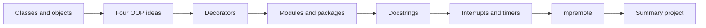

{:class="cover"}

---

By the end of this lesson you will know what the course covers, what kit you need, and how the lessons are laid out.

Ahoy there makers! You can already blink an LED, read a sensor and write a loop. Now your robot code is getting longer, and you have started to notice the mess: copy-pasted motor code, variables everywhere, one giant `main.py` that nobody (including future you) wants to read. This course is how you fix that.

---

## Overview

Building on [Learn MicroPython - the basics](/learn/micropython/), this course teaches the techniques that turn a pile of scripts into a robot you can grow. We will write classes, split code into modules, react to buttons instantly with interrupts, run jobs on timers, and manage the board from the command line.

One thing sets this course apart. MicroPython is not the Python that runs on your laptop. It is a lean re-implementation that fits in a couple of hundred kilobytes, and a few things you may have read about in Python tutorials are missing or behave differently. Every example here has been run on MicroPython, and wherever the two differ we say so plainly.

---

## Course Content

- Object-oriented programming: classes, abstraction, inheritance, encapsulation and polymorphism
- Decorators, including `@property`
- Modules, packages, and installing libraries with `mip`
- Docstrings and what MicroPython does with them
- Pin interrupts and timers
- Managing your board with `mpremote`
- A summary project that combines the lot

---

## Key Results

After completing this course, you will:

- Turn a robot's motors, sensors and LEDs into tidy, reusable classes
- Know which Python features exist on a Pico and which do not
- Organise a project into modules and packages and install libraries with `mip`
- Respond to a button press the instant it happens, without polling
- Run repeating jobs in the background with a timer
- Copy files to your board and run code from the command line

---

## What you'll need

- A Raspberry Pi Pico, Pico W or Pico 2 running MicroPython (see [How to install MicroPython](/learn/how_to_install_micropython/) if you need to flash it)
- A computer with [Thonny](https://thonny.org/) or another MicroPython editor
- A USB cable that carries data, not just power
- For lessons 11 and 12: a push button, an LED, a 330 ohm resistor, a breadboard and jumper wires
- For lesson 9 only: a Pico W (or any board with Wi-Fi) and a Wi-Fi network

Most of the lessons can be followed with no hardware at all, because the class and module examples run in the browser using the Snakie boxes.

---

## How the course works

Each lesson opens with an objective, teaches one idea with robot-flavoured code, and ends with three parts:

- **Try it Yourself**: exercises of rising difficulty. Do at least the first two.
- **Common Issues**: the errors you are most likely to meet, with fixes.
- **Check your understanding**: a short quiz. Your score shows in the sidebar.

Code comes in two flavours. Boxes with a **Run** button execute in your browser and need no hardware. Plain code blocks are for your Pico: save them in Thonny and run them on the board. Where a program talks to hardware, the wiring is described above it.

> **Teachers**: The course suits learners aged 14 and over who have finished a first MicroPython course, and works well as a half-term unit of 14 lessons at about 45 to 60 minutes each. Lessons 2 to 8 and 10 need no hardware, so a class can work in the browser on shared laptops. Lessons 11 and 12 need one button and one LED per learner or pair. Lesson 9 needs a Wi-Fi-capable board and a network that allows it, which some school networks block, so plan an alternative (a phone hotspot, or skip the install step).

---

## Prerequisites

Please complete [Learn MicroPython - the basics](/learn/micropython/) first. You should be comfortable with variables, loops, functions, `if` statements and `machine.Pin`. For wiring practice, [MicroPython GPIO](/learn/micropython_gpio/) is a helpful companion.

Ready? Let's build some classes.
