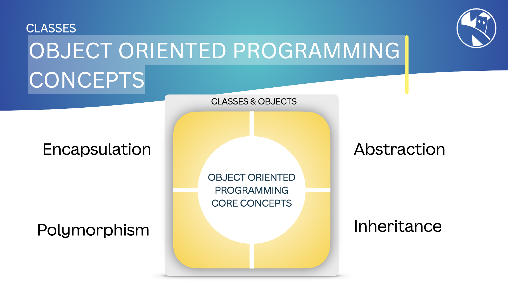
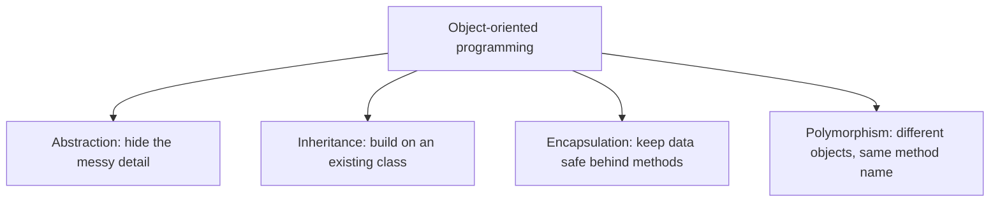

{:class="cover"}

---

By the end of this lesson you will be able to explain what object-oriented programming is for, and name the OOP features that MicroPython leaves out.

## The problem OOP solves

Imagine a robot with two motors. In the style you learned in the basics course, you might write this:

```python
left_speed = 0
right_speed = 0

def set_left(speed):
    global left_speed
    left_speed = speed

def set_right(speed):
    global right_speed
    right_speed = speed
```

It works, but add a third motor and you copy and paste everything. Add a speed limit and you have to remember to edit three places. The data (`left_speed`) and the code that touches it (`set_left`) live in different parts of the file, held together only by a naming habit.

**Object-oriented programming** (OOP) fixes this by bundling the two together. An *object* owns its data and the functions that work on it. You describe the bundle once, as a *class*, then stamp out as many objects as you like.

{:class="img-fluid w-100 card-shadow card-hover rounded-3"}

---

## The four ideas

OOP is usually taught as four ideas. Each gets its own lesson:



- [Abstraction](03_abstraction): give a motor a simple `forward()` method so nobody has to think about PWM
- [Inheritance](04_inheritance): make a `UltrasonicSensor` out of a general `Sensor`
- [Encapsulation](05_encapsulation): stop other code putting a motor speed of 9000 into your robot
- [Polymorphism](06_polymorphism): loop over a list of LEDs, buzzers and servos and call `.signal()` on each

First, [Classes and Objects](02a_classes) gives you the building blocks.

---

## OOP on a microcontroller

The Pico has 264 KB of RAM (a Pico 2 has 520 KB). Your laptop has thousands of times more. That changes how we use OOP:

- **Classes cost memory.** Every class and every object takes RAM. Ten motor objects are fine. Ten thousand are not.
- **Keep hierarchies shallow.** One level of inheritance is common. Four levels deep is a warning sign.
- **Keep it readable.** The goal is code you can still understand next month, not showing off.

### What MicroPython leaves out

MicroPython implements the core of Python's object model, but it is a smaller language. These things you may see in desktop Python tutorials do **not** work on a Pico, and we will not teach them as if they did:

| Desktop Python feature | On MicroPython |
| --- | --- |
| `from dataclasses import dataclass` | Not available: `ImportError` |
| `from abc import ABC, abstractmethod` | Not available: `ImportError` |
| `__mro__` and `__doc__` on classes and functions | Not available: `AttributeError` |
| `__slots__` | Accepted, but not enforced |
| Name mangling of `__private` names | Does not happen |

{:class="table table-single"}

Each row is explained in the lesson where it matters. The good news is that classes, `__init__`, `self`, inheritance, `super()`, `@property`, `@classmethod`, `@staticmethod`, and the usual `__str__`, `__repr__`, `__add__`, `__eq__` and `__len__` methods all work.

> **Which version?** The checks in this course were run on MicroPython 1.26.1. Features are added over time, so if something differs on your board, run `import sys; print(sys.implementation)` to see which version you have.

---

## Try it Yourself

1. Write down the data and the actions of an LED on your robot (hint: a pin, a state, `on`, `off`). That list is the start of a class.
2. Count how many global variables are in your last MicroPython project. Which ones always change together?
3. Challenge: sketch, on paper, the classes your robot would need if it had two motors, one distance sensor and a buzzer.

---

## Common Issues

- **Problem**: A tutorial tells you to `from dataclasses import dataclass` and you get `ImportError: no module named 'dataclasses'`.
- **Solution**: Write the class by hand with an `__init__` method.
- **Why**: MicroPython ships a small standard library to fit on a microcontroller, and `dataclasses` is not part of it.

---

## Check your understanding


? What does OOP bundle together?
- [ ] A program and its comments
- [x] Data and the functions that work on it
- [ ] A board and its pins
> An object owns its data and the methods that act on it, so the two stay together.

? Which of these is NOT available on a Pico?
- [ ] `@property`
- [ ] `super()`
- [x] `from dataclasses import dataclass`
> `dataclasses` is not in MicroPython's small standard library. Properties and `super()` both work.

? Why should you keep class hierarchies shallow on a Pico?
- [x] Classes and objects use limited RAM
- [ ] MicroPython only allows two levels
- [ ] Inheritance is not supported
> Every class costs memory, and the Pico has far less RAM than a computer.

