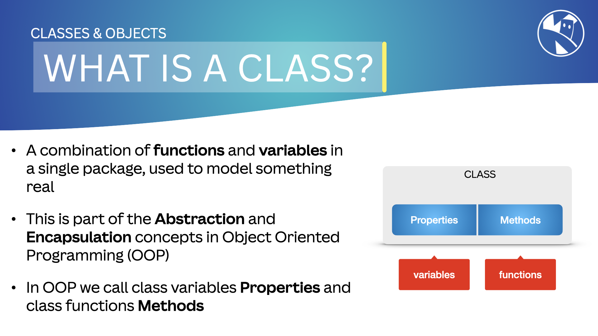
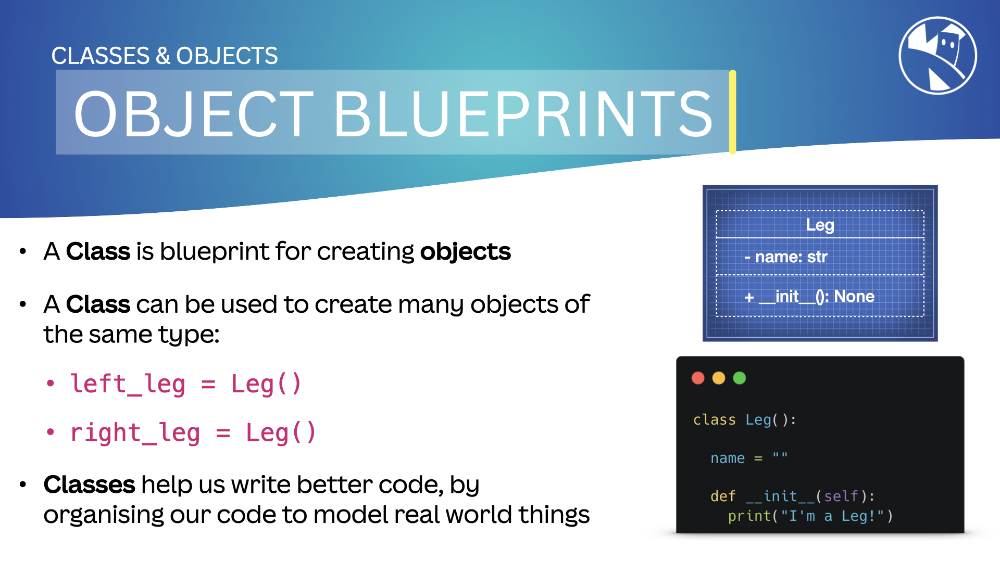
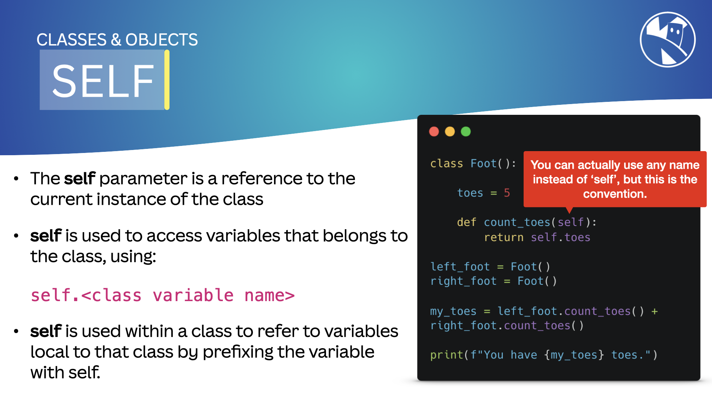
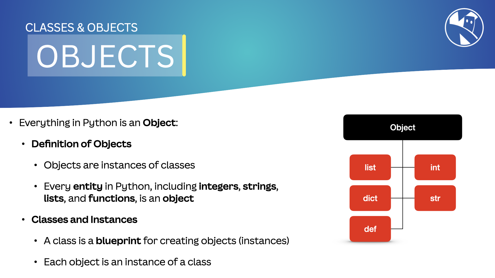

{:class="cover"}

---

By the end of this lesson you will be able to write a class with a constructor and methods, create several objects from it, and explain the difference between class and instance attributes.

Let's build a robot, in code. A **class** is the blueprint, and an **object** is one robot built from it. Every robot has a name and a battery level (its *attributes*) and can say hello or use up some battery (its *methods*).

{:class="img-fluid w-100 card-shadow card-hover rounded-3"}

---

## Your first class


class Robot:
    def __init__(self, name, battery=100):
        self.name = name
        self.battery = battery

    def say_hello(self):
        print(f"Hello, I am {self.name}")

    def drive(self, minutes):
        self.battery -= minutes * 5
        if self.battery < 0:
            self.battery = 0

r2 = Robot("R2")
bb = Robot("BB", battery=60)

r2.say_hello()
bb.say_hello()

r2.drive(4)
print(r2.name, "battery:", r2.battery)
print(bb.name, "battery:", bb.battery)



Run it. `r2` and `bb` come from the same class, but each has its own `name` and `battery`. Driving `r2` did not drain `bb`.

{:class="img-fluid w-100 card-shadow card-hover rounded-3"}

---

## The constructor: `__init__`

`__init__` is the **constructor**. MicroPython calls it automatically when you write `Robot("R2")`, and its job is to set up the new object's starting values. Notice that we passed `"R2"` and `__init__` received it as `name`.

By convention, class names use CapWords (`Robot`, `DistanceSensor`) and everything else uses lowercase_with_underscores.

---

## What is `self`?

Every method's first parameter is `self`. It is the particular object the method is working on. When you write `r2.drive(4)`, MicroPython quietly turns it into `Robot.drive(r2, 4)`, and inside the method `self` is `r2`. That is how `self.battery` finds the right robot's battery.

{:class="img-fluid w-100 card-shadow card-hover rounded-3"}

You never type `self` when calling a method, but you must write it in the `def` line. `self` is only a convention, but everyone uses it, so you should too.

**Common mistake:** forgetting `self.` inside a method. Writing `battery -= 5` changes a throwaway local variable, not the robot's battery.

---

## Instance attributes and class attributes

So far each attribute was set with `self.something`, which makes it an **instance attribute**: every object gets its own copy. You can also put a value directly in the class body. That makes a **class attribute**, shared by every object.


class Robot:
    count = 0            # class attribute: one copy, shared

    def __init__(self, name):
        self.name = name  # instance attribute: one per robot
        Robot.count += 1

a = Robot("A")
b = Robot("B")
c = Robot("C")
print("Robots built:", Robot.count)
print(a.name, b.name, c.name)



Use class attributes for things that really are shared, like a counter or a maximum speed limit that is the same for the whole fleet. Use instance attributes for everything that differs between robots.

{:class="img-fluid w-100 card-shadow card-hover rounded-3"}

---

## A class that drives hardware

Classes are not just for pretend robots. Here is an LED wrapped in a class. Wire an LED with a 330 ohm resistor from GP15 to GND, then save and run this on your Pico:

```python
from machine import Pin
from time import sleep

class Led:
    def __init__(self, pin_number):
        self.pin = Pin(pin_number, Pin.OUT)

    def on(self):
        self.pin.value(1)

    def off(self):
        self.pin.value(0)

    def blink(self, times, delay=0.25):
        for _ in range(times):
            self.on()
            sleep(delay)
            self.off()
            sleep(delay)

status = Led(15)
status.blink(3)
```

Now adding a second LED is one line: `warning = Led(14)`. No copy and paste.

> Everything in Python is an object, including strings and lists. When you call `"hello".upper()` you are calling a method of the `str` class.

---

## Try it Yourself

1. Add a `charge(self, minutes)` method to `Robot` that adds 10 battery per minute but never goes above 100.
2. Create three robots in a list and use a `for` loop to call `say_hello()` on each.
3. Add a `toggle()` method to the `Led` class that flips the LED using `self.pin.value()`.
4. Challenge: add a class attribute `max_speed = 100` to a `Motor` class and see what happens when you change it for one object with `m1.max_speed = 50`. Does `m2` change too?

---

## Common Issues

- **Problem**: `TypeError: m() takes 0 positional arguments but 1 were given` (the numbers vary) when calling a method.
- **Solution**: Check the `def` line of the method includes `self` as its first parameter.
- **Why**: Python passes the object in automatically as the first argument, so a method that forgets `self` receives one argument too many.

- **Problem**: `AttributeError: 'Robot' object has no attribute 'battery'`.
- **Solution**: Make sure `__init__` sets `self.battery = ...`, with the `self.` prefix and with two underscores each side of `init`.
- **Why**: Attributes only exist once they have been assigned on `self`. A misspelt `__init__` is never called.

---

## Check your understanding


? What is the relationship between a class and an object?
- [ ] They are the same thing
- [x] A class is a blueprint and an object is one thing built from it
- [ ] An object is a blueprint for classes
> The class describes the attributes and methods. Each object is an instance with its own values.

? What does `self` refer to inside a method?
- [ ] The class itself
- [ ] The Pico board
- [x] The particular object the method was called on
> When you call `r2.drive(4)`, `self` inside `drive` is `r2`.

? In the `Robot` counter example, why does `Robot.count` reach 3?
- [x] It is a class attribute shared by all robots
- [ ] Each robot has its own count that adds up
- [ ] `__init__` is called only once
> A class attribute has one copy shared by every object, and each `__init__` call adds one to it.

