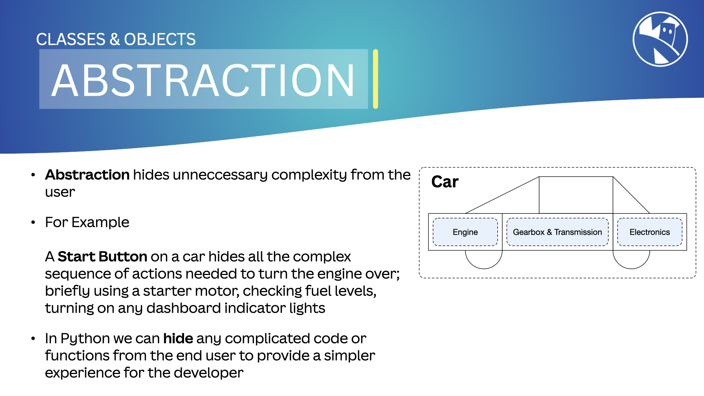
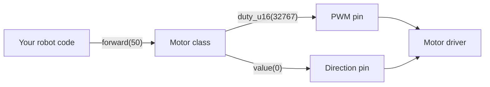

{:class="cover"}

---

By the end of this lesson you will be able to wrap hardware in a class with a simple interface, and swap the inside of that class without changing the code that uses it.

## What is abstraction?

When you drive a car you use the pedals and the steering wheel. You do not think about fuel injection. The car has *abstracted away* the engine and handed you a simple interface.

Robot code deserves the same treatment. Spinning a motor with PWM involves pins, a frequency and a 16-bit duty cycle. Your robot's main program should not care. It should say `left.forward(50)` and move on.

{:class="img-fluid rounded-3 w-100 card-shadow card-hover"}

---

## A motor with a simple face

Suppose a motor driver has one direction pin and one speed pin that takes PWM. Wire direction to GP14 and speed to GP15 (and give the driver its own power: never run motors from a Pico pin). Save and run this on your Pico:

```python
from machine import Pin, PWM
from time import sleep

class Motor:
    def __init__(self, direction_pin, speed_pin):
        self._dir = Pin(direction_pin, Pin.OUT)
        self._pwm = PWM(Pin(speed_pin))
        self._pwm.freq(1000)
        self.stop()

    def forward(self, percent):
        self._dir.value(0)
        self._set_speed(percent)

    def backward(self, percent):
        self._dir.value(1)
        self._set_speed(percent)

    def stop(self):
        self._pwm.duty_u16(0)

    def _set_speed(self, percent):
        percent = max(0, min(100, percent))
        self._pwm.duty_u16(int(percent * 65535 / 100))

left = Motor(14, 15)
left.forward(50)
sleep(2)
left.stop()
```

Look at what the caller needs to know: `forward`, `backward`, `stop`, and a speed from 0 to 100. The 16-bit duty maths, the clamping and the PWM frequency are hidden inside.



---

## Why it pays off: change the inside, keep the outside

Here is the real benefit. Say your next robot uses a different driver chip with two PWM pins (one for each direction) instead of a direction pin. You write a new class with the *same* method names:


class FakeMotor:
    """A motor stand-in that just prints, for testing without hardware."""

    def __init__(self, name):
        self.name = name

    def forward(self, percent):
        print(self.name, "forward at", percent)

    def backward(self, percent):
        print(self.name, "backward at", percent)

    def stop(self):
        print(self.name, "stopped")

def square_dance(motor):
    motor.forward(50)
    motor.stop()
    motor.backward(30)
    motor.stop()

square_dance(FakeMotor("left"))



`square_dance` does not know or care whether it was given a real `Motor` or a `FakeMotor`. This is also a handy trick for teaching: learners without a robot can still run their movement code.

---

## Abstraction by composition

Bigger objects can be built from smaller ones. A `Robot` *has* two motors and one sensor, and gives the program a single simple interface:


class FakeMotor:
    def __init__(self, name):
        self.name = name

    def forward(self, percent):
        print(self.name, "forward at", percent)

    def stop(self):
        print(self.name, "stopped")

class Robot:
    def __init__(self, left, right):
        self.left = left
        self.right = right

    def go(self, speed):
        self.left.forward(speed)
        self.right.forward(speed)

    def halt(self):
        self.left.stop()
        self.right.stop()

bot = Robot(FakeMotor("left"), FakeMotor("right"))
bot.go(60)
bot.halt()



Notice that we pass the motors *into* `Robot`. That keeps `Robot` independent of which kind of motor it uses.

> **Abstraction or encapsulation?** They are cousins. Abstraction is about the *simple interface* you offer. [Encapsulation](05_encapsulation) is about *protecting the data* behind it. We cover the second next.

---

## Try it Yourself

1. Add a `turn_left()` method to `Robot` that runs the left motor at 20 and the right at 60. Test it with `FakeMotor`.
2. Write a `FakeSensor` class with a `read_cm()` method that always returns 25, then use it to write a function `too_close(sensor)` that returns `True` below 10.
3. Challenge: add a `speed_limit` argument to `Motor.__init__` and clamp every call to it. Does any code outside the class need to change?

---

## Common Issues

- **Problem**: `AttributeError: 'FakeMotor' object has no attribute 'backward'`.
- **Solution**: Add every method the calling code uses to your stand-in class.
- **Why**: A stand-in only works if it offers the same interface as the real thing.

- **Problem**: The motor stutters or the Pico resets when it starts.
- **Solution**: Power the motor from its own battery through the driver board and join the grounds.
- **Why**: Motors draw far more current than a GPIO pin can give, and a sudden surge can brown out the Pico.

---

## Check your understanding


? What is the goal of abstraction?
- [ ] To make the code run faster
- [x] To offer a simple interface and hide the complicated inside
- [ ] To stop anyone reading your code
> The caller uses simple methods like `forward(50)` without knowing about PWM duty cycles.

? Why did `square_dance` work with both a real and a fake motor?
- [ ] Python converts one into the other
- [x] Both classes offer the same method names
- [ ] They share a global variable
> The function only calls `forward`, `backward` and `stop`, which both classes provide.

? Why does `Robot` receive its motors as arguments?
- [x] So it does not depend on one particular kind of motor
- [ ] Because classes cannot create objects
- [ ] To save memory
> Passing the motors in lets you give it real or fake ones.

