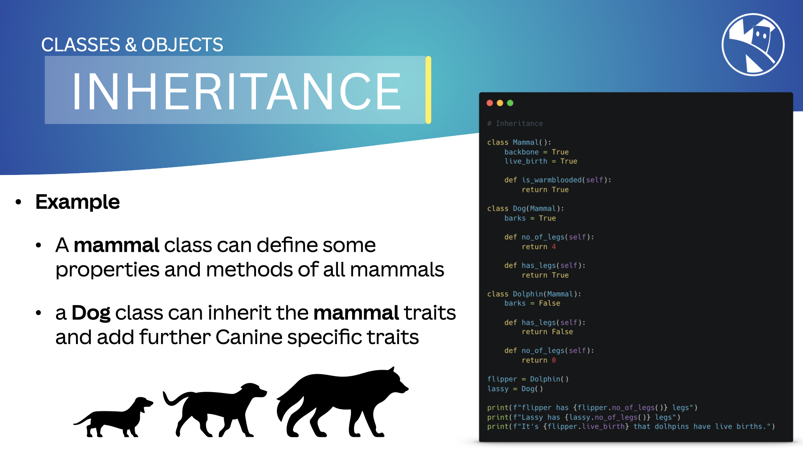
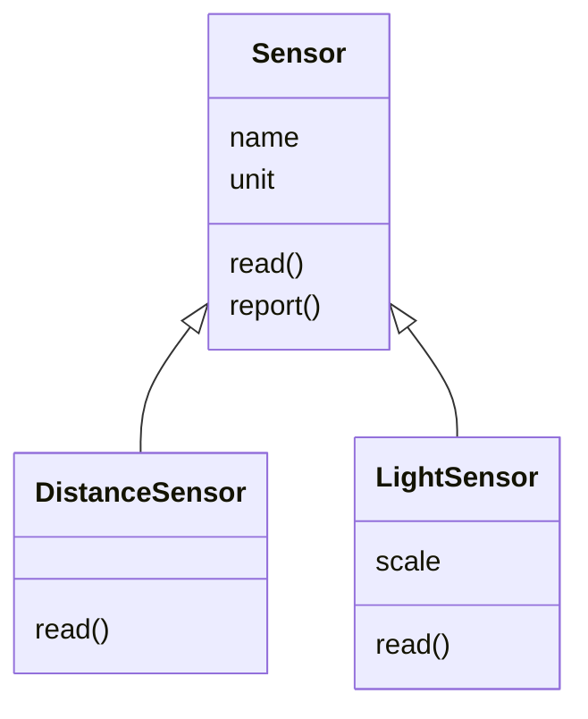
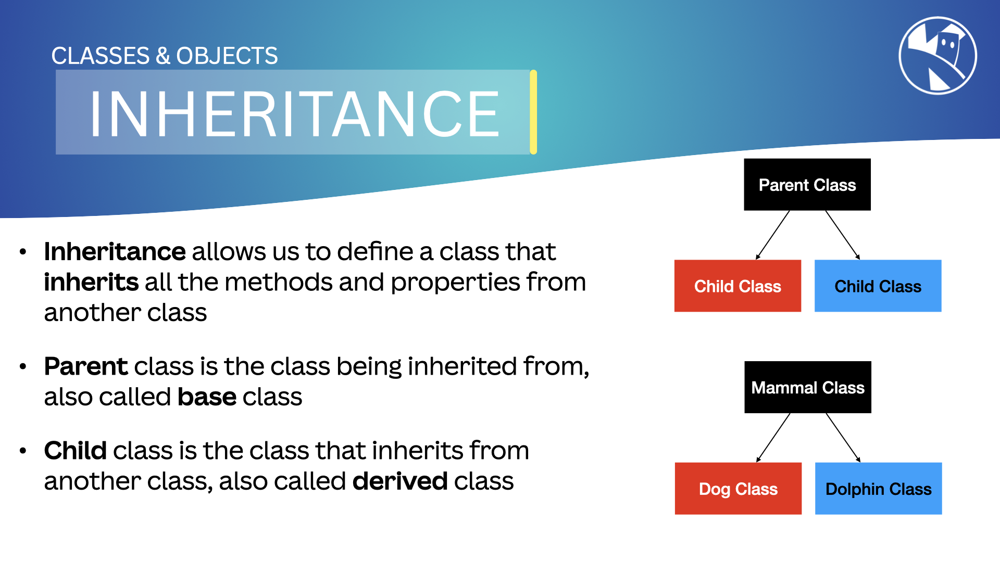

{:class="cover"}

---

By the end of this lesson you will be able to create a subclass that reuses and overrides its parent, choose between inheritance and composition, and explain why multiple inheritance is risky on a Pico.

## Reusing a class with inheritance

Your robot has a temperature sensor, a distance sensor and a light sensor. They all need a name, a way to take a reading and a way to print it. Writing that three times is exactly the copy-and-paste trap we want to avoid.

**Inheritance** lets a new class (the *subclass*, or child) start with everything an existing class (the *base class*, or parent) has, then add or change what it needs.

{:class="img-fluid rounded-3 w-100 card-shadow card-hover"}


class Sensor:
    def __init__(self, name, unit):
        self.name = name
        self.unit = unit

    def read(self):
        return 0

    def report(self):
        print(f"{self.name}: {self.read()} {self.unit}")

class DistanceSensor(Sensor):
    def __init__(self, name):
        super().__init__(name, "cm")

    def read(self):
        return 23          # a real sensor would measure here

class LightSensor(Sensor):
    def __init__(self, name, scale=100):
        super().__init__(name, "%")
        self.scale = scale

    def read(self):
        return 61

front = DistanceSensor("front")
lamp = LightSensor("lamp")
front.report()
lamp.report()



Three things to notice:

- `class DistanceSensor(Sensor)` puts the parent in brackets.
- `report()` is written once in `Sensor`, yet both children can use it.
- Each child **overrides** `read()` with its own version. When `report()` calls `self.read()`, Python uses the child's version.

### `super()`

When a subclass defines its own `__init__`, the parent's `__init__` is not called automatically. `super().__init__(...)` calls it explicitly, so `name` and `unit` still get set. Forget it, and `report()` will crash with an `AttributeError`, because `self.name` was never created.

---

## Inheritance or composition?

Inheritance models an **is-a** relationship: a `DistanceSensor` *is a* `Sensor`. **Composition** models **has-a**: a `Robot` *has* motors and sensors. Beginners often reach for inheritance when composition is the better fit. A rule of thumb: if you would not say "is a" out loud, use composition.


class Sensor:
    def read(self):
        return 23

class Motor:
    def forward(self, speed):
        print("forward at", speed)

class Robot:                       # a Robot IS NOT a Motor. It HAS motors.
    def __init__(self):
        self.sensor = Sensor()
        self.motor = Motor()

    def step(self):
        if self.sensor.read() > 10:
            self.motor.forward(50)
        else:
            print("obstacle!")

Robot().step()



Composition keeps your classes small and independent, which matters on a board with limited RAM and a limited patience budget.

{:class="img-fluid rounded-3 w-100 card-shadow card-hover"}

---

## Multiple inheritance: handle with care

A class can have more than one parent: `class C(A, B)`. This works on MicroPython:


class Blinker:
    def blink(self):
        print("blink")

class Beeper:
    def beep(self):
        print("beep")

class Beacon(Blinker, Beeper):
    pass

b = Beacon()
b.blink()
b.beep()



The danger shows up when two parents share a grandparent and both override the same method (the "diamond"). Desktop Python resolves this with a carefully defined search order (the MRO). On the MicroPython version we tested (1.26.1), the lookup order is simpler and can give a **different answer** to desktop Python for the same code, and the `__mro__` attribute that lets you check the order is not available. If code works on your laptop but not on your Pico, this could be why.

The practical advice: use multiple inheritance only for small, independent "mixins" like `Blinker` and `Beeper` above, which share no parents and never override each other. For anything else, use composition.

---

## Try it Yourself

1. Add an `AngleSensor` subclass of `Sensor` that reports in `"deg"` and returns 90.
2. Override `report()` in `DistanceSensor` so it prints `"WARNING"` when `read()` is below 10, then calls the parent version with `super().report()`.
3. Draw (or write as a `classDiagram`) a hierarchy for a `Motor`, `ServoMotor` and `StepperMotor`. What do they share? What differs?
4. Challenge: write a `Robot` that holds a *list* of `Sensor` objects and prints every report in a loop.

---

## Common Issues

- **Problem**: `AttributeError: 'DistanceSensor' object has no attribute 'name'`.
- **Solution**: Call `super().__init__(name, "cm")` inside the subclass's `__init__`.
- **Why**: Defining `__init__` in a subclass replaces the parent's, so the parent's setup never runs unless you call it.

- **Problem**: A subclass method does not seem to be used and the parent's version runs instead.
- **Solution**: Check the method name matches exactly, including spelling and capital letters.
- **Why**: Overriding works by name. `Read` and `read` are different methods.

---

## Check your understanding


? Which relationship does inheritance model?
- [ ] has-a
- [x] is-a
- [ ] uses-a
> A `DistanceSensor` is a `Sensor`. A robot that owns motors is composition (has-a).

? Why do we call `super().__init__(...)` in a subclass?
- [x] The parent's constructor does not run automatically once the subclass defines its own
- [ ] It makes the code faster
- [ ] It is required by the `class` keyword
> Without it, attributes set by the parent, like `name`, are never created.

? What is the safest way to use multiple inheritance on a Pico?
- [ ] Always, for every class
- [x] Only for small independent mixins that share no parents
- [ ] Never write a class with a base
> Method lookup order in shared-grandparent cases can differ from desktop Python, so keep mixins independent.

