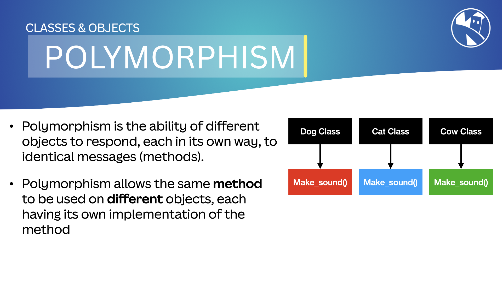
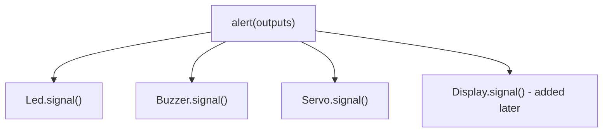

{:class="cover"}

---

By the end of this lesson you will be able to write code that works with any object offering the right method, and write a base class that insists subclasses fill in a method.

## One name, many behaviours

**Polymorphism** means "many forms". In practice: different objects respond to the same method name in their own way, so the code calling the method does not need to know which kind of object it has.

{:class="img-fluid rounded-3 w-100 card-shadow card-hover"}

Your robot has an LED, a buzzer and a servo that can all "signal" that something happened. Each does it differently, but the main program just says `signal()`.


class Led:
    def signal(self):
        print("LED flashes")

class Buzzer:
    def signal(self):
        print("Buzzer beeps")

class Servo:
    def signal(self):
        print("Servo waves")

def alert(outputs):
    for item in outputs:
        item.signal()

alert([Led(), Buzzer(), Servo()])



`alert()` has no `if isinstance(...)` checks. Add a `Display` class with a `signal()` method tomorrow and `alert()` works with it unchanged. That is the payoff: new behaviour, no edits to existing code.

---

## Duck typing

Notice that `Led`, `Buzzer` and `Servo` share no parent class at all. Python does not ask what an object *is*, only whether it has the method you call. This is called **duck typing**: "if it walks like a duck and quacks like a duck, treat it as a duck." It is one of Python's most useful habits, and it needs no extra memory.

---

## Polymorphism with inheritance

You can also share a parent class. This documents the interface and lets you share common code:


class Output:
    def __init__(self, name):
        self.name = name

    def signal(self):
        raise NotImplementedError("subclasses must define signal()")

    def describe(self):
        print(self.name, "->", end=" ")
        self.signal()

class Led(Output):
    def signal(self):
        print("flash")

class Buzzer(Output):
    def signal(self):
        print("beep")

class Broken(Output):
    pass

Led("status").describe()
Buzzer("alarm").describe()

try:
    Broken("oops").describe()
except NotImplementedError as e:
    print("caught:", e)



The base class `Output` is a contract. Its `signal()` raises `NotImplementedError`, so a subclass that forgets to write its own gets a clear message instead of silently doing nothing.

### No `abc` module on a Pico

On desktop Python you may see `from abc import ABC, abstractmethod` used for this job. **That module is not available in MicroPython** (`import abc` raises `ImportError`). The `raise NotImplementedError` pattern above is the standard replacement, with one difference: it complains when the method is *called*, not when the object is created.

---

## Built-in polymorphism: special methods

Python's own operators are polymorphic too. `+` adds numbers, joins strings and merges lists. You can make `+` work for your own classes with special ("dunder") methods:


class Vec:
    def __init__(self, x, y):
        self.x = x
        self.y = y

    def __add__(self, other):
        return Vec(self.x + other.x, self.y + other.y)

    def __repr__(self):
        return f"Vec({self.x}, {self.y})"

step = Vec(1, 0) + Vec(0, 2)
print(step)



`__repr__` controls how `print()` shows the object, and `__add__` makes `+` work. Both work on MicroPython.

---

## Try it Yourself

1. Add a `Display` class with a `signal()` method and pass it to `alert()` too.
2. Give `Output` a `volume` argument and make `Buzzer.signal()` print it.
3. Write a `Shape` base class with `area()` that raises `NotImplementedError`, then `Square` and `Circle` subclasses. Loop over a list and print every area.
4. Challenge: add `__eq__` to `Vec` so `Vec(1, 2) == Vec(1, 2)` is `True`.

---

## Common Issues

- **Problem**: `AttributeError: 'Led' object has no attribute 'signal'`.
- **Solution**: Make sure every class in the list defines a method with exactly that name.
- **Why**: Duck typing only works if every object really has the method you call.

- **Problem**: A tutorial uses `from abc import ABC, abstractmethod` and you get `ImportError`.
- **Solution**: Use a base class whose method raises `NotImplementedError`.
- **Why**: MicroPython does not include the `abc` module.

---

## Check your understanding


? What does polymorphism let you do?
- [x] Call the same method name on different objects and get behaviour suited to each
- [ ] Give every object the same data
- [ ] Hide attributes from outside code
> Each object responds to `signal()` in its own way, so the caller does not care which it is.

? In the lesson, how do `Led`, `Buzzer` and `Servo` work together in `alert()`?
- [ ] They all inherit from one base class
- [x] They each have a `signal()` method (duck typing)
- [ ] `alert()` checks each type with `isinstance`
> They share no parent class. Python only needs the method to exist.

? What replaces `abc.abstractmethod` on a Pico?
- [ ] The `abstract` keyword
- [x] A method that raises `NotImplementedError`
- [ ] The `@property` decorator
> `abc` is not available in MicroPython, so the base method raises an error if it is called unchanged.

