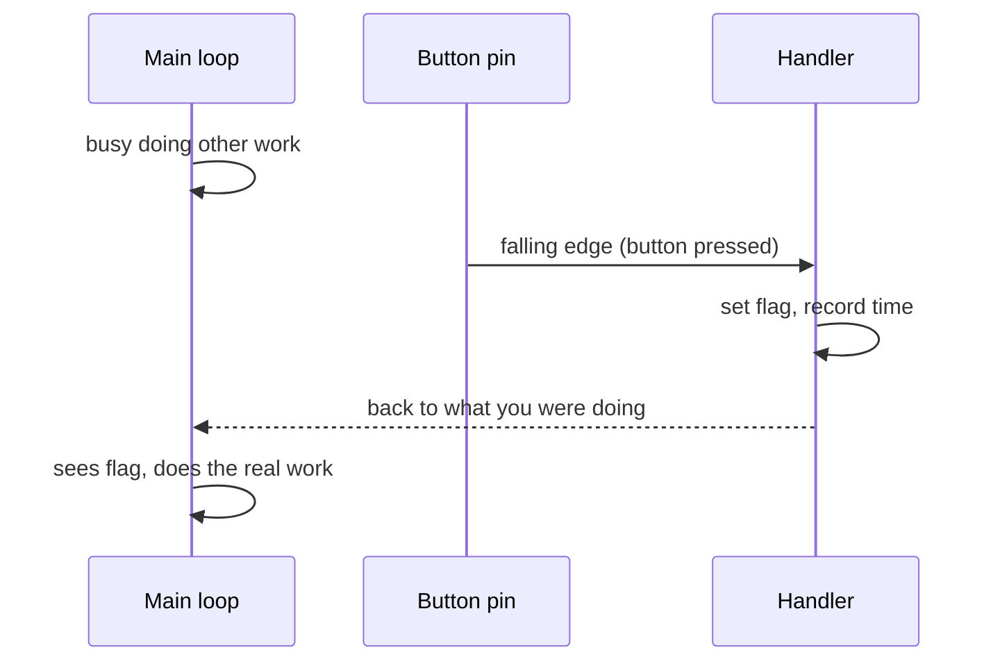

{:class="cover"}

---

By the end of this lesson you will be able to attach an interrupt handler to a button, debounce it with a time check, and hand the real work to your main loop.

## The trouble with polling

Here is a robot that checks its bump switch in a loop:

```python
while True:
    if bumper.value() == 0:
        stop_motors()
    do_slow_thing()      # takes half a second
```
{: .no-snakie }

If `do_slow_thing()` takes half a second, a quick tap on the bumper can come and go while the program is busy elsewhere. **Polling** (asking over and over "has it happened yet?") either wastes time or misses events.

An **interrupt** flips this around. You tell the hardware "when this pin changes, pause whatever you are doing, run this function, then carry on." The pin does the watching.



---

## Your first interrupt

Wire a push button between **GP14** and **GND**, and an LED with a 330 ohm resistor from **GP15** to GND. We use the Pico's internal pull-up resistor, so the pin reads 1 normally and 0 while the button is pressed. A press is therefore a **falling edge**. Save and run:

```python
from machine import Pin
from time import sleep, ticks_ms, ticks_diff

button = Pin(14, Pin.IN, Pin.PULL_UP)
led = Pin(15, Pin.OUT)

pressed = False
last_press = 0

def on_press(pin):
    global pressed, last_press
    now = ticks_ms()
    if ticks_diff(now, last_press) > 200:    # ignore bounces
        last_press = now
        pressed = True

button.irq(trigger=Pin.IRQ_FALLING, handler=on_press)

presses = 0
while True:
    if pressed:
        pressed = False
        presses += 1
        led.toggle()
        print("press number", presses)
    sleep(0.05)
```

Press the button: the LED toggles and the count goes up, even if the loop is mid-sleep. Let's look at what is going on.

- `button.irq(...)` registers `on_press` to run on every falling edge. The handler always receives the `Pin` that fired.
- The handler does almost nothing: it sets a flag and records a time. The real work (`toggle`, `print`) happens in the main loop.
- `global` is needed because the handler assigns to `pressed` and `last_press`.

### Debouncing

A mechanical button does not make clean contact. It bounces on and off for a few milliseconds, which can fire the interrupt several times for one press. Comparing the time since the last accepted press and ignoring anything under 200 ms is a simple **debounce**.

---

## Rules for handlers

An interrupt handler runs at an awkward moment, so follow these rules (they are summarised in MicroPython's own docs as the ISR rules):

- **Keep it short.** Set a flag, store a number, return.
- **Do not `print()`, sleep or do slow work inside it.** Do that in the main loop.
- **Avoid creating new objects** (growing a list, building a big string). Allocating memory inside a handler can fail or misbehave, especially for "hard" interrupts. Preallocate a `bytearray` or list outside and fill it in.
- **Be careful with shared data.** If the main loop reads a value the handler changes, it might read half an update. For a single flag as above, you are fine. For several values that must stay consistent, briefly disable interrupts around the read:

```python
import machine

state = machine.disable_irq()
# read or copy the shared values here, quickly
machine.enable_irq(state)
```
{: .no-snakie }

- **`micropython.schedule(func, arg)`** asks MicroPython to run a function soon, from the main program rather than from the interrupt itself. It is a tidy way to run a longer job triggered by a pin.

---

## Other triggers

`Pin.IRQ_FALLING` fires on a high-to-low change. You can also use `Pin.IRQ_RISING` (low to high), or combine them with `|`:

```python
trigger = Pin.IRQ_FALLING | Pin.IRQ_RISING
```
{: .no-snakie }

Use both edges when you want to know both when a button is pressed and when it is released, or for a sensor that signals with a pulse.

> **Teachers**: Check each button is wired between the pin and GND with `PULL_UP` set. A very common mistake is wiring to 3V3 and then seeing no events. Buttons are cheap and tiny, so put one in each learner's kit rather than sharing. One 330 ohm resistor per LED prevents burnt-out LEDs.

---

## Try it Yourself

1. Run the example and change the debounce time from 200 to 20 and then to 1000. What do you notice?
2. Change the trigger to `Pin.IRQ_RISING` so the LED toggles on release.
3. Make the main loop do something slow (`sleep(2)`). Do button presses still register? How many are remembered?
4. Challenge: add a second button on GP13 with its own handler that turns the LED off.

---

## Common Issues

- **Problem**: One press counts several times.
- **Solution**: Add or lengthen the debounce check (around 50 to 200 ms for a push button).
- **Why**: Mechanical contacts bounce, causing several edges for one press.

- **Problem**: Nothing happens when you press the button.
- **Solution**: Check the wiring goes to GND and that you used `Pin.PULL_UP` with a falling-edge trigger.
- **Why**: With a pull-up the pin only goes low when the button connects it to ground.

- **Problem**: `MemoryError` or odd behaviour in a handler.
- **Solution**: Move list, string and print work out of the handler and into the main loop.
- **Why**: Handlers should not allocate memory.

---

## Check your understanding


? What is the main advantage of an interrupt over polling?
- [ ] It uses less wiring
- [x] The hardware watches the pin, so you do not miss events while busy elsewhere
- [ ] It makes the button stronger
> The handler runs when the pin changes, however busy the main loop is.

? Why does the example handler only set a flag?
- [x] Handlers should be short; the real work is done in the main loop
- [ ] Handlers cannot use variables
- [ ] Flags are faster than LEDs
> Slow work or `print()` inside a handler causes timing problems.

? What does debouncing do?
- [ ] Makes the button louder
- [x] Ignores the rapid extra edges caused by contacts bouncing
- [ ] Turns off interrupts
> Comparing times with `ticks_diff` ignores presses that come too soon after the last.

