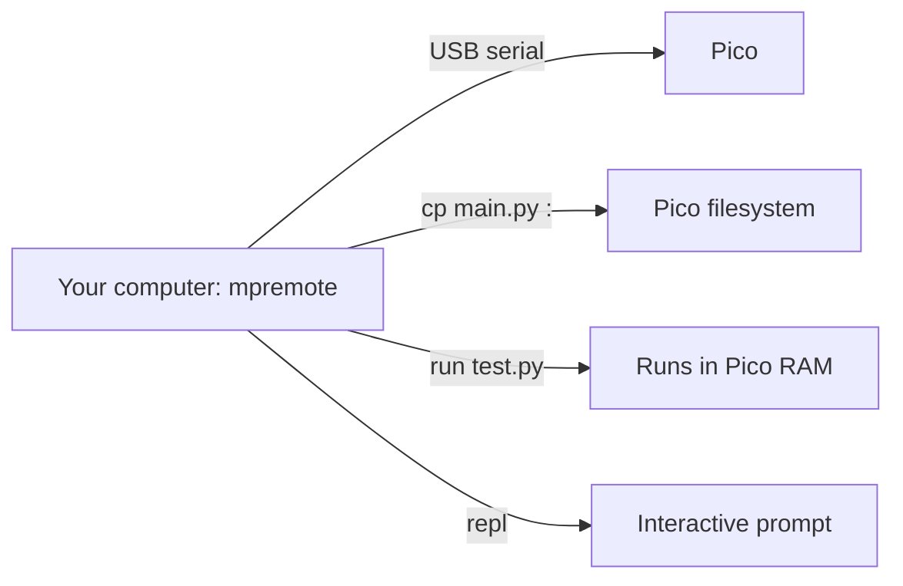

{:class="cover"}

---

By the end of this lesson you will be able to install `mpremote`, connect to your Pico, copy files and folders to and from it, run a script without saving it, and chain commands together.

## Why use the command line?

Thonny is lovely, but it is point-and-click. When your project is a package of ten files, or you want to upload the same code to five robots, a command is much faster than clicking. **`mpremote`** is the official MicroPython tool for this. It is written by the MicroPython project, is free, and works on Windows, macOS and Linux.

(Note the name: it is `mpremote`, one word, with no hyphen. Earlier versions of this lesson used a different name and commands that do not exist. The ones below are checked against the tool's own help.)



---

## Install it

You need Python on your computer. In a terminal (not on the Pico):

```bash
pip install mpremote
```

Check it worked with `mpremote version`. If your system complains about "externally managed environments", use `pipx install mpremote` instead.

---

## Find and connect to your board

Plug in the Pico with a data USB cable and list the serial devices:

```bash
mpremote devs
```

With no other instruction, `mpremote` connects to the first USB serial device it finds, so for one board you can usually skip choosing. To be explicit, use `connect` with the port name from `devs` (for example `/dev/ttyACM0` on Linux, `COM3` on Windows, or a `/dev/cu.usbmodem...` name on macOS):

```bash
mpremote connect /dev/ttyACM0
```

---

## The commands you will use daily

```bash
mpremote repl                  # interactive prompt (leave it with Ctrl-])
mpremote run test.py           # run a file from your computer, without saving it on the board
mpremote exec "print(1 + 2)"   # run one line of code
mpremote ls                    # list the files on the board
mpremote cat main.py           # show a file on the board
mpremote cp main.py :          # copy main.py from the computer to the board
mpremote cp :main.py .         # copy it back from the board to this folder
mpremote cp -r bot/ :          # copy a whole folder (our package from lesson 8)
mpremote rm main.py            # delete a file on the board
mpremote reset                 # restart the board
```
{: .no-snakie }

The colon is the key to reading these: **`:` means "on the board"**. `cp main.py :` copies *to* the board, `cp :main.py .` copies *from* the board to the current folder (`.`).

`run` is brilliant for quick experiments: the script runs on the Pico straight from your computer and prints its output, but nothing is saved on the board, so you cannot make a mess.

---

## Chain commands with `+`

You can string commands together to make a one-line workflow. This copies your package and main program, then restarts the board and shows what it prints:

```bash
mpremote cp -r bot/ : + cp main.py : + soft-reset repl
```
{: .no-snakie }

Each `+` starts the next command. `soft-reset` restarts the MicroPython interpreter (running `main.py`) and `repl` leaves you watching its output. If you want a quick upload-and-run cycle for a project you are developing, this is the command to paste into your shell history.

You can also install libraries from your computer, as in [the last lesson](09_pypi):

```bash
mpremote mip install umqtt.simple
```
{: .no-snakie }

---

## Handy extras

- `mpremote mount .` makes your current folder appear on the Pico, so you can run code that imports your local files without copying them first. The files are only there while `mpremote` is connected.
- `mpremote edit main.py` opens a board file in your editor, then saves it back.
- `mpremote df` shows free space on the board's filesystem.
- `mpremote help` lists every command.

> **Teachers**: Installing `mpremote` needs Python and `pip`, which locked-down school computers often block, and a board's serial port can only be used by one program at a time, so close Thonny before using `mpremote` (and vice versa). A teacher can pre-install the tool on a class image, or learners can use Thonny and treat this lesson as optional enrichment. Be careful with `rm`: `mpremote rm -r :` deletes files on the board with no undo.

---

## Try it Yourself

1. Install `mpremote` and run `mpremote devs`. Is your Pico listed?
2. Write `hello.py` on your computer that prints a message, then run it with `mpremote run hello.py`. Then check with `mpremote ls` that it was *not* saved.
3. Copy `hello.py` to the board with `mpremote cp hello.py :` and list the files again.
4. Challenge: write one chained command that copies your `main.py` to the board and then resets it.

---

## Common Issues

- **Problem**: `mpremote` cannot find or connect to your board.
- **Solution**: Check the USB cable carries data, then run `mpremote devs`. Close any other program, such as Thonny, that has the board open.
- **Why**: A charge-only cable has no data lines, and only one program at a time can use the serial port.

- **Problem**: `mpremote: command not found`.
- **Solution**: Install it with `pip install mpremote`, or `pipx install mpremote`, and open a new terminal.
- **Why**: The tool is installed on the computer, not on the board, and has to be on your PATH.

- **Problem**: A file you copied does not seem to be on the board.
- **Solution**: Make sure you included the colon, `cp main.py :`.
- **Why**: Without the colon, `mpremote` treats both paths as local files on your computer.

---

## Check your understanding


? What does the colon mean in `mpremote cp main.py :`?
- [ ] A comment
- [x] The destination is on the board
- [ ] Copy everything
> `:` means "on the connected board", so the file is copied to the Pico.

? What does `mpremote run test.py` do?
- [x] Runs the file on the board without saving it there
- [ ] Copies it to `/lib`
- [ ] Opens the file in an editor
> The script is sent to the Pico and run, but nothing is stored.

? Why close Thonny before using `mpremote`?
- [ ] Thonny deletes files
- [x] Only one program can use the board's serial port at a time
- [ ] `mpremote` needs the screen
> If another program has the port open, `mpremote` cannot connect.

