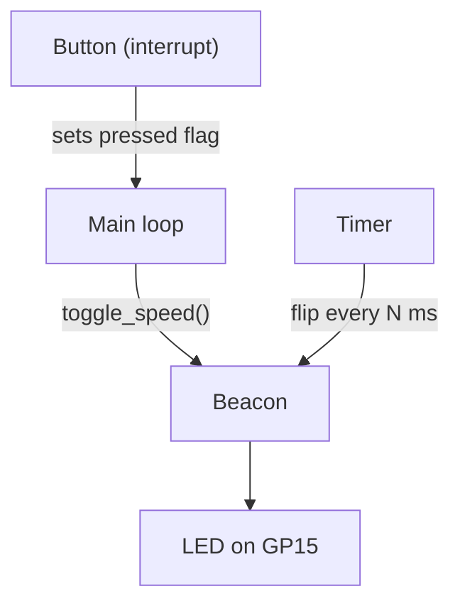

{:class="cover"}

---

By the end of this lesson you will be able to combine classes, an interrupt and a timer in one small robot program, and know where to go next.

Well done, makers! You started this course writing scripts. You can now organise a robot as classes, split it into packages, react to a button instantly, run background jobs and manage your board from the command line. Let's put the main ideas together in one program.

---

## What you learned

| Lesson | Big idea | MicroPython catch |
| --- | --- | --- |
| Classes and objects | A class is a blueprint, an object is one built from it | `self` is explicit |
| Abstraction | Offer a simple interface, hide the detail | Fake classes let you test with no hardware |
| Inheritance | Subclasses reuse and override a parent | Diamond inheritance can resolve differently from desktop Python |
| Encapsulation | Keep data behind methods | `__name` is not mangled, so use a single underscore |
| Polymorphism | Same method name, different behaviour | No `abc` module: raise `NotImplementedError` |
| Decorators | Wrap functions, guard settings with `@property` | No `functools` on the stock firmware |
| Modules and packages | Split code into files and folders | Modules load once, and live on the board |
| mip | Install libraries | Not PyPI: micropython-lib and GitHub |
| Docstrings | Document for human readers | Not stored: no `__doc__` |
| Interrupts and timers | React and repeat without polling | Only software timers, `Timer()` |
| mpremote | Control the board from the terminal | `:` means "on the board" |

{:class="table table-single"}

---

## Putting it together: a beacon

This program uses classes, a timer and a button interrupt. A beacon LED blinks in the background using a timer. Pressing the button switches the beacon between fast and slow blinking, and the main loop reports the change.

Wire a button between **GP14** and GND, and an LED with a 330 ohm resistor from **GP15** to GND. Save and run:

```python
from machine import Pin, Timer
from time import sleep, ticks_ms, ticks_diff

class Beacon:
    """An LED that blinks by itself using a timer."""

    SLOW_MS = 800
    FAST_MS = 150

    def __init__(self, pin_number):
        self._led = Pin(pin_number, Pin.OUT)
        self._timer = Timer()
        self.fast = False
        self._start()

    def _flip(self, timer):
        self._led.toggle()

    def _start(self):
        period = self.FAST_MS if self.fast else self.SLOW_MS
        self._timer.init(period=period, mode=Timer.PERIODIC, callback=self._flip)

    def toggle_speed(self):
        self.fast = not self.fast
        self._start()          # re-initialising the timer changes its rate

class Button:
    """A push button that sets a flag when pressed (debounced)."""

    def __init__(self, pin_number):
        self._pin = Pin(pin_number, Pin.IN, Pin.PULL_UP)
        self._last = 0
        self.pressed = False
        self._pin.irq(trigger=Pin.IRQ_FALLING, handler=self._on_press)

    def _on_press(self, pin):
        now = ticks_ms()
        if ticks_diff(now, self._last) > 200:
            self._last = now
            self.pressed = True

beacon = Beacon(15)
button = Button(14)

while True:
    if button.pressed:
        button.pressed = False
        beacon.toggle_speed()
        print("fast" if beacon.fast else "slow")
    sleep(0.05)
```

Look at how the earlier lessons show up: two classes with simple interfaces (abstraction), internal names marked with an underscore (encapsulation), docstrings for readers, and a timer and an interrupt doing the watching so the main loop stays tiny.



A bound method such as `self._flip` works as a timer callback and as an interrupt handler, which is handy when you want the state to live inside an object.

---

## Try it Yourself

1. Add a third speed, "off", so each press cycles slow, fast, off. Which class should own that logic?
2. Move `Beacon` and `Button` into a `parts.py` module and import them in `main.py`.
3. Add a `Buzzer` class with the same `toggle_speed` method name so a list of beacons and buzzers could be handled the same way. Which OOP idea is that?
4. Challenge: put the modules in a package and use `mpremote` to upload and run it in one chained command.

---

## Common Issues

- **Problem**: The LED blinks but the button does nothing.
- **Solution**: Check the button is wired between GP14 and GND and that the pin uses `Pin.PULL_UP`.
- **Why**: A falling edge only happens when the button pulls the pin down to ground.

- **Problem**: The beacon stops blinking after a while.
- **Solution**: Keep the `Beacon` object in a variable that lasts for the whole program.
- **Why**: The timer inside it stops when MicroPython tidies away the object.

---

## Where next?

- [Learn MicroPython - The basics](/learn/micropython/): a refresher if anything felt shaky.
- [MicroPython GPIO](/learn/micropython_gpio/): go deeper on pins, PWM, ADC, UART, I2C and SPI.
- [MicroPython Robotics Projects with the Raspberry Pi Pico](/learn/micropython_robotics/): use your new class skills to build robots.
- [Talking to the World - Working with I2C and SPI](/learn/i2c_spi/): wrap displays and sensors in classes of your own.

> **Teachers**: As an assessment, ask learners to take any earlier lab and refactor it into two classes and a `main.py`, then explain each choice. The Beacon project needs one button and one LED per learner or pair.

---

## Check your understanding


? In the Beacon project, what does the timer do?
- [ ] Reads the button
- [x] Blinks the LED in the background
- [ ] Imports the modules
> The timer calls `_flip` at a fixed period while the main loop watches the flag.

? Why does the button handler only set `pressed = True`?
- [x] Handlers should be short; the main loop does the real work
- [ ] Python cannot call methods from a handler
- [ ] The LED would turn off
> Longer work belongs outside the interrupt.

? Which of these works on a Pico?
- [ ] `from dataclasses import dataclass`
- [ ] `from abc import ABC`
- [x] `class Beacon:` with `__init__`, methods and `@property`
> Plain classes, inheritance and properties work. `dataclasses` and `abc` do not.

