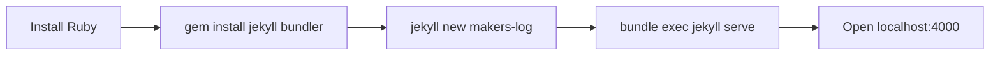

{:class="cover"}

---

By the end of this lesson you will be able to install Jekyll, create a new site, and preview it in your browser with `bundle exec jekyll serve`.

---

## The big picture

Jekyll is written in **Ruby**, so we need Ruby first. Ruby programs are shared as **gems**, and **Bundler** keeps track of exactly which gems your site uses in a file called the `Gemfile`. Think of the Gemfile as the parts list for your website.



The official requirement is Ruby 2.7.0 or higher, plus RubyGems, GCC and Make. Check what you already have with `ruby -v`.

## Step 1: Install Ruby and Jekyll

Pick your operating system. These follow the official guides at [jekyllrb.com/docs/installation](https://jekyllrb.com/docs/installation/).

**Ubuntu** (the official guide covers Ubuntu; other Debian-based systems such as Raspberry Pi OS use the same `apt` tool, but check the Jekyll docs if a package name differs):

```bash
sudo apt-get install ruby-full build-essential zlib1g-dev
echo '# Install Ruby Gems to ~/gems' >> ~/.bashrc
echo 'export GEM_HOME="$HOME/gems"' >> ~/.bashrc
echo 'export PATH="$HOME/gems/bin:$PATH"' >> ~/.bashrc
source ~/.bashrc
gem install jekyll bundler
```

The three `echo` lines tell Ruby to keep your gems in your own `~/gems` folder, so you never need `sudo` to install them. The Jekyll docs specifically advise against installing gems as the root user.

**macOS:** the official guide uses Homebrew, then `brew install chruby ruby-install` and `ruby-install ruby 3.4.1` to get a current Ruby (the system Ruby is not recommended), adds chruby to your shell profile, and then you run `gem install jekyll`. Follow the steps on the [macOS page](https://jekyllrb.com/docs/installation/macos/), as the versions move on.

**Windows:** download a **Ruby+Devkit** build from [rubyinstaller.org](https://rubyinstaller.org/), install it with the defaults, and run `ridk install` at the end, choosing the "MSYS2 and MINGW development toolchain" option. Then open a **new** Command Prompt and run `gem install jekyll bundler`. The Jekyll docs note that Windows is not officially supported, and suggest Windows Subsystem for Linux (WSL) with the Ubuntu steps above as an alternative.

Verify it worked:

```bash
jekyll -v
```

You should see something like `jekyll 4.4.1`.

## Step 2: Create the site

Choose a folder for your projects, then run:

```bash
jekyll new makers-log
cd makers-log
```

Jekyll creates the folder and, unless you add `--skip-bundle`, runs `bundle install` for you. Here is what you get:

| File or folder | What it is |
| --- | --- |
| `_config.yml` | Site-wide settings such as the title and plugins |
| `Gemfile` | The list of gems the site needs, including the `minima` theme |
| `index.markdown` | The home page |
| `about.markdown` | An About page, served at `/about/` |
| `_posts/` | Blog posts live here (it holds a welcome post) |
| `404.html` | The page shown when a link is broken |
| `.gitignore` | Keeps generated folders such as `_site` out of Git |
{:class="table table-single"}

## Step 3: Preview it

```bash
bundle exec jekyll serve
```

Jekyll builds your site into a new `_site` folder, then starts a small web server. Look for these lines:

```text
 Auto-regeneration: enabled for '/home/you/makers-log'
    Server address: http://127.0.0.1:4000/
  Server running... press ctrl-c to stop.
```

Open `http://localhost:4000` in your browser. Now edit `index.markdown` and save: Jekyll rebuilds in a moment and you refresh the page. Press Ctrl+C in the terminal to stop the server.

**One catch:** the generated `_config.yml` warns that it is not reloaded automatically. If you change it, stop the server and start it again.

> **Teachers**: installing Ruby needs administrator rights on most computers and often fails on locked-down school machines. Test the install on one machine first, or have learners work on their own laptops or Raspberry Pis. Allow about an hour. If a class cannot install anything, demonstrate the install and preview on the teacher's computer.

## Try it Yourself

1. Change `title:` in `_config.yml` to `Maker's Log`, restart the server and find the new title in the page header.
2. Delete the welcome post in `_posts/` and add a line of your own to `index.markdown`. Watch the page update.
3. Run `bundle exec jekyll build` instead of `serve`, then look inside `_site/`. Which files did Jekyll create from `about.markdown`?
4. Challenge: run `bundle exec jekyll serve --port 4001` and open that address. What does `--port` change?

## Common Issues

- **Problem**: `jekyll: command not found` after installing.
- **Solution**: Open a new terminal, or run `source ~/.bashrc`. Check `echo $PATH` includes `~/gems/bin` on Linux.
- **Why**: The shell only picks up PATH changes when it starts, so an old terminal does not know where your gems are.

- **Problem**: A long stream of `DEPRECATION WARNING` lines about Sass `@import` appears when you build with the minima theme.
- **Solution**: Ignore them. The site still builds and the page still works.
- **Why**: The default theme uses an older Sass style that newer Sass tools warn about. It is a message for theme authors, not an error in your site.

- **Problem**: You can't build because of a missing gem, or `bundle exec` says it can't find a gem.
- **Solution**: Run `bundle install` in the site folder.
- **Why**: The Gemfile lists the gems the site needs, and Bundler has to download them once.

- **Problem**: The server won't start because the port is already in use.
- **Solution**: Stop the other Jekyll window, or start on a new port with `--port 4001`.
- **Why**: Only one program can listen on a port at a time.

## Check your understanding


? What is the Gemfile for?
- [ ] It holds your blog posts
- [x] It lists the Ruby gems your site needs, and Bundler installs them
- [ ] It stores your site's colours
> The Gemfile is the parts list for your site, and `bundle install` fetches everything on it.

? Which command builds the site and starts a local preview server?
- [ ] `jekyll new`
- [ ] `gem install jekyll`
- [x] `bundle exec jekyll serve`
> `serve` builds into `_site` and serves it, rebuilding when files change.

? You edit `_config.yml` while the server is running. What should you do?
- [x] Stop the server and start it again
- [ ] Nothing, it reloads on its own
- [ ] Delete the `_site` folder only
> The generated config warns that it is not reloaded automatically.

