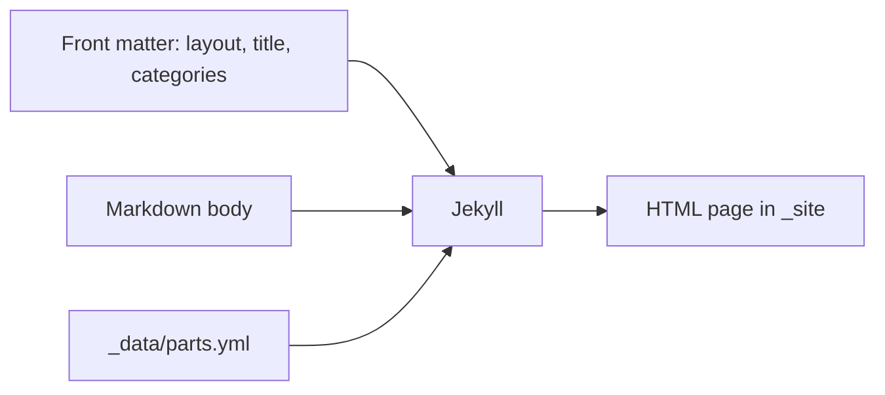

{:class="cover"}

---

By the end of this lesson you will be able to write a post and a page with front matter, and use a data file and a Liquid loop to show a parts list.

---

## Posts, pages and the file name rules

Jekyll treats two kinds of file differently. **Posts** are dated entries that live in `_posts/` and must be named `YYYY-MM-DD-title.md`. **Pages** are anything else with front matter, such as `about.markdown`, and can sit anywhere. Let's write both for Maker's Log.

Create `_posts/2026-11-24-first-robot.md` and delete the welcome post:

```markdown
---
layout: post
title: "My First Robot Build"
date: 2026-11-24
categories: robots
tags: smars 3d-printing
---
Today I printed the chassis for my first **SMARS** robot.

## Parts used

- 2 x N20 motors
- 1 x Raspberry Pi Pico
```

The block between the two `---` lines is **front matter**: settings written in YAML that Jekyll reads before it processes the rest. `layout: post` picks a template, `categories` becomes part of the URL, and `tags` can be a space-separated list. The part below is ordinary Markdown.

Here is what that file turns into, which we checked by building it:

| Source file | Built file | URL |
| --- | --- | --- |
| `_posts/2026-11-24-first-robot.md` | `_site/robots/2026/11/24/first-robot.html` | `/robots/2026/11/24/first-robot.html` |
| `about.markdown` (has `permalink: /about/`) | `_site/about/index.html` | `/about/` |
{:class="table table-single"}



Notice the category `robots` became the first part of the post's address. That is Jekyll's default post permalink, `/:categories/:year/:month/:day/:title:output_ext`.

## Markdown in a minute

Markdown is plain text with light marks: `#` for headings, `**bold**`, `*italic*`, `[text](url)` for links and `` for images. If you want the full tour, the [Markdown course](/learn/markdown/) covers it. For now, it is enough that you write posts the way you would write notes.

## Data files and Liquid

Some information is better as a list than as prose. Our parts list is a good example. Create `_data/parts.yml`:

```yaml
- name: Raspberry Pi Pico
  qty: 1
  used_in: Brain
- name: N20 motor
  qty: 2
  used_in: Drive
- name: TB6612 motor driver
  qty: 1
  used_in: Drive
```

Jekyll reads every file in `_data/` and exposes it as `site.data.<filename>`. Now make a page, `parts.md`, that loops over it with **Liquid**, the template language Jekyll uses:


```markdown
---
layout: page
title: Parts list
permalink: /parts/
---

<ul>

  <li>{{ part.qty }} x {{ part.name }} ({{ part.used_in }})</li>

</ul>

There are {{ site.data.parts | size }} kinds of part on the page called "{{ page.title }}".
```


Liquid has two kinds of marker. Double curly braces **output** a value, such as `{{ part.name }}`. Curly-brace-percent tags such as `` run **logic**. The `| size` part is a **filter**, which changes a value on its way out. Building this gave exactly three list items, and the last line read "There are 3 kinds of part on the page called "Parts list"."

I used a plain `<ul>` rather than Markdown bullets because blank lines left by the loop can turn Markdown bullets into spaced-out paragraphs.

> **Teachers**: this lesson is about file names and folders as much as code. Before each save, ask learners to say which folder the file belongs in (`_posts`, `_data` or the site root). Folders starting with an underscore are special to Jekyll, so a missing underscore or a mis-dated file name means the file is ignored. Also check that nobody puts personal details in a post that will later be published.

## Try it Yourself

1. Add a fourth part to `_data/parts.yml` and refresh the Parts page. Did you need to touch `parts.md`?
2. Write a second post about wiring a sensor. Give it a different `categories` value and find where the URL changed.
3. In `parts.md`, show only the parts used in `Drive`. Hint: Liquid has an `if` tag, written as `` and closed with ``.
4. Challenge: add a `{{ part.qty | times: 2 }}` to show how many parts you need to build two robots.

## Common Issues

- **Problem**: Jekyll reports `YAML Exception reading ... mapping values are not allowed in this context`.
- **Solution**: Put quotes around any title containing a colon, such as `title: "Robots: a build log"`.
- **Why**: A colon followed by a space means "key and value" in YAML, so a second one confuses the reader.

- **Problem**: Your new post does not appear, and the build prints `Skipping: ... has a future date`.
- **Solution**: Set the date to today or earlier, or build with `--future` while you test.
- **Why**: Jekyll hides posts dated in the future so you can schedule them.

- **Problem**: A file in `_posts/` is ignored without any message.
- **Solution**: Rename it to `YYYY-MM-DD-title.md`.
- **Why**: Jekyll only recognises posts whose names start with a date.

- **Problem**: Your page shows `{{ site.title }}` as text instead of the title.
- **Solution**: Add the two `---` front matter lines, even if they are empty, at the top of the file.
- **Why**: Jekyll only processes files that start with front matter. Others are copied across untouched.

## Check your understanding


? What must a blog post file be named?
- [ ] post.md
- [x] YYYY-MM-DD-title.md, inside `_posts`
- [ ] Anything, as long as it has `layout: post`
> Jekyll recognises posts by the date at the start of the file name.

? Where does Jekyll look for data files such as `parts.yml`?
- [ ] In `_includes`
- [x] In `_data`, and you read them through `site.data`
- [ ] In `assets`
> Files in `_data` become available as `site.data.<filename>`.

? What is the difference between double curly braces and curly-brace-percent tags in Liquid?
- [x] Double braces output a value, percent tags run logic such as loops
- [ ] Double braces run loops, percent tags print values
- [ ] There is no difference
> Output markers print values, and tags control logic such as `for` and `if`.

