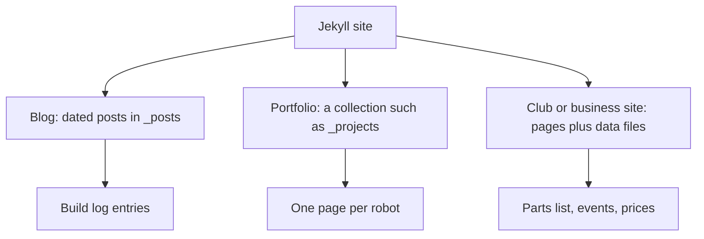

{:class="cover"}

---

By the end of this lesson you will be able to create a collection, give it a layout with front matter defaults, and list its items on an index page.

---

## One tool, three kinds of site

Jekyll's three main building blocks cover most small sites. Which one you reach for depends on what you are showing.



We already have the blog (lesson 3) and a data-driven page (the parts list). Now let's add a portfolio of robots using a **collection**: a group of related documents that are not dated posts.

## Build a projects collection

**Step 1: declare it** in `_config.yml`. `output: true` tells Jekyll to make a page for each item, and `permalink` sets the address:

```yaml
collections:
  projects:
    output: true
    permalink: /projects/:name/

defaults:
  - scope:
      path: ""
      type: "projects"
    values:
      layout: project
```

The `defaults` block gives every item in the collection `layout: project` automatically, so you never have to repeat it in front matter.

**Step 2: write the layout**, `_layouts/project.html`. It sits inside our `default` layout and shows a status from front matter, falling back to `idea` if none is set:


```html
---
layout: default
---
<h1>{{ page.title }}</h1>
<p><strong>Status:</strong> {{ page.status | default: "idea" }}</p>
{{ content }}
```


**Step 3: add items** in a folder named after the collection, with an underscore: `_projects/smars.md` and `_projects/line-follower.md`.

```markdown
---
title: SMARS tracked robot
status: building
---
A small 3D printed tracked robot with a Pico brain.
```

The second one only has a `title` and a one-line description, so its status will show as `idea`.

**Step 4: list them** on a page, `projects.html`:


```html
---
layout: default
title: Projects
permalink: /projects/
---
<h1>Projects</h1>
<ul>

  <li><a href="{{ project.url | relative_url }}">{{ project.title }}</a> ({{ project.status | default: "idea" }})</li>

</ul>
```


`site.projects` holds every document in the collection. When we built this, the output included `_site/projects/index.html`, `_site/projects/smars/index.html` and `_site/projects/line-follower/index.html`.

## Filtering posts on a page

You can also pick posts out of the blog. This page, `log.html`, shows only posts in the `robots` category, with a one-line excerpt and every tag in the site:


```html
---
layout: default
title: Build log
permalink: /log/
---
<h1>Build log</h1>


<h2><a href="{{ post.url | relative_url }}">{{ post.title }}</a></h2>
<p>{{ post.date | date: "%-d %B %Y" }}: {{ post.excerpt | strip_html | strip }}</p>

<p>No posts yet.</p>


<h2>Tags</h2>
<ul>

  <li>{{ tag[0] }} ({{ tag[1].size }})</li>

</ul>
```


The `where` filter keeps posts whose categories include `robots`. The `else` branch inside a `for` loop runs when the list is empty. The excerpt is the first paragraph of each post by default. Our build printed "24 November 2026: Today I printed the chassis for my first SMARS robot." and the tags `smars (1)` and `3d-printing (1)`.

## A word about forms

A static site has no server code, so it cannot receive a submitted contact form by itself. If you need one, you point the form at a separate form-handling service, or simply publish an email address. Keep this in mind before promising a "contact us" box on a business site.

> **Teachers**: this makes a good small assessed project: each learner or group builds a three-page portfolio of their own robot builds. Agree beforehand what is allowed on a public page. Photos of people, full names and anything identifying a school should be left out. Group work is easier if one person owns the repository and others submit changes through Git.

## Try it Yourself

1. Add a third project file and check it appears on the Projects page without touching `projects.html`.
2. Give one project a `status: finished` and one `status: building`. Change the list to show finished robots first, or only finished ones, with an `if`.
3. Add a link to Projects in your `nav.html` include.
4. Challenge: create a second collection called `parts`, with one page per part, and link each part in your parts list.

## Common Issues

- **Problem**: A collection item gives a 404.
- **Solution**: Check `output: true` is set, the folder name starts with an underscore, and you restarted the server after editing `_config.yml`.
- **Why**: Without `output: true`, Jekyll reads the files but never writes pages for them.

- **Problem**: `site.projects` is empty.
- **Solution**: The folder must be named exactly `_projects`, matching the collection name in the config.
- **Why**: Jekyll finds a collection's documents through its name.

- **Problem**: Items have no layout and display as bare text.
- **Solution**: Check the `defaults` block: `type` must match the collection name and be indented correctly.
- **Why**: The defaults only apply to files that fit the scope.

## Check your understanding


? What does `output: true` do for a collection?
- [ ] Hides the collection from the site
- [x] Makes Jekyll write a page for each item
- [ ] Sorts the items by date
> Without it, the documents exist in `site.projects` but have no pages of their own.

? Why use front matter `defaults` for a collection?
- [x] So every item gets the same layout without repeating it
- [ ] To speed up the build
- [ ] To change the file names
> One default saves writing the layout line in every file.

? Why can't a static site handle a contact form by itself?
- [ ] Static sites cannot contain HTML forms
- [x] There is no server code to receive the submitted data
- [ ] Forms are only allowed in posts
> A form needs something to receive it, so you use an outside service or publish an email address.

