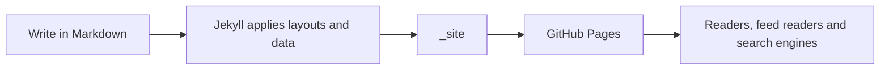

{:class="cover"}

---

By the end of this lesson you will be able to name each part of a Jekyll site, use the handiest command-line flags, and choose what to learn next.

---

## What you built

Maker's Log started as a command and ended as a published website. Here is how every piece fits together, and which lesson introduced it:

| Piece | Where it lives | Lesson |
| --- | --- | --- |
| Settings | `_config.yml` | 2 and 4 |
| Posts | `_posts/YYYY-MM-DD-title.md` | 3 |
| Pages | `about.markdown`, `parts.md` | 3 |
| Data | `_data/parts.yml` | 3 |
| Layouts and includes | `_layouts/`, `_includes/` | 4 |
| Plugins | `Gemfile` and `plugins:` | 5 |
| Collections | `_projects/` | 7 |
| Output | `_site/`, published with GitHub Pages | 6 |
{:class="table table-single"}

## Handy commands

These flags all appear in the Jekyll help output on version 4.4.1:

| Command | What it does |
| --- | --- |
| `bundle exec jekyll serve --livereload` | Refreshes the browser for you whenever a file changes |
| `bundle exec jekyll serve --drafts` | Includes the posts in `_drafts/` |
| `bundle exec jekyll serve --port 4001` | Uses another port |
| `bundle exec jekyll build --incremental` | Only rebuilds what changed |
| `bundle exec jekyll build --profile` | Shows which templates take longest to render |
| `bundle exec jekyll build --trace` | Prints the full error trail when something fails |
| `bundle exec jekyll build --strict_front_matter` | Fails the build if front matter has an error |
| `bundle exec jekyll doctor` | Checks the site for common problems |
{:class="table table-single"}

Why `--strict_front_matter` is worth knowing: when we tried a title with a colon in it, Jekyll printed a YAML error, but the build carried on and still wrote a page at an odd address. A strict build stops instead, so the mistake can't slip through.

## Tips that save time

- **Keep one source of truth.** Put lists such as parts, events or prices in `_data/`, so you edit data and not templates.
- **Pre-size your images.** Large photos slow a site more than any template. Resize them before adding them to your assets folder, and add `loading="lazy"` to image tags.
- **Commit often.** Small commits make it easy to find the change that broke the build.
- **Read the build output.** `Skipping`, `Error` and `Dependency Error` lines tell you the cause in plain words.
- **Only add plugins you need.** Each is one more thing to update and one more thing GitHub Pages might not support.

> **Teachers**: finish the course with a short show-and-tell where each learner presents one page and explains which file it came from. This checks they understand the source-to-site idea rather than just copying commands. If the class used a shared GitHub account, clean up and agree who keeps ownership of the repository after the course.

## Try it Yourself

1. Start the server with `--livereload` and edit a post. What do you notice compared with refreshing by hand?
2. Run `bundle exec jekyll build --profile` and find which template took the longest.
3. Draw a map of your own site on paper, labelling every file with the lesson that taught it.
4. Challenge: make Maker's Log a real log of a robot you are building, with at least three posts, two projects and a parts list.

## Common Issues

- **Problem**: A command works for a friend but not for you.
- **Solution**: Compare `bundle exec jekyll -v` and `ruby -v` first.
- **Why**: Different Jekyll or Ruby versions print different messages, and sometimes behave differently.

- **Problem**: LiveReload does not refresh the browser.
- **Solution**: Hard refresh once, check the terminal for errors, and make sure you started the server with `--livereload`.
- **Why**: The auto-refresh only connects when the page was loaded from a server started with that flag.

## What's next

- [Mastering Markdown for Documentation with Jekyll](/learn/markdown/) goes deeper into writing for Jekyll sites.
- [Git for Beginners](/learn/git/) makes publishing safer and teamwork easier.
- [Create Diagrams with Mermaid](/learn/mermaid/) shows how to draw diagrams in your posts.
- [Obsidian](/learn/obsidian/) is a great place to write notes that can become posts.
- The [Programming learning pathway](/learn/learning_pathways/programming.html) lists these courses together.

Well done, makers. Go and write down what you build.

## Check your understanding


? Which flag shows you where a build spends its time?
- [ ] `--drafts`
- [x] `--profile`
- [ ] `--port`
> `--profile` generates a Liquid rendering profile.

? Where should lists such as parts or prices live?
- [ ] Hard-coded in every layout
- [x] In `_data/`, so you can change data without touching templates
- [ ] In `_site`
> Data files keep content and design separate.

? What does `jekyll doctor` do?
- [x] Checks the site for common problems
- [ ] Deletes your `_site` folder
- [ ] Publishes the site to GitHub
> It examines the site and reports issues, or says everything looks fine.

