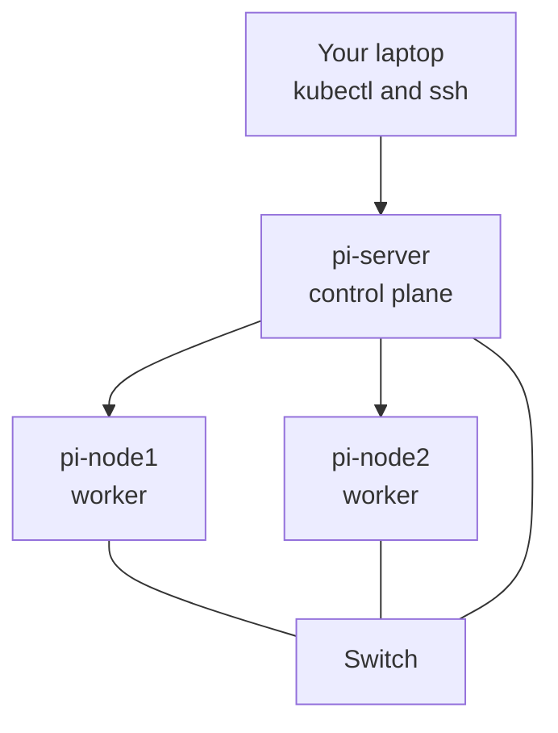

{:class="cover"}

---

Ahoy there makers! Welcome to **Running K3s on Raspberry Pi**.

By the end of this lesson you will be able to explain what K3s is, how it differs from full Kubernetes, and what you will build in this course.

---

## Overview

Kubernetes is the system most of the industry uses to run containers across many computers. It is also famously heavy. **K3s** is a certified, lightweight Kubernetes distribution from Rancher (now part of SUSE) that ships as a single small binary, which makes it a great fit for little computers like the Raspberry Pi.

In this course you will turn a few Raspberry Pis into a real Kubernetes cluster, deploy a small web app with a Redis database, give it storage and a friendly web address, lock it down, and automate its deployment.

K3s bundles sensible defaults, so you do not have to assemble them yourself:

- **containerd** as the container runtime (there is no Docker Engine involved)
- **Flannel** for pod networking
- **Traefik** as the ingress controller
- **ServiceLB** so `LoadBalancer` services work on bare metal
- **local-path** storage for volumes
- **CoreDNS** for names inside the cluster, and **metrics-server** for `kubectl top`

---

## Course Content

- Choosing hardware and preparing Raspberry Pi OS on every node
- Giving each node a fixed address and a unique name
- Installing a K3s server and joining worker nodes
- Using `kubectl`, metrics and a dashboard
- Storage, Services and Ingress
- Deploying an app, then packaging it with Helm
- CI/CD, network policy and cluster security
- A final project that brings it all together

---

## Key Results

After completing this course, you will:

- Build a multi-node K3s cluster on Raspberry Pi hardware
- Explain what the control plane and worker nodes do
- Deploy, expose, scale and update apps with `kubectl`
- Keep data safe with persistent volume claims
- Route web traffic to apps with Traefik Ingress
- Package an app with Helm and automate deployment
- Apply basic security: Secrets, RBAC and NetworkPolicy

---

## What you'll need

- 2 to 4 Raspberry Pi 4 or Raspberry Pi 5 boards (the server needs at least 2GB of RAM, 4GB is more comfortable)
- A microSD card per Pi, or better, a USB SSD (the K3s docs recommend an external SSD on Raspberry Pi)
- The official power supply for each Pi
- Ethernet cables and a switch or router
- A computer to work from, with a terminal and `ssh`. You will install `kubectl` and `helm` on it later
- Internet access for the cluster, to pull container images

No second Pi yet? You can follow the whole course on a single Pi, apart from the lesson on joining worker nodes.

---

## How the course works

Every lesson starts with an objective, teaches one idea, and ends with **Try it Yourself** exercises, **Common Issues** and a short quiz. Commands are in code boxes: copy them exactly as written. Where a command prints something, I describe what you should see rather than paste a log, because versions and addresses will differ on your cluster.

These names are used throughout:

| Role | Hostname | Example address |
|---|---|---|
| Control plane (server) | `pi-server` | `192.168.1.100` |
| Worker | `pi-node1` | `192.168.1.101` |
| Worker | `pi-node2` | `192.168.1.102` |
{:class="table table-single"}

Swap in your own addresses wherever you see these. Every YAML file is a complete manifest, ready for `kubectl apply -f`.

> **Teachers**: This course suits secondary or college groups who have already used the Linux command line. Allow about 45 to 60 minutes per lesson. The ideal kit is one cluster per group of three or four learners (one Pi each) plus a switch; a single Pi can run every lesson except the node-joining ones. Pre-flash the cards before class, because lesson 3 is the slow step. School networks often block static addresses or isolate devices, so a small private switch per group, with a laptop as the gateway or a spare router, avoids a lot of trouble. Kubernetes has many new words, so keep a shared glossary on the wall.

---

## Prerequisites

- [Introduction to the Linux Command Line on Raspberry Pi OS](/learn/linux_intro/) for `ssh`, files and `nano`
- Helpful: [Docker](/learn/docker/) to understand images and containers
- Helpful: [Raspberry Pi 5 Cluster with Docker Swarm](/learn/docker_swarm/), another way to cluster Pis, which makes a good comparison

---

## Try it Yourself

1. Write down which of your Pis will be the server and which will be workers, and choose their hostnames and addresses.
2. Visit docs.k3s.io and list three things K3s bundles that you would otherwise install yourself.
3. Challenge: sketch the diagram above for your own hardware, including where your router and your laptop sit.

---

## Check your understanding


? What does K3s use to run containers by default?
- [ ] Docker Engine
- [x] containerd
- [ ] Podman
> K3s bundles containerd, so you do not need to install Docker on the nodes.

? Which component gives `LoadBalancer` services an address on a plain Pi cluster?
- [ ] Traefik
- [ ] local-path
- [x] ServiceLB
> ServiceLB is bundled with K3s so that LoadBalancer services work without a cloud provider.

? What role do the extra Pis play in the cluster?
- [x] Worker nodes, which run the pods the control plane schedules
- [ ] Backup copies of the server
- [ ] Network switches
> Workers join the server using a token and run your workloads.

