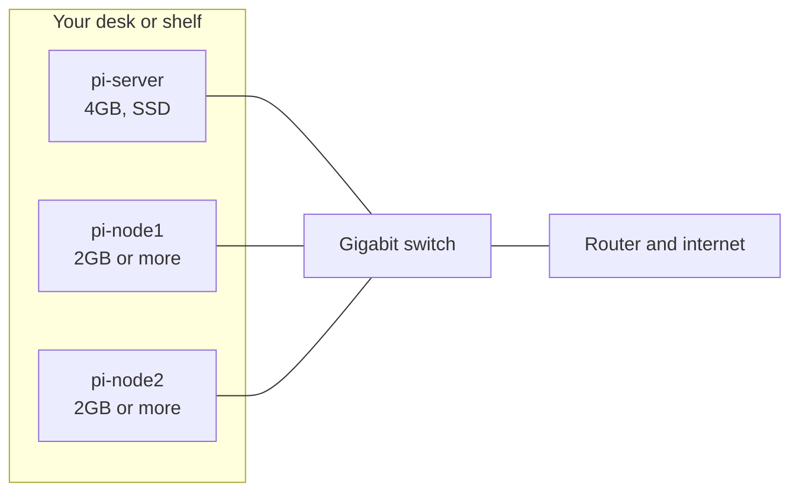

{:class="cover"}

---

By the end of this lesson you will be able to choose and plan the Raspberry Pi hardware for a K3s cluster, and explain why storage and networking matter more than raw CPU speed.

---

## You do not need a datacentre

K3s was designed for small machines, so a couple of Pis is genuinely enough. The K3s documentation gives these minimums:

| Role | CPU | RAM |
|---|---|---|
| Server (control plane) | 2 cores | 2GB |
| Agent (worker) | 1 core | 512MB |
{:class="table table-single"}

Those are minimums for K3s itself. Your own apps need memory on top, so I recommend a Raspberry Pi 4 or Raspberry Pi 5 with **4GB** for the server and at least 2GB for each worker. Both boards are 64-bit, which is what we need.

---

## What the cluster looks like

Everything plugs into one switch, and the switch connects to your router so the nodes can pull images from the internet.

---

## The three things that really matter

**1. Storage.** A Kubernetes server writes to disk constantly (its database, logs, image layers). The K3s docs say plainly that on a Raspberry Pi you should use an external SSD, because SD cards cannot handle the IO load. A microSD card will work for learning, but expect it to be slow and eventually to wear out. If you can afford one USB SSD, put it on the server first.

**2. Wired networking.** Nodes talk to each other all the time. Use Ethernet. Wi-Fi adds delay and drops, and a node that vanishes for a few seconds looks like a failure to Kubernetes.

**3. Power and cooling.** Under load a Pi that is short of power throttles or reboots. Use the official power supply for your model and, for a Pi 5 or a stack in a case, a fan or heatsink. A node that browns out in the middle of a deployment is a confusing thing to debug.

---

## Choosing a cluster size

| Layout | Good for |
|---|---|
| 1 Pi (server only) | Learning `kubectl`, manifests and Helm. K3s can run pods on the server. |
| 2 Pis (1 server, 1 worker) | Seeing nodes, scheduling and what happens when a node is lost |
| 3 to 4 Pis (1 server, 2 to 3 workers) | Scaling and spreading replicas across nodes, the best classroom size |
{:class="table table-single"}

A single server is a single point of failure: if it stops, the cluster stops being manageable (running pods on workers keep going for a while). High availability needs three servers and a different datastore, which is beyond this course.

---

## Shopping list for a 3-node cluster

- 3 Raspberry Pi 4 or 5 boards
- 3 microSD cards of 32GB or more (or SSDs, at least one for the server)
- 3 official power supplies
- 1 gigabit switch with at least 4 ports
- 3 Ethernet patch cables, plus one for the switch to your router
- Optional: a case or rack with fans, and a label for each Pi

I have left out prices and brands on purpose, since they change. Check a Raspberry Pi approved reseller for current stock.

> **Teachers**: Cost is the catch. A cluster of three or four Pis plus a switch is a real expense per group, so consider one cluster per group of three or four learners, or one shared cluster that learners connect to with their own namespace. Order power supplies and cables at the same time as the boards, because missing power supplies are the commonest reason a lesson cannot start.

---

## Try it Yourself

1. Decide your cluster size and write a shopping list with a quantity next to every item.
2. Work out how much RAM your cluster will have in total, then subtract about 1GB per node for the OS and K3s. How much is left for your apps?
3. Challenge: look up the specification of your Pi's USB ports and decide which one you would plug an SSD into, and why.

---

## Common Issues

- **Problem**: A Pi reboots randomly or reports undervoltage warnings.
- **Solution**: Swap to the official power supply and a good cable.
- **Why**: Undervoltage makes the Pi throttle or reset, and cheap phone chargers often cannot supply enough current.

- **Problem**: The cluster feels slow and the server's disk is very busy.
- **Solution**: Move the server's storage from microSD to a USB SSD.
- **Why**: Kubernetes keeps writing its datastore, and SD cards handle that kind of load badly.

---

## Check your understanding


? What does the K3s documentation recommend for storage on a Raspberry Pi?
- [ ] A fast microSD card
- [x] An external SSD
- [ ] Network boot only
> SD cards cannot handle the IO load of a Kubernetes server, so an external SSD is recommended.

? Why should you use Ethernet rather than Wi-Fi for the nodes?
- [x] Nodes talk to each other constantly, and Wi-Fi drops look like node failures
- [ ] K3s refuses to start over Wi-Fi
- [ ] Ethernet gives the Pi more RAM
> Stability matters more than peak speed for cluster traffic.

? What is the risk of running only one server node?
- [ ] You cannot run pods at all
- [x] If the server stops, you lose the control plane
- [ ] K3s will delete your data
> Workers rely on the server for scheduling and the API. High availability needs more servers.

