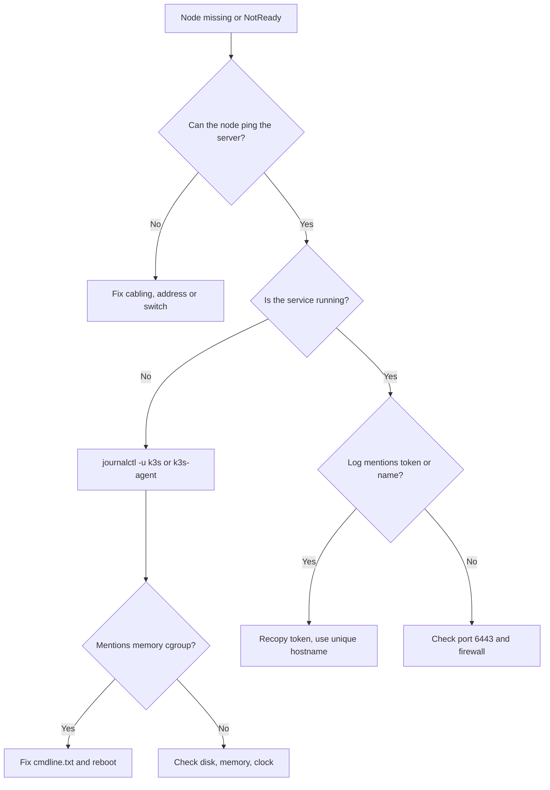

{:class="cover"}

---

By the end of this lesson you will be able to diagnose a failed K3s install or join by reading service logs, and reinstall cleanly when you need to.

---

## Work from the outside in

K3s is quite forgiving, but when something is wrong the cause is nearly always one of four things: the **network**, the **cgroup setting**, **disk or memory**, or a **name or token clash**. Check them in that order, and always read the log before guessing.



---

## The two commands you will use most

On the server:

```bash
sudo systemctl status k3s
sudo journalctl -u k3s -e
```

On a worker, the service has a different name:

```bash
sudo systemctl status k3s-agent
sudo journalctl -u k3s-agent -e
```

`-e` jumps to the end of the log, where the latest error is. Read the last 20 or so lines slowly. The message is often a plain-English sentence telling you what is wrong.

---

## Problem 1: the memory cgroup

K3s needs the memory cgroup on Raspberry Pi OS. If it is missing, the log says it failed to find the memory cgroup and suggests adding `cgroup_memory=1 cgroup_enable=memory` to the kernel command line. On current Raspberry Pi OS that file is `/boot/firmware/cmdline.txt` (older releases used `/boot/cmdline.txt`). It must remain a single line. Check it took effect after a reboot:

```bash
grep memory /proc/cgroups
```

The memory line should end in `1`.

---

## Problem 2: the node cannot reach the server

From the worker:

```bash
ping -c 3 192.168.1.100
curl -k https://192.168.1.100:6443
```

The ping should get replies. The `curl` will not give you a nice page, but any response at all, even an authorisation error, means the port is open. A timeout or "connection refused" means a network or firewall problem. If you installed a firewall, port TCP 6443 must be open from workers to the server.

---

## Problem 3: token or name clashes

- Recopy the token from `/var/lib/rancher/k3s/server/node-token` on the server. Do not retype it.
- Use the server's IP address in `K3S_URL`, not a name your Pi cannot resolve.
- Give every node a unique hostname. A second machine using an existing node name is rejected.

---

## Problem 4: disk, memory and time

```bash
df -h
free -h
date
```

A full disk stops K3s from pulling images. Very low free memory can make pods restart. A Pi has no battery-backed clock, so after power-up the date can be wrong until the network syncs it. Certificates depend on correct time, so if `date` is badly off, wait for the time to sync before blaming K3s.

---

## Starting again cleanly

K3s ships its own uninstall scripts. They stop the service, remove it and delete the cluster data on that node.

On the **server**:

```bash
sudo /usr/local/bin/k3s-uninstall.sh
```

On a **worker**:

```bash
sudo /usr/local/bin/k3s-agent-uninstall.sh
```

Then reinstall following the earlier lessons. Uninstalling the server deletes the cluster state, including the token. After a fresh server install, workers must be rejoined with the new token, and the old node entries should be removed with `sudo k3s kubectl delete node <name>`.

---

## Quick checklist

| Question | Command |
|---|---|
| Is the node Ready? | `sudo k3s kubectl get nodes` |
| Why did the server service fail? | `sudo journalctl -u k3s -e` |
| Why did the worker service fail? | `sudo journalctl -u k3s-agent -e` |
| Are system pods healthy? | `sudo k3s kubectl get pods -A` |
| Is there disk and memory? | `df -h` and `free -h` |
{:class="table table-single"}

> **Teachers**: Troubleshooting is a good lesson to run as a game: secretly break one thing on a spare cluster (a typo in the token, the wrong port, a duplicate hostname) and have groups find it using only the logs. Keep a reinstall script handy, since a full uninstall and reinstall takes only a few minutes.

---

## Try it Yourself

1. Read the last 30 lines of `journalctl -u k3s` on a working server. Do you see any warnings? You will usually see a few and that is fine.
2. On a spare worker, deliberately mistype the token, watch the join fail, and find the error in `journalctl -u k3s-agent`.
3. Challenge: uninstall a worker with the agent script, delete its node record on the server, and rejoin it with a new hostname.

---

## Common Issues

- **Problem**: You edited the cgroup settings but K3s still complains.
- **Solution**: Check you edited `/boot/firmware/cmdline.txt` and rebooted, then run `grep memory /proc/cgroups`.
- **Why**: Edits to the wrong file are silently ignored, and the setting only applies at boot.

- **Problem**: An old node still shows `NotReady` after you reinstalled it.
- **Solution**: Run `sudo k3s kubectl delete node <name>` on the server.
- **Why**: Kubernetes keeps the node object until you delete it, even when the machine has gone.

---

## Check your understanding


? Which command shows why the worker's K3s service failed?
- [ ] `journalctl -u k3s -e`
- [x] `journalctl -u k3s-agent -e`
- [ ] `kubectl logs k3s-agent`
> Workers run the `k3s-agent` service, so its logs are under that unit name.

? What does the K3s uninstall script on the server do to the cluster data?
- [ ] Keeps it for next time
- [x] Removes it, so workers must rejoin with a new token
- [ ] Moves it to the SD card
> A fresh server install creates a fresh token and datastore.

? Why can a wrong system clock cause problems?
- [x] Certificates depend on correct time
- [ ] The Pi refuses to boot
- [ ] Ethernet stops working
> A Pi has no battery-backed clock, so time can be wrong until it syncs.

