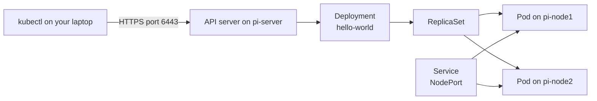

{:class="cover"}

---

By the end of this lesson you will be able to point `kubectl` on your own computer at your K3s cluster, and use it to deploy, inspect, expose and delete a simple app.

---

## What kubectl does

`kubectl` is the command-line tool that talks to the Kubernetes API on your server. You describe what you want ("three copies of nginx"), and Kubernetes makes it so and keeps it that way. If a pod dies, the Deployment creates another.



---

## Step 1: Install kubectl on your computer

K3s already includes `kubectl` on the server, but it is nicer to work from your own computer. Install the standard `kubectl` by following the instructions at kubernetes.io/docs/tasks/tools/ for your operating system, then check it with:

```bash
kubectl version --client
```

---

## Step 2: Copy the kubeconfig

The kubeconfig at `/etc/rancher/k3s/k3s.yaml` is root-only, so `scp` as a normal user is refused. Instead, read it with `sudo` over SSH:

```bash
mkdir -p ~/.kube
ssh pi@pi-server.local "sudo cat /etc/rancher/k3s/k3s.yaml" > ~/.kube/config
chmod 600 ~/.kube/config
```

Inside the file, the `server:` line points to `https://127.0.0.1:6443`, which means "this computer". The K3s docs tell you to replace that with your server's address. Open the file in an editor and change it, or on Linux:

```bash
sed -i 's/127.0.0.1/192.168.1.100/' ~/.kube/config
```

On macOS use `sed -i '' ...` instead. Now test:

```bash
kubectl get nodes
```

You should see the same nodes as before, with no `sudo` and no `k3s` in front. Keep this file private: it gives full administrator access to your cluster.

---

## Step 3: Explore

```bash
kubectl get nodes -o wide
kubectl get pods -A
kubectl get pods -n kube-system
```

`-A` means all namespaces and `-n` picks one. Namespaces are folders for resources. K3s puts its own components in `kube-system`, and yours go in `default` unless you say otherwise.

---

## Step 4: Deploy and expose an app

```bash
kubectl create deployment hello-world --image=nginx --replicas=2
kubectl expose deployment hello-world --port=80 --type=NodePort
kubectl get pods -o wide
kubectl get svc hello-world
```

The Service line shows a port such as `80:3xxxx/TCP`. The number after the colon is the **NodePort**, between 30000 and 32767. Open `http://192.168.1.100:<nodeport>` in your browser, using any node's address, and you should see the nginx welcome page. NodePort opens that same port on every node.

---

## Step 5: Look inside and watch it heal

```bash
kubectl describe pod <pod-name>
kubectl logs <pod-name>
kubectl exec -it <pod-name> -- sh
```

Replace `<pod-name>` with a name from `get pods`. Then delete a pod and watch the Deployment replace it:

```bash
kubectl delete pod <pod-name>
kubectl get pods
```

A new pod with a different name appears almost at once. This is Kubernetes keeping its promise of two replicas.

---

## Handy commands

| Command | What it does |
|---|---|
| `kubectl get <thing>` | List pods, services, deployments, nodes |
| `kubectl describe <thing> <name>` | Details and recent events, the first stop for problems |
| `kubectl logs <pod>` | Output from a pod's container |
| `kubectl apply -f file.yaml` | Create or update from a file |
| `kubectl delete -f file.yaml` | Remove what a file created |
| `kubectl scale deployment <name> --replicas=3` | Change the number of copies |
{:class="table table-single"}

Clean up when you are done:

```bash
kubectl delete service hello-world
kubectl delete deployment hello-world
```

> **Teachers**: Learners sharing one cluster will all type `hello-world` and trip over each other. Give each learner a namespace (`kubectl create namespace alice`) and have them add `-n alice` to every command. Also stress that the kubeconfig is an administrator key, so it should not be emailed or committed to Git.

---

## Try it Yourself

1. Deploy `nginx` with three replicas and use `get pods -o wide` to see which nodes they run on.
2. Delete one pod and time how long it takes the replacement to become `Running`.
3. Scale the deployment up to five replicas and back down to one.
4. Challenge: run `kubectl create deployment demo --image=nginx --dry-run=client -o yaml` and read the YAML it prints. Which fields could you change?

---

## Common Issues

- **Problem**: `kubectl` says `connection refused` to `127.0.0.1:6443`, or `localhost:8080`.
- **Solution**: Check `~/.kube/config` exists and its `server:` line holds the server's real IP address.
- **Why**: The copied kubeconfig points at `127.0.0.1`, which on your laptop is not the Pi.

- **Problem**: A pod is stuck in `ImagePullBackOff`.
- **Solution**: Run `kubectl describe pod <name>`, read the Events, and check the image name and that it supports `arm64`.
- **Why**: A typo or an image built only for another CPU type cannot be pulled and started on a Pi.

---

## Check your understanding


? What does `kubectl get pods -A` show?
- [ ] Only pods on the current node
- [x] Pods in all namespaces
- [ ] Only failed pods
> `-A` is short for all namespaces.

? What happens if you delete one pod owned by a Deployment?
- [ ] The Deployment is deleted
- [x] The Deployment creates a replacement
- [ ] Nothing, until you restart K3s
> A Deployment keeps the requested number of replicas running.

? Why do you edit the `server:` line in the copied kubeconfig?
- [x] It points to 127.0.0.1, which is your laptop, not the Pi
- [ ] It must be a hostname
- [ ] It has expired
> The server's own copy refers to itself, so you replace the address when copying it elsewhere.

