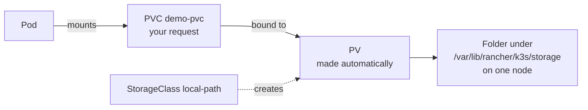

{:class="cover"}

---

By the end of this lesson you will be able to give a pod storage that survives restarts by using a PersistentVolumeClaim with K3s's built-in local-path storage, and explain its limits.

---

## Containers forget

Anything a container writes to its own filesystem disappears when the pod is replaced. That is fine for nginx, but not for a database or a counter you want to keep. Kubernetes separates the *request* for storage from the storage itself:

- A **PersistentVolumeClaim (PVC)** is your request: "I need 1GB I can read and write."
- A **PersistentVolume (PV)** is the actual storage.
- A **StorageClass** says how to create storage on demand.

K3s ships a StorageClass called `local-path`, which is the default. When you create a PVC, it makes a folder on a node's disk and hands it over. Check it exists:

```bash
kubectl get storageclass
```



---

## Step 1: Ask for storage

Create `pvc-demo.yaml`:

```yaml
apiVersion: v1
kind: PersistentVolumeClaim
metadata:
  name: demo-pvc
spec:
  accessModes:
    - ReadWriteOnce
  storageClassName: local-path
  resources:
    requests:
      storage: 1Gi
```

```bash
kubectl apply -f pvc-demo.yaml
kubectl get pvc
```

The PVC will probably show `Pending`. That is expected: local-path waits until a pod actually uses the claim, so that it can create the folder on the same node the pod runs on.

---

## Step 2: Use it in a pod

Create `pvc-tester.yaml`:

```yaml
apiVersion: v1
kind: Pod
metadata:
  name: pvc-tester
spec:
  containers:
    - name: busybox
      image: busybox
      command: ["sleep", "3600"]
      volumeMounts:
        - mountPath: /data
          name: myvolume
  volumes:
    - name: myvolume
      persistentVolumeClaim:
        claimName: demo-pvc
```

```bash
kubectl apply -f pvc-tester.yaml
kubectl get pvc
```

Once the pod is running, the PVC changes to `Bound`. Write a file, then delete and recreate the pod:

```bash
kubectl exec pvc-tester -- sh -c 'echo "Hello Pi cluster" > /data/test.txt'
kubectl delete pod pvc-tester
kubectl apply -f pvc-tester.yaml
kubectl exec pvc-tester -- cat /data/test.txt
```

The file is still there, because it lives in the volume, not in the pod.

---

## Where is the data?

By default local-path stores data on the node's disk under `/var/lib/rancher/k3s/storage`. Find which node your pod ran on with `kubectl get pod pvc-tester -o wide`, then on that Pi:

```bash
sudo ls /var/lib/rancher/k3s/storage
```

You will see a folder named after the volume. You can change this location with the `default-local-storage-path` setting in `/etc/rancher/k3s/config.yaml`.

---

## The limits of local-path

- The data lives on **one node**. A pod that uses it is tied to that node, so if the Pi dies, so does access to the data.
- By default, deleting a PVC deletes its data. Do not delete a claim you care about.
- It is a plain folder on the node's disk, so an SD card wears faster. Prefer an SSD.

For storage that follows pods around, look at **Longhorn**, which the K3s docs list as a distributed block storage option (it is not supported on 32-bit ARM, which is another reason to use 64-bit), or an NFS share on a NAS.

> **Teachers**: Storage is where learners lose work. Make the point early that data in local-path is not backed up, and that deleting a PVC deletes the data. If many learners share a cluster, a small SSD can fill up, so agree a size (`1Gi` is plenty) and clean up claims at the end of a session.

---

## Cleanup

```bash
kubectl delete pod pvc-tester
kubectl delete pvc demo-pvc
```

---

## Try it Yourself

1. Run the demo and confirm the file survives deleting the pod.
2. Check `kubectl get pv`. What is the name of the volume and its status?
3. Change the claim to ask for `2Gi` in a new file, apply it, and see what you get.
4. Challenge: after the pod is running, look on the node for the folder and read `test.txt` directly from the node's disk.

---

## Common Issues

- **Problem**: The PVC stays `Pending`.
- **Solution**: Create a pod that uses the claim. Then run `kubectl describe pvc demo-pvc` and read the Events.
- **Why**: local-path waits for the first pod to use the claim before choosing a node.

- **Problem**: A pod will not start after its node went down.
- **Solution**: Bring that node back, or restore the data and recreate the claim elsewhere.
- **Why**: The volume exists on that one node, so the pod can only run there.

---

## Check your understanding


? What is the name of the default StorageClass in K3s?
- [ ] longhorn
- [x] local-path
- [ ] nfs-client
> K3s bundles the local-path provisioner as its default.

? Where does local-path store data by default?
- [ ] /opt/data
- [x] /var/lib/rancher/k3s/storage on the node
- [ ] On all nodes at once
> Data is a folder on one node's disk.

? What is a PVC?
- [x] A request for storage that a pod can mount
- [ ] A type of container image
- [ ] A network policy
> A claim asks for storage, and a StorageClass provides it.

