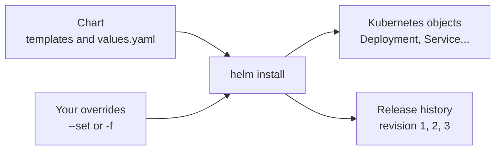

{:class="cover"}

---

By the end of this lesson you will be able to install Helm, create your own chart, and install, upgrade, roll back and uninstall it on your K3s cluster.

---

## Why Helm?

Last lesson we wrote five YAML files by hand. Now imagine a second copy of the app, with a different host name and two replicas. You would copy everything and edit it. **Helm** is the package manager for Kubernetes. It turns your YAML into a **chart**, a folder of templates plus a `values.yaml` of settings. You install a chart as a named **release**, and Helm remembers each version so you can upgrade and roll back.



---

## Step 1: Install Helm on your computer

Helm runs on your computer and uses the same kubeconfig as `kubectl`, so lesson 8 must be done first. The Helm documentation gives this installer script. Download it, read it, then run it:

```bash
curl -fsSL -o get_helm.sh https://raw.githubusercontent.com/helm/helm/main/scripts/get-helm-4
chmod 700 get_helm.sh
./get_helm.sh
helm version
```

You can also install Helm from your system's package manager, as described at helm.sh/docs/intro/install/.

---

## Step 2: Create a chart

Helm can generate a starter chart for you:

```bash
helm create hello-chart
```

Look inside the new `hello-chart` folder. The files that matter are `Chart.yaml` (the name and version), `values.yaml` (the settings) and the `templates` folder (the Kubernetes YAML with placeholders). The starter chart deploys nginx, which runs on a Pi.

Check it for mistakes, and look at the YAML it would create without installing anything:

```bash
helm lint hello-chart
helm template hello hello-chart
```

---

## Step 3: Install it as a release

The starter chart picks its nginx version from the chart's `appVersion`, which is an old number, so we override the image tag in our own values file. Create `my-values.yaml` next to the chart folder:

```yaml
replicaCount: 1
image:
  tag: alpine
```

Then install:

```bash
helm install hello ./hello-chart -f my-values.yaml
helm list
kubectl get pods
```

`hello` is the release name. Helm created a Deployment and Service from the templates, using the defaults in `values.yaml` with your file laid on top.

---

## Step 4: Change a setting with an upgrade

Always pass your values file again on an upgrade, otherwise Helm goes back to the chart defaults. You can override a single value on top of it with `--set`:

```bash
helm upgrade hello ./hello-chart -f my-values.yaml --set replicaCount=2
kubectl get pods
```

You should now have two pods. Because the file can go into Git, your settings are written down and repeatable, which is the real power of Helm.

---

## Step 5: Roll back

See the history, then go back to the first revision:

```bash
helm history hello
helm rollback hello 1
kubectl get pods
```

You are back to one replica. Rolling back creates a new revision, so the history keeps growing and nothing is lost.

---

## Step 6: Uninstall

```bash
helm uninstall hello
```

Everything the release created is removed.

---

## Using charts from other people

Helm charts live in repositories. The commands are:

```bash
helm repo add <name> <url>
helm repo update
helm search repo <name>
helm install my-release <name>/<chart>
```

You can browse public charts at artifacthub.io. Before you install one on a Pi, check that the chart is still maintained, that its images support `arm64`, and how much memory it asks for: some big charts are too heavy for a small cluster. Read the chart's `values.yaml` and README first.

K3s also has a built-in Helm controller that can install charts from a `HelmChart` resource, which is how it installs Traefik. That is a good topic to explore in the K3s docs once you are comfortable with the Helm command.

> **Teachers**: Helm hides the YAML, so make sure learners have written a few manifests by hand first (lessons 11 and 12), otherwise charts feel like magic. Charts from the internet download software that learners have not read, so stick to your own chart or a chart you have checked in class.

---

## Try it Yourself

1. Create a chart, install it, and use `helm list` to see the release.
2. Upgrade with `-f my-values.yaml --set replicaCount=3`, and confirm three pods.
3. Run `helm history` and roll back to revision 1.
4. Challenge: run `helm template` and find the Service in the output. Change `service.type` to `NodePort` with `--set` and see how the output changes.

---

## Common Issues

- **Problem**: `Kubernetes cluster unreachable`.
- **Solution**: Check `kubectl get nodes` works from the same terminal, and that `~/.kube/config` has the server's real address.
- **Why**: Helm uses the same kubeconfig as `kubectl`, so if one fails, so does the other.

- **Problem**: `cannot re-use a name that is still in use`.
- **Solution**: Pick another release name, or run `helm uninstall` on the old one.
- **Why**: Release names must be unique within a namespace.

- **Problem**: An upgrade changed something you did not expect, such as the image version.
- **Solution**: Pass `-f my-values.yaml` on every upgrade, and look at `helm get values hello`.
- **Why**: Without your file, Helm uses the chart defaults, not what you used last time.

- **Problem**: An upgrade did not change anything.
- **Solution**: Check the setting name matches what is in `values.yaml`, for example `replicaCount`, and look at `helm get values hello`.
- **Why**: A misspelled value is silently ignored, because Helm does not know it exists.

---

## Check your understanding


? What is a Helm release?
- [ ] A new version of Kubernetes
- [x] A named installation of a chart in your cluster
- [ ] A Docker image
> A release is one install of a chart, with its own history.

? Which command changes `replicaCount` on an existing release?
- [ ] `helm install --set replicaCount=2`
- [x] `helm upgrade hello ./hello-chart -f my-values.yaml --set replicaCount=2`
- [ ] `helm template hello`
> `upgrade` modifies a release that already exists.

? What does `helm rollback hello 1` do?
- [x] Returns the release to revision 1 as a new revision
- [ ] Deletes the release
- [ ] Rolls back K3s itself
> Rollbacks create a new revision, so history is kept.

