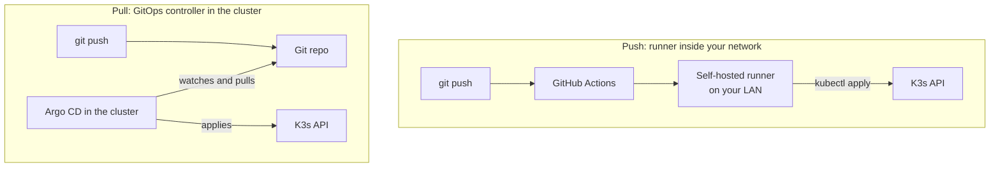

{:class="cover"}

---

By the end of this lesson you will be able to explain the two ways of automating deployment to a home cluster, push-based with a runner and pull-based with GitOps, and set up a GitHub Actions workflow that applies your manifests.

---

## The problem with a home cluster

Continuous deployment means that pushing to Git updates your cluster automatically. The obvious plan is to have GitHub's servers run `kubectl apply`. But your Pi cluster sits on a private home network (`192.168.x.x`), and GitHub's servers on the internet cannot reach it. You also should never open port 6443 on your router to fix that.

So there are two sensible designs:



---

## Option 1: GitHub Actions with a self-hosted runner

A **self-hosted runner** is a small program on a machine of yours that picks up jobs from GitHub. Because the runner is inside your network, it can reach the cluster. The runner machine needs `kubectl` installed, and can be a spare computer or another Linux machine on the network. Follow GitHub's instructions under your repository's Settings, then Actions, then Runners, then New self-hosted runner.

> Use self-hosted runners only with private repositories you control. GitHub warns against them on public repositories, because anyone's pull request could then run code on your network.

**A kubeconfig for the workflow.** The workflow needs credentials. Take your kubeconfig, make sure the `server:` line holds the server's LAN address, and encode it so it fits in a secret:

```bash
base64 -w 0 ~/.kube/config
```

(On macOS use `base64 -i ~/.kube/config`.) Save the output as a repository secret called `KUBECONFIG_B64`. This kubeconfig is a cluster administrator key, so for anything beyond a home lab you would create a limited service account instead, using what you learn in lesson 16.

**The workflow.** Create `.github/workflows/deploy.yml` in your repo, with your manifests in a `k8s/` folder:

```yaml
name: Deploy to K3s

on:
  push:
    branches:
      - main

jobs:
  deploy:
    runs-on: self-hosted
    steps:
      - name: Checkout code
        uses: actions/checkout@v4

      - name: Write kubeconfig
        env:
          KUBECONFIG_B64: ${{ secrets.KUBECONFIG_B64 }}
        run: |
          echo "$KUBECONFIG_B64" | base64 -d > "$RUNNER_TEMP/kubeconfig"
          chmod 600 "$RUNNER_TEMP/kubeconfig"

      - name: Apply manifests
        env:
          KUBECONFIG: ${{ runner.temp }}/kubeconfig
        run: |
          kubectl apply -f k8s/
          kubectl rollout status deployment/web --timeout=120s
```

Push a change to a manifest and watch the Actions tab. The last step waits until the rollout succeeds, so a bad deployment makes the workflow fail instead of passing silently.

**Building images.** If your app has its own container image, remember the Pis need an `arm64` image. Build it on an ARM machine, or build for `linux/arm64` with Docker Buildx, push it to a registry, and then put the new tag in your manifest.

---

## Option 2: GitOps with Argo CD

With GitOps, a controller **inside** the cluster watches your Git repository and applies changes itself. Nothing outside has to reach in, which makes it a better fit for home networks. The Argo CD documentation gives these install commands:

```bash
kubectl create namespace argocd
kubectl apply -n argocd --server-side --force-conflicts -f https://raw.githubusercontent.com/argoproj/argo-cd/stable/manifests/install.yaml
```

Argo CD is a bigger piece of software than anything else we have run, so give it time to start and expect it to use a fair amount of memory on a small Pi. Check progress with `kubectl get pods -n argocd`. Then reach its web page with a port-forward:

```bash
kubectl port-forward svc/argocd-server -n argocd 8080:443
```

Open `https://localhost:8080`. The username is `admin`. The first password is in a secret:

```bash
kubectl -n argocd get secret argocd-initial-admin-secret -o jsonpath="{.data.password}" | base64 -d
```

From the UI you add your Git repository and point an application at your `k8s/` folder. Flux is another popular GitOps tool with the same idea.

> **Teachers**: This lesson needs a GitHub account for each learner or group, and school policies may forbid personal accounts or block GitHub. Self-hosted runners execute code on the machine they run on, so keep them on a machine you own. Argo CD is heavy for a class of small Pis, so the workflow in Option 1, or simply reading the diagrams, may be enough.

---

## Try it Yourself

1. Create a private repo with a `k8s/` folder holding the `hello.yaml` manifest from lesson 11.
2. Draw which machine talks to which in your own setup for Option 1.
3. Add `kubectl get pods` as a final step in the workflow so the job log shows the result.
4. Challenge: install Argo CD, add your repo as an application, change the replica count in Git, and watch the cluster follow.

---

## Common Issues

- **Problem**: The job stays queued and never starts.
- **Solution**: Check the runner is online in Settings, Actions, Runners, and that the workflow says `runs-on: self-hosted`.
- **Why**: A job with `self-hosted` waits for a runner you registered, and does not run on GitHub's own machines.

- **Problem**: `kubectl` in the workflow says `connection refused` to `127.0.0.1`.
- **Solution**: Edit your kubeconfig so `server:` is the server's LAN address, and re-create the secret.
- **Why**: K3s writes `127.0.0.1` into its kubeconfig, which only works on the server itself.

- **Problem**: Argo CD pods keep restarting.
- **Solution**: Check `kubectl top nodes` and `kubectl describe pod` for memory pressure. Use a Pi with more RAM or stay with Option 1.
- **Why**: Argo CD has several components, and a 2GB node can run out of memory.

---

## Check your understanding


? Why can't GitHub's hosted runners deploy to a home K3s cluster directly?
- [ ] K3s blocks GitHub
- [x] The cluster is on a private network they cannot reach
- [ ] kubectl does not run in CI
> Private 192.168.x.x addresses are not reachable from the internet.

? What does a GitOps controller like Argo CD do?
- [ ] Builds your images
- [x] Watches a Git repo from inside the cluster and applies changes
- [ ] Replaces kubectl
> The pull model means nothing outside needs to reach the cluster.

? What is a good reason to use `kubectl rollout status` in a workflow?
- [x] The job fails if the deployment does not become ready
- [ ] It builds the image
- [ ] It deletes old pods
> It waits for the rollout and returns an error if it fails.

