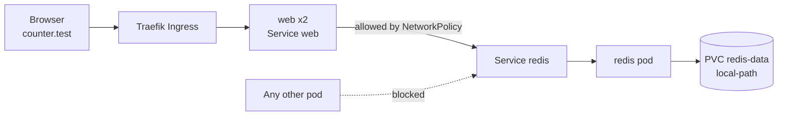

{:class="cover"}

---

By the end of this lesson you will be able to deploy a complete multi-service app on K3s in its own namespace, with storage that survives a restart, an Ingress, and a NetworkPolicy that protects the database.

---

## The project

In lesson 12 we built a visit counter whose count vanished when Redis restarted. Now let's finish the job and make it something you would be happy to leave running on your shelf. We will:

- put everything in its own **namespace**, `pi-counter`
- give Redis a **PersistentVolumeClaim** so the count survives
- keep the web app and Ingress from lesson 12
- add a **NetworkPolicy** so only the web pods can talk to Redis
- keep every file in a `k8s/` folder, ready for Git and the CI/CD from lesson 14



---

## Step 1: The folder

```text
k8s/
  00-namespace.yaml
  redis.yaml
  web.yaml
  web-ingress.yaml
  netpol.yaml
```

Copy `web.yaml` and `web-ingress.yaml` from lesson 12 unchanged, except that in `web-ingress.yaml` you change the host to `counter.test`. Kubernetes applies files in name order, so the `00-` prefix puts the namespace first.

Create `k8s/00-namespace.yaml`:

```yaml
apiVersion: v1
kind: Namespace
metadata:
  name: pi-counter
```

---

## Step 2: Redis with storage

Create `k8s/redis.yaml`. It asks for a 1Gi volume, runs Redis with its append-only file turned on so writes are saved to disk, and mounts the volume at `/data`, where the Redis image keeps its files:

```yaml
apiVersion: v1
kind: PersistentVolumeClaim
metadata:
  name: redis-data
spec:
  accessModes:
    - ReadWriteOnce
  storageClassName: local-path
  resources:
    requests:
      storage: 1Gi
---
apiVersion: apps/v1
kind: Deployment
metadata:
  name: redis
spec:
  replicas: 1
  strategy:
    type: Recreate
  selector:
    matchLabels:
      app: redis
  template:
    metadata:
      labels:
        app: redis
    spec:
      containers:
        - name: redis
          image: redis:7-alpine
          command: ["redis-server", "--appendonly", "yes"]
          ports:
            - containerPort: 6379
          resources:
            requests:
              memory: 32Mi
              cpu: 50m
            limits:
              memory: 128Mi
          volumeMounts:
            - name: data
              mountPath: /data
      volumes:
        - name: data
          persistentVolumeClaim:
            claimName: redis-data
---
apiVersion: v1
kind: Service
metadata:
  name: redis
spec:
  selector:
    app: redis
  ports:
    - port: 6379
      targetPort: 6379
```

`strategy: Recreate` matters here. The default rolling update starts the new pod before stopping the old one, and two Redis processes must not share one data folder.

---

## Step 3: Protect Redis

Create `k8s/netpol.yaml`:

```yaml
apiVersion: networking.k8s.io/v1
kind: NetworkPolicy
metadata:
  name: redis-from-web-only
spec:
  podSelector:
    matchLabels:
      app: redis
  policyTypes:
    - Ingress
  ingress:
    - from:
        - podSelector:
            matchLabels:
              app: web
      ports:
        - protocol: TCP
          port: 6379
```

This selects the Redis pods and lets only pods labelled `app: web` reach port 6379. The web pods stay open to Traefik, because we have not restricted them.

---

## Step 4: Deploy

```bash
kubectl apply -f k8s/ -n pi-counter
kubectl get all,pvc,ingress,networkpolicy -n pi-counter
```

Wait for the pods to be `Running` and the claim to be `Bound`. Then visit the app:

```bash
curl -H "Host: counter.test" http://192.168.1.100/
```

Run it a few times and watch the number climb.

---

## Step 5: Prove it works

**The count survives.** Delete the Redis pod and let the Deployment recreate it:

```bash
kubectl delete pod -n pi-counter -l app=redis
kubectl get pods -n pi-counter
```

When the new Redis pod is `Running`, call the page again. The count carries on from where it was, instead of going back to 1.

**Redis is locked down.** Try to reach Redis from a pod that is not part of the web app. busybox's `nc` sends a `PING`:

```bash
kubectl run tester -n pi-counter --rm -it --restart=Never --image=busybox:1.36 -- sh -c 'echo PING | nc -w 3 redis 6379'
```

This should time out with no reply, because the tester does not carry the `app: web` label. If you see `+PONG`, check the policy is applied and that K3s was not started with `--disable-network-policy`.

---

## Extension ideas

- Package the folder as a Helm chart (lesson 13) with a values file for the host name.
- Push the `k8s/` folder to a private Git repo and deploy it with the workflow or Argo CD from lesson 14.
- Add a TLS Secret and `tls:` section to the Ingress (lesson 16).
- Run `kubectl top pods -n pi-counter` and tune the resource limits.

> **Teachers**: This is a good assessed task. A simple rubric: the app responds (deployed), the count survives a Redis restart (storage), the tester pod is blocked (policy), and the learner can explain each file in their own words. Give each group its own namespace and host name so groups do not collide.

---

## Try it Yourself

1. Deploy the whole project and take the count above ten.
2. Delete the Redis pod and confirm the count continues.
3. Scale `web` to four replicas and check the pod names in the replies.
4. Challenge: delete the PVC and the Redis pod, apply again, and explain why the count starts at 1.

---

## Common Issues

- **Problem**: `kubectl apply -f k8s/` complains the namespace does not exist.
- **Solution**: Apply the `00-namespace.yaml` file first with `kubectl apply -f k8s/00-namespace.yaml`, then apply the folder again.
- **Why**: Kubernetes creates objects in order, and a namespace has to exist before anything goes in it. Re-running fixes a race.

- **Problem**: The web page says `Cannot reach Redis`.
- **Solution**: Check the web pods carry the label `app: web`, and run `kubectl get endpoints redis -n pi-counter`.
- **Why**: The NetworkPolicy only admits pods with that label, so a changed label blocks the app too.

- **Problem**: The Redis pod stays `Pending`.
- **Solution**: Run `kubectl describe pod -n pi-counter -l app=redis` and check the PVC is `Bound` and the node has disk space.
- **Why**: The pod cannot start until its volume is created on a node.

---

## Check your understanding


? Why does the Redis Deployment use `strategy: Recreate`?
- [ ] To make it faster
- [x] To avoid two pods sharing one data volume during an update
- [ ] To scale it to three replicas
> A rolling update would run two Redis pods at once on the same data.

? What lets the count survive deleting the Redis pod?
- [ ] The Ingress
- [x] The PersistentVolumeClaim and Redis's append-only file
- [ ] The NetworkPolicy
> Data is stored in the volume, not in the pod.

? Who is allowed to connect to Redis under our NetworkPolicy?
- [x] Only pods labelled app: web, on port 6379
- [ ] Every pod in the cluster
- [ ] Only Traefik
> The policy's ingress rule selects pods with that label.

