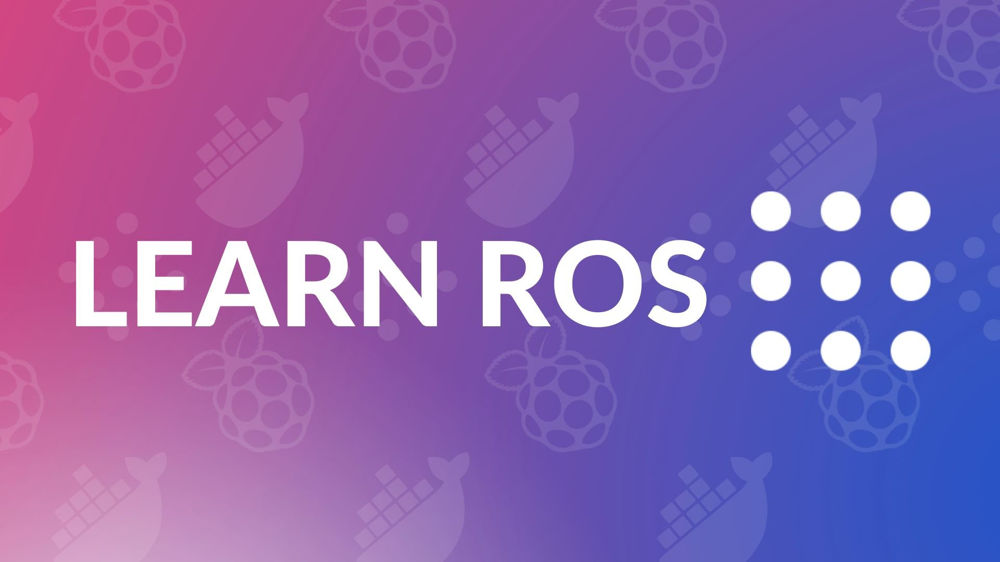

{:class="cover"}

## Watch the video

This course follows my "Learn ROS with me" video series. Part 1 shows the robot we're working towards.



---

## Overview

This course will teach you all about the Robot Operating System, how to run ROS 2 on a Raspberry Pi, and how to write your own ROS programs in Python.

---

## Course Content

In this course you will learn:

* How to set up a Raspberry Pi for use with ROS
* How to install Docker on a Raspberry Pi
* Setting up the ROS environment within a Docker container
* ROS versions and distributions
* Creating a ROS workspace with `colcon`
* ROS command line tools such as `ros2 run` and `ros2 topic`
* Writing ROS 2 nodes in Python
* Creating a package with a publisher and a subscriber
* Visualising LiDAR laser scan data in RViz2, using TF2 transforms

---

## Key Results

By the end of this course you will be able to:

* Run ROS 2 in a Docker container on a Raspberry Pi
* Write, build and run your own ROS 2 Python nodes
* Explain what nodes, topics, publishers and subscribers are
* Display live data from a LiDAR sensor in RViz2

---

### About ROS

ROS (Robot Operating System) is an open-source, meta-operating system for your robot. It provides the tools and libraries that allow you to quickly create and deploy robotics applications. ROS provides a flexible framework for writing and executing code, as well as a wide variety of libraries and tools for navigation, manipulation, and perception. ROS is used by many leading robotics companies and research institutions worldwide.

---

### Don't be scared

 ROS can be very intimidating at first, but don't worry - it's actually quite manageable once you understand the basics. This course is a great starting point for unpacking and learning how ROS works.

---

### What you'll need

Item             | Description
:----------------|-----------------------------
A Raspberry Pi 4 or 5 | 4GB or 8GB (recommended)
A LiDAR sensor   | RPLidar A1 LiDAR sensor from Slamtec (only needed for the last section)
A computer with VS Code | To write code on the Pi remotely
{:class="table table-striped"}

ROS can be installed on Windows, macOS or Linux; however for robotics we often want to install this on a single board computer such as the **Raspberry Pi**. ROS supports the Raspberry Pi running Ubuntu, or you can run the standard 64-bit Raspberry Pi OS and run ROS inside a Docker container; this is what we will use in this course.

The 8GB version of the Raspberry Pi is recommended as ROS is quite memory hungry, and the Raspberry Pi cannot use a large swap file as it damages the SD card over time (due to the large number of writes to the flash storage).

---

## How the course works

Each lesson is a set of steps to follow on the Raspberry Pi or in VS Code, with commands to type shown like `this`. The four videos in the series appear in the lessons they match. There's a short quiz at the end of each section.

## Prerequisites

* Comfortable typing commands in a terminal; [Introduction to the Linux Command Line](/learn/linux_intro/) covers this
* Some Python; [Python for beginners](/learn/python/) covers everything you need
* It helps to have seen [Docker](/learn/docker/) before, but it isn't required
