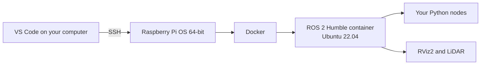

{:class="cover"}

---

## Watch the video

This course follows my "Learn ROS with me" video series. Part 1 shows the robot we're working towards.



---

## Overview

This course teaches you the Robot Operating System (ROS) from a blank SD card. You'll set up a Raspberry Pi, run **ROS 2 Humble** inside a Docker container, write your own nodes in Python, and finish by drawing live LiDAR scans in RViz2.

Every command in this course is for **ROS 2 Humble Hawksbill** on **Ubuntu 22.04 (Jammy)**. You don't install Ubuntu on the Pi: the Docker image supplies it, and the Pi keeps running 64-bit Raspberry Pi OS. Stick to Humble while you follow along, because package names, command output and some arguments change between ROS 2 releases.

---

## Course Content

* How to set up a Raspberry Pi for use with ROS
* How to install Docker on a Raspberry Pi
* Setting up the ROS environment within a Docker container
* ROS versions and distributions
* Creating a ROS workspace with `colcon`
* ROS command line tools such as `ros2 run`, `ros2 topic` and `ros2 node`
* Writing ROS 2 nodes in Python
* Creating a package with a publisher and a subscriber
* Visualising LiDAR laser scan data in RViz2, using TF2 transforms

---

## Key Results

By the end of this course you will be able to:

* Run ROS 2 in a Docker container on a Raspberry Pi
* Write, build and run your own ROS 2 Python nodes
* Explain what nodes, topics, publishers and subscribers are
* Display live data from a LiDAR sensor in RViz2

---

### About ROS

ROS (Robot Operating System) is an open-source set of libraries and tools for building robot software. It gives you a flexible way for many small programs to talk to each other, plus ready-made tools for navigation, manipulation and perception. It is used by robotics companies and research labs worldwide.

### Don't be scared

ROS can look intimidating at first, but it is quite manageable once you understand a few ideas: nodes, topics, packages and a build tool. This course introduces them one at a time, and every lesson ends with some things to try and a short quiz.

---

## What you'll need

| Item | Description |
|:-----|:------------|
| A Raspberry Pi 4 or 5 | 4GB or 8GB (8GB recommended) |
| A 32GB or larger SD card | Plus a card reader |
| A computer with VS Code | To write code on the Pi remotely |
| An RPLidar A1 LiDAR | From Slamtec; only needed for the last four lessons |
{:class="table table-single"}

ROS can be installed on Windows, macOS or Linux, but for robots we often want it on a single board computer such as the **Raspberry Pi**. ROS supports the Pi running Ubuntu, or you can run the standard 64-bit Raspberry Pi OS and run ROS inside a Docker container. That is what we do here.

The 8GB Pi is recommended because ROS is memory hungry, and a Pi shouldn't lean on a large swap file: the constant writes wear out the SD card.

---

## How the course works

Each lesson is a set of steps to follow on the Raspberry Pi or in VS Code, with commands to type shown in code boxes. Lessons start with an objective and end with **Try it Yourself** exercises, a **Common Issues** list and a short quiz. The video series appears in the lessons it matches. Nothing in the ROS lessons needs the LiDAR until lesson 16.

> **Teachers**: This suits confident 12 to 16 year olds and adults who can use a terminal. Allow 30 to 45 minutes per lesson; the Docker build in lesson 7 can take 10 minutes or more on a Pi. Each learner or pair needs their own Pi, SD card and a computer with VS Code. Without a Pi you can still read the lessons and study the code, and the Docker lessons run on any 64-bit Linux machine. Lessons 15 to 18 need a screen on the Pi and, for the live scan, an RPLidar. Docker downloads are large, so pre-pull images on the school network if you can.

## Prerequisites

* Comfortable typing commands in a terminal; [Introduction to the Linux Command Line](/learn/linux_intro/) covers this
* Some Python; [Python for beginners](/learn/python/) covers everything you need
* It helps to have seen [Docker](/learn/docker/) before, but it isn't required
