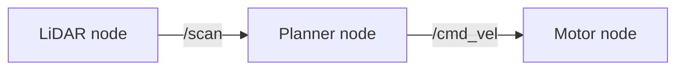

{:class="cover"}

---

By the end of this lesson you will be able to explain what ROS is, say how ROS 1 and ROS 2 differ, and name the distribution this course uses.

## What is ROS?

Here is the definition from the creators of ROS - <https://ros.org/>

> *"The Robot Operating System (ROS) is a set of software libraries and tools that help you build robot applications. From drivers to state-of-the-art algorithms, and with powerful developer tools, ROS has what you need for your next robotics project. And it's all open source."*

ROS isn't an operating system like Windows or Linux. It's middleware: a layer that sits on top of Linux and lets lots of small programs, called **nodes**, pass messages to each other. Imagine a small rover. One node reads the LiDAR, another decides where to go, another drives the motors. With ROS each node does one job, and they chat over named channels called **topics**.

The nice part is that you can swap a node (a different LiDAR, say) without touching the rest.

---

## Which version should I use

There are two versions of ROS:

* **ROS 1** - The original version of ROS. Its last release, Noetic, reached end of life in May 2025.
* **ROS 2** - The current version of ROS, and what we will be using in this course.

---

## Releases and distros

ROS 2 has a new release (called a *distro*) every May. The releases in even years are Long Term Support (LTS) releases with five years of updates. This course uses **Humble Hawksbill**, which runs on Ubuntu 22.04 and is what the example Docker files are built on. If you're starting a new project, check the [list of ROS 2 distributions](https://docs.ros.org/en/rolling/Releases.html) for the newest LTS release.

| Distro | Release date | End Of Life date |
|:-------|-------------:|-----------------:|
| Jazzy Jalisco (LTS) | May 23, 2024 | May 2029 |
| Iron Irwini | May 23, 2023 | December 2024 |
| **Humble Hawksbill (LTS)** | **May 23, 2022** | **May 2027** |
| Foxy Fitzroy | June 5, 2020 | May 2023 |
{:class="table table-single"}

**Why it matters:** commands, package names and even command output differ between distros. A tutorial for another distro may not work word for word on Humble, so check the distro name (it's in the install path, for example `/opt/ros/humble`) before you copy a command.

---

## Programming languages

ROS 2 supports both `C++` and `Python` out of the box, and community projects add other languages. In this course we use `Python`, because it's quick to write and easy to read.

---

## Try it Yourself

1. Open the [list of ROS 2 distributions](https://docs.ros.org/en/rolling/Releases.html) and find which distro is newest and which Ubuntu version it targets.
2. Think of a robot you've built. Sketch it as three or four nodes, with arrows for the topics between them.
3. Challenge: which of your nodes could be swapped for a different part (a new sensor, say) without changing the others?

## Common Issues

- **Problem**: A ROS tutorial you found online doesn't work.
- **Solution**: Check which ROS version and distro the tutorial is for. Look for "ROS 1", "Noetic", "Foxy" or "catkin" and treat those as warning signs.
- **Why**: ROS 1 and ROS 2 use different tools and APIs, and even ROS 2 distros differ in small ways.

## Check your understanding


? Which ROS 2 distro does this course use?
- [ ] Foxy Fitzroy
- [x] Humble Hawksbill
- [ ] Iron Irwini
> Humble is a Long Term Support release, and what the example Docker files are built on.

? Which two programming languages does ROS 2 support out of the box?
- [x] C++ and Python
- [ ] Java and JavaScript
- [ ] Rust and Go

? What is ROS, really?
- [ ] A replacement for Linux
- [x] A set of libraries and tools that lets small programs (nodes) pass messages to each other
- [ ] A single robot
> ROS sits on top of an operating system such as Linux. It isn't an operating system itself.

