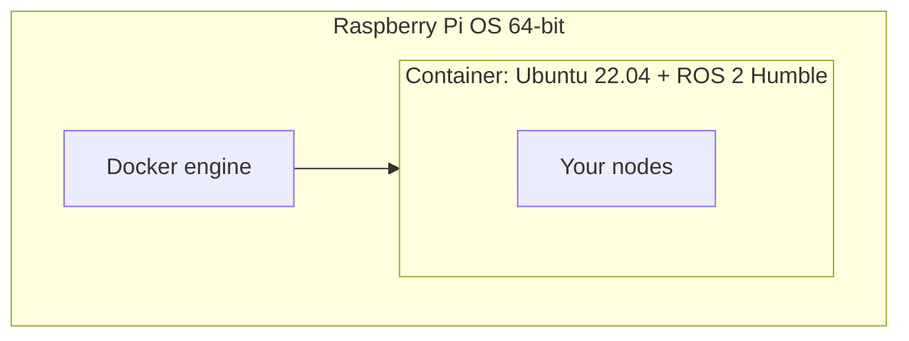

{:class="cover"}

---

By the end of this lesson you will be able to install Docker on a Raspberry Pi, run Docker commands without `sudo`, and check that it works.

## Why Docker?

ROS 2 is built for Ubuntu, but we're running Raspberry Pi OS. Docker bridges the gap. It runs **containers**: separate environments with their own files and processes. They behave like lightweight virtual machines, without emulating a whole computer, because they share the Pi's kernel. Our ROS 2 Humble container will bring its own copy of Ubuntu 22.04, and our Pi stays tidy.



---

## Get Docker

* **Get the install script** - from the terminal, type:

```bash
curl -fsSL https://get.docker.com -o get-docker.sh
chmod +x get-docker.sh
```

## Remove any existing docker installation

Only do this if you've installed Docker before and want a clean start.

```bash
sudo apt-get purge docker-ce docker-ce-cli containerd.io -y
```

## Install Docker

```bash
./get-docker.sh
```

The script asks for your password when it needs `sudo`, then downloads and installs the engine. It takes a few minutes.

---

## Fix permissions

Docker normally needs `sudo` for every command. Adding your user to the `docker` group removes that:

```bash
sudo usermod -aG docker $USER
```

*`$USER` is filled in automatically with the account you created when [setting up the Pi](02_pi_setup.html).*

If Docker was installed but won't start, it may be "masked". Unmasking is harmless if it isn't:

```bash
sudo systemctl unmask docker
sudo systemctl start docker
```

> ## Docker Compose
>
> The install script also installs **Docker Compose**, which we'll use to start our ROS container. It's run as `docker compose` (with a space). Older guides use a hyphenated command, which was a separate program you no longer need.
{:class="bg-blue"}

Now restart the Pi so the group change takes effect:

```bash
sudo reboot
```

## Check it works

After the reboot, log in again and type:

```bash
docker --version
docker compose version
docker run --rm hello-world
```

The last command downloads a tiny test image and prints a "Hello from Docker!" message. If you see it, Docker is ready.

> **Teachers**: Membership of the `docker` group is effectively root access on that machine, so only add learners on Pis they own or that you are happy to give them. The install script is downloaded from the internet, so a school filter may block it, and Docker Hub limits how many images an anonymous network can pull in a few hours; a whole class sharing one school IP can hit that limit. Pre-pull images, or stagger the class.

---

## Try it Yourself

1. Run `docker ps -a` after `hello-world`. Can you see the finished container?
2. Run `docker images` and note how small the `hello-world` image is.
3. Challenge: try `docker run --rm -it ubuntu:22.04 bash` and then `cat /etc/os-release`. You are inside an Ubuntu container on your Raspberry Pi OS machine. Type `exit` to leave.

## Common Issues

- **Problem**: `permission denied while trying to connect to the Docker daemon socket`.
- **Solution**: Check you ran `sudo usermod -aG docker $USER`, then reboot (or log out and in).
- **Why**: Group changes only apply to new logins.

- **Problem**: `toomanyrequests` when pulling an image.
- **Solution**: Wait a few hours, or log in with a free Docker Hub account using `docker login`.
- **Why**: Docker Hub rate-limits anonymous pulls per network address.

## Check your understanding


? Why add your user to the `docker` group?
- [ ] To make Docker run faster
- [x] So you can run `docker` commands without typing `sudo` every time
- [ ] To install Docker Compose
> The change takes effect after you log out and back in, which is why we reboot.

? How is a Docker container different from a virtual machine?
- [x] Containers share the host's operating system kernel, so they're much lighter
- [ ] Containers emulate a whole computer, including the hardware
- [ ] There is no difference

? Which command checks Docker is working end to end?
- [ ] `docker --version`
- [x] `docker run --rm hello-world`
- [ ] `sudo reboot`
> The version command only shows Docker is installed. `hello-world` downloads and runs a container.

