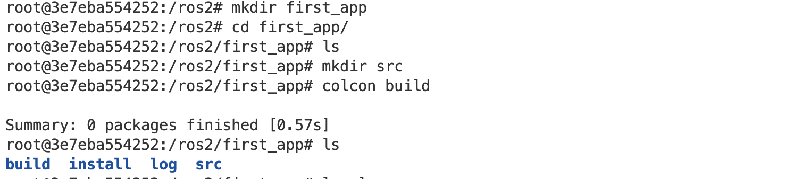
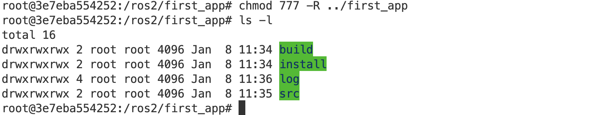
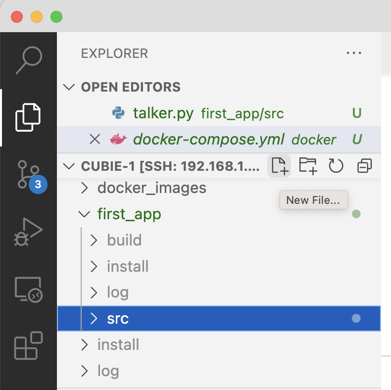
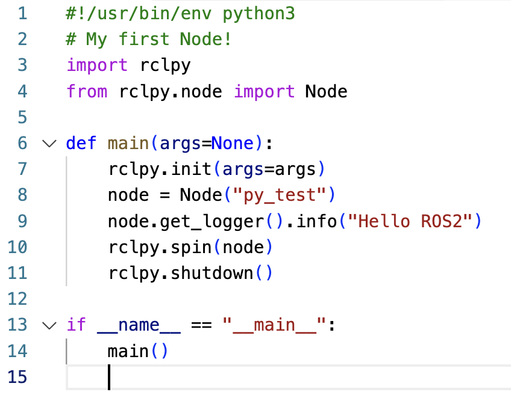
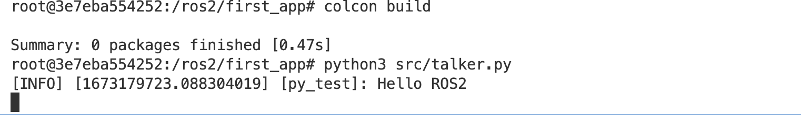

{:class="cover"}

---

By the end of this lesson you will be able to source ROS 2, create a workspace with `colcon`, and run a Python node that logs a message.

## Watch the video



---

## Source the ROS setup.bash script

ROS 2 is installed in the container under `/opt/ros/humble`, but your terminal doesn't know that yet. Sourcing the setup script adds the ROS commands and Python libraries to your terminal session.

* **Source the script** - from the container terminal, type:

```bash
source /opt/ros/humble/setup.bash
```

Every new terminal needs this, so if `ros2` says "command not found" this is the first thing to check. If you'd rather not retype it, add it to your shell startup file with `echo "source /opt/ros/humble/setup.bash" >> ~/.bashrc`.

---

## ROS2 Workspaces

A workspace is a folder laid out the way ROS expects, with your code in a `src` folder. ROS makes setting one up easy, using `colcon`.

* **Create a new workspace** - from the container terminal, type:

```bash
cd /ros2
mkdir first_app
cd first_app
mkdir src
colcon build
ls
```

*You will see new folders appear: `build`, `install` and `log`.*

{:class="img-fluid w-100 shadow-lg"}

> ### What is `colcon`?
>
> **colcon** stands for "collective construction". It's a command line tool to build, test and use multiple software packages. It handles the ordering of the builds and sets up the environment for you.
{:class="bg-blue"}

With an empty `src` folder colcon builds zero packages, which is fine: it has still created the folders we need.

## Source the workspace

The `install` folder holds setup scripts for this workspace. Source the local one so the terminal knows about our workspace:

```bash
source install/setup.bash
```

*You can look inside a setup script with `cat install/setup.bash`.*

## Fix permissions

The container runs as the `root` user, so the folders it creates are owned by root, and VS Code (running as you) can't save into them. Open the permissions up for this learning project:

```bash
chmod 777 -R /ros2/first_app
```

{:class="img-fluid w-100 shadow-lg"}

*`chmod 777` lets anyone read, write and run these files. That's fine for a throwaway workspace on your own Pi, but don't copy it onto a shared machine.*

---

## Create talker.py in src

* **Select the `src` folder and click New File** - in the VS Code Explorer
* **Name the file** - `talker.py`

{:class="img-fluid w-50 shadow-lg"}

## Paste this code

Let's cheat a bit: paste the code below, and we'll explain it right after.

```python
#!/usr/bin/env python3
# My first Node!
import rclpy
from rclpy.node import Node

def main(args=None):
    rclpy.init(args=args)
    node = Node("py_test")
    node.get_logger().info("Hello ROS2")
    rclpy.spin(node)
    rclpy.shutdown()

if __name__ == "__main__":
    main()
```

{:class="img-fluid w-50 shadow-lg"}

## Run the program

From the container terminal, type:

```bash
python3 src/talker.py
```

You'll see a line like `[INFO] [1673801367.468008815] [py_test]: Hello ROS2`, then the program waits.

{:class="img-fluid w-100 shadow-lg"}

Press `CTRL + C` to stop it. Congratulations! You've just written a ROS2 program.

---

## What the code means

* `import rclpy` loads the ROS 2 Python library (**r**os **cl**ient library for **py**thon).
* `rclpy.init()` starts ROS communications for this program.
* `Node("py_test")` creates a **node** called `py_test`. A node is a single program in a ROS system; a robot usually has lots of them, each doing one job (reading a sensor, driving the motors, planning a route).
* `node.get_logger().info(...)` prints a message through ROS's logging system, with a timestamp and the node's name.
* `rclpy.spin(node)` keeps the node running and handling events until you press `CTRL + C`.
* `rclpy.shutdown()` tidies up when the node stops.

---

## Try it Yourself

1. Change the message from `Hello ROS2` to your robot's name and run it again.
2. Change the node name from `py_test` to `my_first_node`. Where does the new name show up in the output?
3. Replace `.info(...)` with `.warn(...)` and then `.error(...)`. How does the output change?
4. Challenge: add a second `node.get_logger().info("Ready")` line after the first. Do both appear before the program waits?

## Common Issues

- **Problem**: `ModuleNotFoundError: No module named 'rclpy'`.
- **Solution**: Run `source /opt/ros/humble/setup.bash`, then try again.
- **Why**: The setup script is what tells Python where the ROS libraries are. It only affects the terminal you ran it in.

- **Problem**: A long error message (a traceback) appears when you press `CTRL + C`.
- **Solution**: Ignore it for now. It's `KeyboardInterrupt`, Python telling you the program was stopped.
- **Why**: `rclpy.spin` is interrupted before reaching `rclpy.shutdown()`. Later you can wrap `spin` in a `try / except KeyboardInterrupt` to tidy it.

- **Problem**: VS Code says it can't save the file (permission denied).
- **Solution**: Run the `chmod 777 -R` command above.
- **Why**: The files belong to `root` inside the container.

## Check your understanding


? Why do we `source /opt/ros/humble/setup.bash`?
- [ ] To install ROS 2
- [x] So the terminal can find the ROS commands and Python libraries
- [ ] To restart the container
> Without it, commands such as `ros2` and `import rclpy` won't work in that terminal.

? What does `colcon build` create inside a workspace?
- [x] The `build`, `install` and `log` folders
- [ ] A Docker image
- [ ] A new node
> The `install` folder also contains the `setup.bash` we source.

? What does `rclpy.spin(node)` do?
- [ ] Spins the robot's wheels
- [x] Keeps the node running and handling events until it's stopped
- [ ] Builds the workspace

