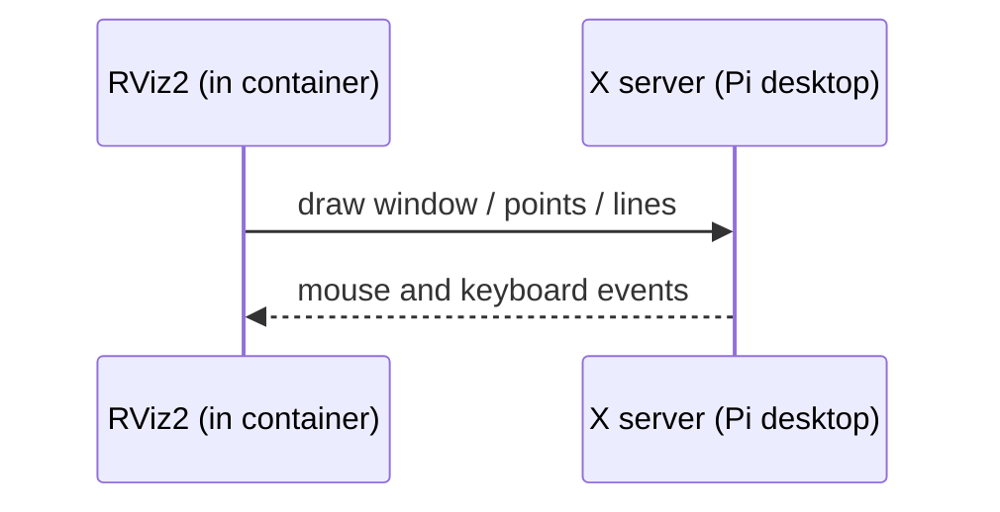

{:class="cover"}

---

By the end of this lesson you will be able to explain how a program in a container can draw a window on the Pi's desktop, and set up `xhost` and `DISPLAY` to make it happen.

To use the ROS visualisation tool `rviz2` from inside our Docker container, we need to send its graphics out of the container and onto the Pi's screen.

## What is X11

`X11` is the window system developed at MIT in the 1980s that most Linux desktops have used to draw windows. It splits the work in two. The **X server** runs on the computer with the screen, keyboard and mouse, and draws everything. The **clients** are applications, such as RViz2, which send drawing commands to the server.

Because it's a network protocol, a client in one place (our Docker container) can draw windows on a server somewhere else (the Raspberry Pi desktop). (Newer Raspberry Pi OS releases use Wayland, but still run X11 applications through a compatibility layer called XWayland.)



---

## Redirecting the X11 Display to the host

To send the display out of the container we do two things:

1. Use `xhost` to let programs in the container use the Pi's X server. (This isn't very secure, but for a learning Pi on your own desk it works.)
1. Pass the `DISPLAY` environment variable into the container, so it knows *which* screen to draw on, then run [RViz2](/resources/glossary#rviz2).

* **Allow the container** - from a terminal on the Pi's desktop, type:

```bash
xhost +local:root
```

It should reply `non-network local connections being added to access control list`. This lets local programs running as `root` (which our container does) use your screen.

* **Add the display to docker-compose.yml** - edit the file in `~/cubie-1/docker` so the service includes:

```yaml
    environment:
      - DISPLAY
```

The full file should now look like this (change `/home/kev` to your own home folder):

```yaml
services:
  ros2:
    build: .
    network_mode: host
    volumes:
      - /home/kev/ros:/home/ros
      - /home/kev/cubie-1:/ros2
    devices:
      - /dev/ttyUSB0:/dev/ttyUSB0
    tty: true
    environment:
      - DISPLAY
```

`network_mode: host` was already there. As well as helping ROS 2 find nodes outside the container, it lets the container reach the Pi's X server. `- DISPLAY` with no value means "copy the `DISPLAY` variable from my shell".

---

## Bring up the new container

A running container doesn't pick up changes to the compose file, so we recreate it:

```bash
docker compose up -d
```

*The `-d` means run detached (in the background). Without it, the container's output fills this terminal, and the container stops when you close it.*

Before moving on, check the display is set in the terminal you start Docker from:

```bash
echo $DISPLAY
```

On the Pi's own desktop this prints something like `:0`.

> **Teachers**: `xhost +local:root` lets any local program running as root draw on the learner's screen, and the `docker` group is already powerful, so treat this as a classroom-only setup. Turn it off afterwards with `xhost -local:root`. Learners connected by SSH will need a monitor on the Pi, or screen sharing, to see RViz2.

---

## Try it Yourself

1. Run `docker compose exec ros2 bash` and then `echo $DISPLAY` inside the container. Does it match the Pi?
2. Run `xhost` on its own on the Pi to list what is allowed to connect.
3. Challenge: remove access with `xhost -local:root`, and describe what you'd expect to happen when RViz2 starts. Then switch it back on.

## Common Issues

- **Problem**: `echo $DISPLAY` prints nothing when I'm connected over SSH.
- **Solution**: Run Docker from a terminal on the Pi's desktop, or set `export DISPLAY=:0` first, then run `docker compose up -d` again.
- **Why**: SSH sessions have no screen of their own, so there's no `DISPLAY` to pass to the container.

- **Problem**: RViz2 says `could not connect to display`.
- **Solution**: Run `xhost +local:root` again on the Pi, and check the container was recreated after you edited the compose file.
- **Why**: The permission resets when the Pi restarts, and an old container still has the old settings.

- **Problem**: The container won't start after editing the YAML.
- **Solution**: Check the indentation; YAML uses spaces only, and `environment` must line up with `build`.
- **Why**: YAML structure is defined by indentation.

## Check your understanding


? In X11, which program draws the windows on screen?
- [ ] The client (RViz2)
- [x] The X server, running on the computer with the screen
- [ ] Docker
> Clients send drawing commands, and the server does the drawing.

? What does `xhost +local:root` do?
- [x] Allows local programs running as root, such as our container, to use the Pi's display
- [ ] Installs RViz2
- [ ] Opens the LiDAR port
> It's quick but not very secure, so only use it on a Pi you control.

? Why do we pass `DISPLAY` into the container?
- [ ] To make ROS faster
- [x] So programs inside know which screen to draw on
- [ ] To connect to Wi-Fi
> `DISPLAY` names the X server and screen, for example `:0`.

