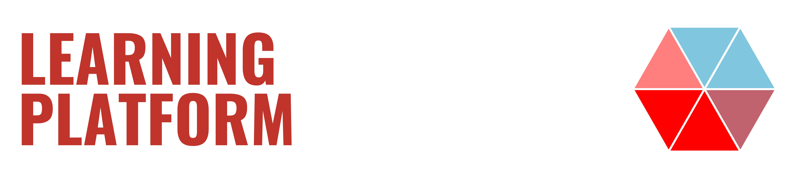

{:class="cover"}

---

{:class="img-fluid w-100"}

By the end of this lesson you will be able to say what the Learn section is for, and what this short course will show you.

## Overview

Ahoy there makers! The Learn section of KevsRobots.com is a library of free courses on robotics, electronics, MicroPython, Python and 3D design. Every course is a short run of bite-sized lessons that build on each other, so you can learn something useful in a single sitting.

The site has grown a lot since this guide was first written in 2022. There are now learning pathways to follow, quizzes at the end of lessons, a play button on Python code, a page that remembers where you got to, and a "course complete" moment when you finish. This course walks through all of it, as it works today.

## Course Content

In this mini-course you'll learn how to:

- Read a course page and a lesson page (lesson 1)
- Find the right course with pathways, levels, topics and search (lesson 2)
- Download files, watch videos and run code in your browser (lesson 3)
- Track your progress, answer quizzes and finish a course (lesson 4)
- Use the platform with a class, and where to go next (lesson 5)

## Key Results

After completing this course, you will:

- Find a course that fits your level and interests
- Move around a lesson with the sidebar, the buttons and your keyboard
- Run Python examples from a lesson without installing anything
- Know exactly what is saved in your browser and what needs an account
- Be able to set up a group of learners with no surprises

## What you'll need

- A computer, tablet or phone with a web browser
- Nothing else. A free account is optional

## How the course works

Each lesson teaches one idea, then ends with **Try it Yourself** exercises, a **Common Issues** list and a short quiz. The quiz is the same kind you will meet in other courses, so you get to use the real thing as you learn about it. Your answers are kept in your browser, and only your first answer to each question counts towards your score.

Where a lesson has a classroom catch, you will see a note that starts with **Teachers**.

> **Teachers**: This course suits anyone new to the site, and is also a quick briefing for teachers and parents setting up learners. Each lesson takes about 10 minutes. You need no hardware at all, only a web browser, so it works well as a first lesson before you hand out kit. Lesson 5 is written for teachers.

Ready? Let's start with what a course actually looks like. When you finish, a good next course is [Learn MicroPython - The basics](/learn/micropython/) or [Robotics 101](/learn/robotics_101/).
