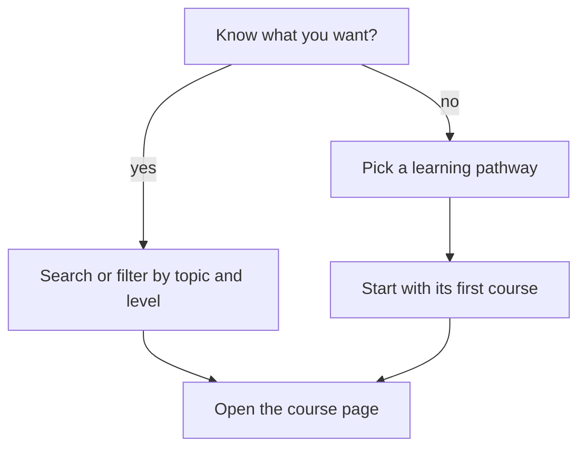

{:class="cover"}

---

By the end of this lesson you will be able to choose a learning pathway, filter the course list by level and topic, and find the course you were last working on.

## Where to start

The [Learn](/learn/) page is your front door. From top to bottom it has a search box, a **Continue learning** strip (only once you have opened some lessons), the **learning pathways**, the newest courses, and **All courses** with filters.

If you are new, start with a pathway. If you already know what you are after, such as "servo" or "Pico", jump straight to the search box.

## Learning pathways

A learning pathway is a set of courses in a sensible order, so you do not have to guess what to learn next. At the time of writing there are 15 of them, from MicroPython and Python to SMARS robots, AI and Fusion 360. Each pathway page lists its courses, the total time, the number of lessons and the levels it covers, and has a **Start with course 1** button.

Courses in a pathway are sorted into three stages:

| Stage | Meaning |
| --- | --- |
| Start | No experience needed |
| Build | The core skills |
| Go further | Pick what interests you |
{:class="table table-single"}

Courses stand on their own, so if you already know the Start courses you can begin at Build. Hover over a pathway card on the Learn page to see what is inside it.

## Levels and topics

Each course has a **level**: beginner, intermediate or advanced. It shows as a small badge on the course card, so you can spot at a glance whether a course is a gentle first step or a stretch.

Courses are also tagged with **topics** (the site calls these groups), such as `micropython`, `3dprinting` or `electronics`. The **All courses** section lets you combine:

- a text search, which looks at the course name, description and topics
- a level picker
- topic chips: tick more than one and a course must match every one you ticked
- a sort order: newest first, A to Z, or shortest first

Press **Clear filters** to start again.

## Picking up where you left off

Once you have opened a few lessons, the **Continue learning** strip on the Learn page shows up to three courses you have in progress, most recent first. The **My Learning** page at `/learn/me/` shows every course you have started or finished, the pathways you are following, and how many courses you have finished.

> **Teachers**: A pathway is a handy ready-made scheme of work. Pick one, then check the level badge and the lesson count on each course page against the time you have per week. Courses are separate, so you can also drop a single course into an existing plan.

## Try it Yourself

1. On the [Learn](/learn/) page, set the level picker to **beginner** and the sort order to **Shortest first**. Which course is at the top?
2. Tick two topic chips at once. Does the list get longer or shorter, and why?
3. Open a learning pathway that interests you and work out which course you would start with if you had never used a Raspberry Pi Pico.
4. Challenge: find a course using only the search box and a word from its description, not its title.

## Common Issues

- **Problem**: A filter combination shows "No courses match those filters."
- **Solution**: Untick a topic chip, or press **Clear filters**.
- **Why**: Ticking several topics only shows courses that match all of them.

- **Problem**: My Learning is empty, even though I did some lessons on another computer.
- **Solution**: Open it in the browser you used before, or log in to the site on both devices (lesson 4).
- **Why**: Without an account, progress is kept only in the browser that recorded it.

## Check your understanding


? What are the three stages of a learning pathway?
- [ ] Easy, Medium, Hard
- [x] Start, Build, Go further
- [ ] Theory, Practice, Exam
> Start needs no experience, Build is the core skills, and Go further is a menu to pick from.

? You tick two topic chips on the Learn page. Which courses are shown?
- [ ] Courses that match either topic
- [x] Courses that match both topics
- [ ] Only the newest course
> A course must match every ticked topic.

? Where do you see every course you have started or finished?
- [ ] On the sidebar of any lesson
- [x] On the My Learning page
- [ ] In the pathway card
> My Learning at /learn/me/ lists the courses you have started and finished.

