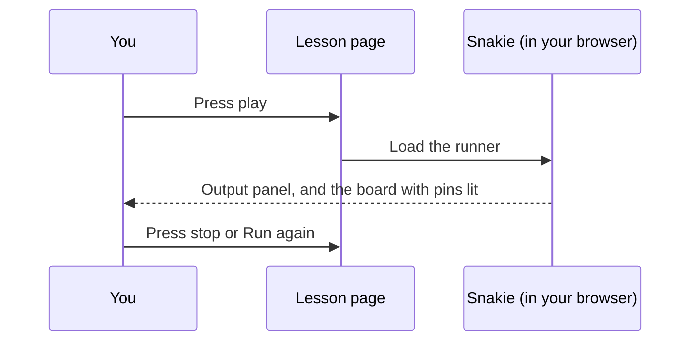

{:class="cover"}

---

By the end of this lesson you will be able to download the files a lesson links to, find a course's video, and run a Python code block in your browser.

## Downloading files

Robot courses come with things you take away: 3D-printable `STL` files, `PDF` templates and worksheets. There is no special "download" button. A lesson simply links to the file, and your browser saves it when you click.

Two real examples from the site:

- The BrachioGraph drawing robot course links a [PDF base template](/learn/brachiograph/assets/template-grid.pdf) to print and stick to a board, and a small [STL spacer](/learn/brachiograph/assets/base.stl) to 3D print.
- The BurgerBot course links its printable parts, such as the [bottom plate](/assets/stl/burgerbot_v2/bottom.stl), from the site's shared STL folder.

A course keeps its own files in its `assets` folder, and the lesson links to them. Check the file name before you print, because lessons often tell you how many copies of a part to make (for example, "print 2 of these").

## Watching the video

Many courses have a video on YouTube. You can spot one in two places: a **Video** badge on the course card in the course list, and a **Watch the video** button on the course page. Some lessons also play a video right on the page, so you can watch and build side by side.

## Running code in your browser

Python code blocks in lessons have three small buttons at the top right:

- a green **play** button, which runs the code
- **copy**, which copies the code so you can paste it into your editor
- **Open in Snakie**, which opens the code in a new tab of Snakie, the browser-based MicroPython editor

Press play and an output panel pops up under the block. The code runs in your browser, so there is nothing to install. Try it on this program, which blinks an LED five times and prints a message each time:

```python
from machine import Pin
from time import sleep

led = Pin("LED", Pin.OUT)

for blink in range(5):
    led.toggle()
    print("blink", blink)
    sleep(0.2)
led.off()
```

When the code drives pins, the panel also shows a board with the pins lit. The board is the Pico 2 W unless the lesson picks another one. While it runs, play turns into stop, and the panel has **Run again** and a close button.



### When play says it cannot run

Some code cannot run in a browser tab. If a program asks you to type with `input()`, or uses things that need real hardware or a computer such as Wi-Fi (`network`, `socket`), Bluetooth or desktop libraries, a short note appears under the block saying why, and offers **Open in Snakie**. A snippet that is only a line or two, like the next one, is not meant to be run on its own:

```python
led.value(1)
```
{: .no-snakie }

Authors mark such snippets with `{: .no-snakie }` under the code block, so that they get no buttons. A lesson can switch the buttons off entirely with `snakie: false` in its front matter.

> **Teachers**: The runner is loaded from Snakie's website (`app.snakie.org`) only when a learner presses play, and Open in Snakie opens that site in a new tab. If your school network blocks it, the code still shows and copies fine, but play will not work. Ask your IT team to allow that site, or have learners run the code in an editor you already use. The same goes for the YouTube videos.

## Try it Yourself

1. Press play on the blink program above. Then change `range(5)` to `range(10)` in your editor of choice and work out how many times it would blink.
2. Click **copy**, paste the program somewhere, and change the sleep time to `0.05`. Does the blinking look faster or slower?
3. Open the [BrachioGraph course](/learn/brachiograph/) and find the PDF and STL files in its build lesson.
4. Challenge: find a course in the [Learn](/learn/) list with a **Video** badge, and watch the first minute.

## Common Issues

- **Problem**: I pressed play and nothing happened, or I got a note instead of output.
- **Solution**: Read the note under the block. If it says the program needs a real board or computer, copy the code and run it there, or use **Open in Snakie**.
- **Why**: A browser tab cannot stand in for Wi-Fi, a keyboard prompt or desktop libraries.

- **Problem**: A downloaded STL opens as a wall of text in my browser.
- **Solution**: Right-click the link and choose to save the file, then open it in your slicer.
- **Why**: STL is a 3D model format, not a web page, and some browsers try to display unknown files.

## Check your understanding


? How do you download an STL or PDF from a lesson?
- [ ] Press the green play button
- [x] Click the link in the lesson
- [ ] Log in first
> Files are plain links, and the browser saves them when you click.

? What does the green play button do on a Python code block?
- [ ] Copies the code
- [x] Runs the code in your browser and shows the output
- [ ] Uploads the code to your robot
> The code runs in your browser, with nothing to install.

? Why might play show a note instead of running a program?
- [ ] The program is too short
- [x] It needs something a browser tab cannot give, like input() or Wi-Fi
- [ ] You have not finished the lesson
> Programs that wait for typing, or need real hardware or desktop libraries, cannot run in the browser.

