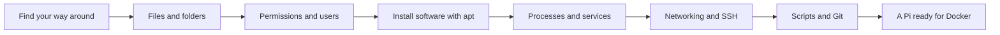

{:class="cover"}

---

Ahoy there makers! By the end of this lesson you will be able to explain what the command line is, why it is worth learning, and open a terminal on your Raspberry Pi.

Kev made a video that walks through the terminal on Raspberry Pi OS. Watch it first, then come back and let's get typing.



## Overview

Almost every cool thing you will do with a Raspberry Pi, from running a robot's brain to hosting a web service, ends up with someone typing a command. The **command line** is a text window where you tell the computer what to do, one line at a time. It looks plain, but it is fast, precise, and works just as well over a network cable from the other side of the house as it does on the Pi's own screen.

In this course we learn it by doing one real job: **setting up and tidying a Raspberry Pi so it is ready to run Docker.** Every lesson adds one piece. We make a tidy home for our projects, look after the users and permissions, install and update software safely, keep an eye on the Pi's health, run a service, log in from another computer, and finish with a script that checks on the Pi for us.



## Course Content

- Opening the terminal, getting help with `man`, and moving around the filesystem
- Users, `sudo`, and who is allowed to do what
- Creating, viewing, copying, moving and deleting files and folders
- File permissions with `chmod` and `chown`
- Installing, updating and removing software with `apt`
- Monitoring disk, memory, temperature and processes
- Running and checking services with `systemctl`
- Networking, SSH and copying files between computers
- Shell scripts, and tracking them with Git
- A final project: a `pi-checkup.sh` script that reports on your Pi

## Key Results

After completing this course, you will be able to:

- Move around the Raspberry Pi OS filesystem and manage files and folders confidently
- Read and change file permissions and understand why they matter
- Install, update and remove software with `apt`
- Check the Pi's disk, memory, temperature and running processes
- Start, stop and inspect services with `systemctl`
- Log in over SSH and copy files between your computer and the Pi
- Write and schedule a simple shell script

## What you'll need

- A Raspberry Pi 4 or Pi 5 running Raspberry Pi OS (64-bit, Debian based). Other 64-bit Pi models work for almost everything too
- A power supply, a microSD card and a network connection
- A second computer, for the SSH lessons (optional but helpful)
- No programming experience at all

Your Pi's first user is whatever name you chose in Raspberry Pi Imager. This course writes `pi` or `YOURNAME` in examples, so swap in your own username, which you can always check by typing `whoami`.

## How the course works

**Command, then output.** Each command appears in a code box, followed by the sort of output you should see. Your numbers and names will differ a little, and that is fine.

**Try things safely.** Anything that deletes, overwrites or needs `sudo` is flagged with a **Careful** note, and we practise on throwaway files first.

**Quizzes and exercises.** Each lesson ends with Try it Yourself exercises, a Common Issues list and a short quiz. Your quiz score is kept in your browser and shown in the sidebar.

**One Pi, one thread.** Each lesson finishes with a line called **Pi progress** so you can see how close you are to a Docker-ready Pi. When you finish, the [Docker course](/learn/docker/) is the natural next step.

**Prerequisites.** None. This is the first course in the Homelab learning pathway.

> **Teachers**: this course suits learners aged about 11 and up, and adults who are new to Linux. Allow 30 to 45 minutes per lesson, and about 90 minutes for the final project (lessons 16 and 17). Each learner or pair needs a Pi with a keyboard, screen and network. Lessons 0 to 5, 12 and 13 can be done on any Linux, macOS or WSL terminal if you have no Pi. Lessons that use `sudo`, add users or install software change the system, so use a Pi your class owns and re-image the card afterwards. Shared school networks often block SSH (port 22) and the apt mirrors, so test lessons 6 and 10 before the class.

## What is the command line?

The command line is a text-based way of talking to the computer. Instead of clicking icons, you type a command and press `Enter`. The program that reads your typing is called the **shell** (on Raspberry Pi OS it is `bash`), and the window it runs in is the **terminal**.

Why bother, when there is a perfectly good desktop?

- **Speed**: one line can do what takes twenty clicks, like renaming a hundred files.
- **Control**: lots of settings and tools only exist as commands.
- **Remote work**: a Pi in a robot or on a shelf usually has no screen. You will reach it with a text connection.
- **Automation**: any command you can type can go into a script that runs by itself.
- **Light on resources**: on a small board, a terminal uses far less memory than the full desktop.

## The anatomy of the terminal

When you open the terminal you will see a **prompt**, a short line that says the shell is ready. After you type a command and press `Enter`, the shell runs it and prints the **output**.

{:class="w-100 img-fluid card-hover card-shadow rounded-3"}

A typical prompt looks like this:

```bash
pi@raspberrypi:~ $
```

Read it from left to right: `pi` is your username, `raspberrypi` is the name of the computer, `~` is the folder you are in (the tilde means your home folder), and `$` says you are a normal user. If you ever see `#` instead, you are the all-powerful root user, so take extra care.

## How to open the terminal

1. **From the menu**: click the Raspberry Pi icon at the top left, choose **Accessories**, then **Terminal**.
2. **From the keyboard**: press `Ctrl + Alt + T`. If nothing happens, use the menu. On a desktop with the taskbar, there is also a terminal icon you can click.
3. **Without a desktop**: if you installed Raspberry Pi OS Lite, you are already at a login prompt and the shell starts as soon as you log in.

{:class="w-100 img-fluid card-hover card-shadow rounded-3"}

Let's type our first commands (you type the part after the `$`, and the Pi prints the rest). `whoami` prints your username and `hostname` prints the name of the Pi:

```bash
$ whoami
pi
$ hostname
raspberrypi
```

You just talked to your Pi. That is the whole idea, and everything else in this course is a variation on it.

## Try it Yourself

1. Open a terminal using the menu, then close it and open it again with `Ctrl + Alt + T`.
2. Type `date` and press `Enter`. Then type `uname -m` to see whether your Pi is running a 64-bit system (`aarch64`) or a 32-bit one (`armv7l`).
3. Challenge: type `echo "Hello, I am $(whoami) on $(hostname)"` and work out why it prints your own username and Pi name.

## Common Issues

- **Problem**: I typed a command and got `command not found`.
- **Solution**: Check the spelling and the capital letters. Linux treats `LS` and `ls` as different commands.
- **Why**: The shell looks for a program with exactly that name and finds none.

- **Problem**: I pressed keys and nothing appears when I type my password.
- **Solution**: Keep typing and press `Enter`. It is working.
- **Why**: Linux shows nothing while you type a password, not even stars, so nobody can count its length over your shoulder.

## Check your understanding


? What is the program called that reads the commands you type?
- [ ] The prompt
- [x] The shell
- [ ] The desktop
> The shell (bash on Raspberry Pi OS) reads your command, runs it and prints the output. The terminal is just the window it lives in.

? In the prompt `pi@raspberrypi:~ $`, what does the `~` mean?
- [ ] You are the root user
- [ ] The command failed
- [x] You are in your home folder
> The tilde is a shortcut for your home folder, for example `/home/pi`.

? Which keyboard shortcut opens a terminal on the Raspberry Pi desktop?
- [x] Ctrl + Alt + T
- [ ] Ctrl + Shift + Q
- [ ] Alt + F4
> Ctrl + Alt + T opens a new terminal window. Alt + F4 would close a window.

? Why is the command line useful for a Pi with no screen attached?
- [ ] It uses a different operating system
- [x] You can type commands to it from another computer
- [ ] It makes the Pi faster
> Text commands travel easily over a network, which is how we manage robots and servers that sit on a shelf.


Pi progress: you have a terminal open and know how to read the prompt. Next, a quick lesson on how to get help without leaving the terminal.
